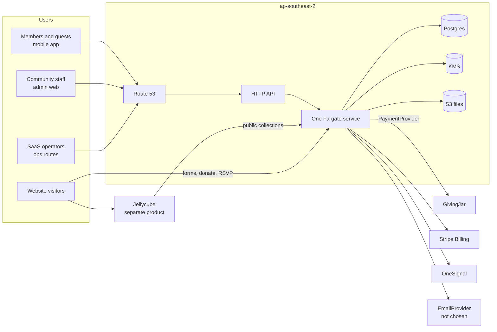

# Community Hub Platform — Architecture

|                   |                                                                                                                               |
| ----------------- | ----------------------------------------------------------------------------------------------------------------------------- |
| **Status**        | **Approved** 2026-09-17 — baseline for implementation. Changes go through an ADR in `docs/adr/` ([AGENTS.md](AGENTS.md) §13)  |
| **Last updated**  | 2026-09-24 (revision 20: website-host-contract — collections, host islands and block packs replace the widget pack; ADR 0006) |
| **Scope**         | `community-hub-core` (the multi-tenant SaaS) and its contracts with the mobile apps, GivingJar and Jellycube                  |
| **Launch region** | Australia (`au`). Canada, EU and US are designed for but not deployed                                                         |

This document is the source of truth for how the platform is structured and why. When code and this document disagree, fix one of them in the same pull request. Significant changes to a decision in [§4](#4-key-decisions) need a new ADR in `docs/adr/`.

---

## Contents

1. [Purpose and scope](#1-purpose-and-scope)
2. [Where we are today](#2-where-we-are-today)
3. [Architectural principles](#3-architectural-principles)
4. [Key decisions](#4-key-decisions)
5. [System context](#5-system-context)
6. [Tenancy model](#6-tenancy-model)
7. [The Sydney runtime](#7-the-sydney-runtime)
8. [Codebase structure](#8-codebase-structure) — [client surfaces](#85-client-surfaces)
9. [Module catalogue](#9-module-catalogue)
10. [Plans, entitlements, add-ons and feature flags](#10-plans-entitlements-add-ons-and-feature-flags)
11. [Identity and access](#11-identity-and-access)
12. [Data protection and children's safety](#12-data-protection-and-childrens-safety)
13. [Mobile apps and the App Registry](#13-mobile-apps-and-the-app-registry)
14. [Payments](#14-payments)
15. [Website builder: Jellycube](#15-website-builder-jellycube)
16. [Third-party apps and integrations](#16-third-party-apps-and-integrations)
17. [API design](#17-api-design)
18. [Events and jobs](#18-events-and-jobs)
19. [Observability and audit](#19-observability-and-audit) — [product usage](#193-product-usage-intelligence)
20. [Security controls](#20-security-controls)
21. [Compliance](#21-compliance)
22. [Reliability, backup and disaster recovery](#22-reliability-backup-and-disaster-recovery)
23. [Environments, delivery and testing](#23-environments-delivery-and-testing)
24. [Migrating from self-hosted Laravel](#24-migrating-from-self-hosted-laravel)
25. [Roadmap](#25-roadmap)
26. [Open questions and risks](#26-open-questions-and-risks)
27. [Glossary](#27-glossary)
28. [Appendix: verified platform facts](#28-appendix-verified-platform-facts)

---

## 1. Purpose and scope

Community Hub is an enterprise-grade, multi-tenant SaaS for communities — churches, mosques, sports clubs and similar organisations. Customers subscribe to a plan, switch on modules their plan includes, and buy add-ons.

**In scope for `community-hub-core`**

- Tenancy (organisations and communities), identity, access control, entitlements and billing
- Community features: engagement, people and families, groups, membership, records and certificates, volunteers and safeguarding, forms, communications, giving, commerce, reporting
- Privacy, consent, audit and data-residency controls
- Public Content API used by websites and mobile apps
- Contracts (ports) that external systems plug into

**Out of scope — connected through contracts**

| System              | Owner                                                                                            | Contract                                                                                               |
| ------------------- | ------------------------------------------------------------------------------------------------ | ------------------------------------------------------------------------------------------------------ |
| Website builder     | Jellycube (our product, built on Cloudflare, shipped as an SDK for any platform)                 | `JellycubeHost` adapter — [§15](#15-website-builder-jellycube)                                         |
| Payment processing  | GivingJar (our Stripe-based processor, hosted in Australia)                                      | `PaymentProvider` port — [§14](#14-payments)                                                           |
| Transactional email | Adapter chosen later                                                                             | `EmailProvider` port — [§7.2](#72-what-runs-where); decision in [§26](#26-open-questions-and-risks) Q9 |
| Mobile apps         | Community Hub mobile codebase (Parish Hub at launch; other directory and white-label apps later) | App Registry + mobile API — [§13](#13-mobile-apps-and-the-app-registry)                                |

---

## 2. Where we are today

| Repository                            | What it is                                                                                                                                                                     | What happens to it                                                                                                                                                                                                                                                                |
| ------------------------------------- | ------------------------------------------------------------------------------------------------------------------------------------------------------------------------------ | --------------------------------------------------------------------------------------------------------------------------------------------------------------------------------------------------------------------------------------------------------------------------------- |
| `Community-Hub`                       | Laravel 12 + Inertia/React + MySQL, installed separately for each client (WordPress-style). 44 models, module toggles stored as JSON in `website_settings`.                    | Features are rebuilt as modules in core. Client data is imported per tenant ([§24](#24-migrating-from-self-hosted-laravel)). Self-hosting concerns (system update, backups, per-client SMTP, URL scanner) are removed. Website templates and the visual editor move to Jellycube. |
| `Community-Hub-Website-Control-Panel` | Laravel registry of communities (`site_url`, `api_url`, location, type) consumed by the mobile app                                                                             | Replaced by directory rows in the `platform` schema, and by the App Registry in that same schema. Not a separate service. The mobile app talks to the Sydney API.                                                                                                                 |
| `Community-Hub-Mobile-App`            | Expo SDK 54 "Parish Hub" app. Lists communities, then calls each community's own server. Guest mode. Login is a Laravel email check plus Supabase OTP; push through OneSignal. | Moves into the monorepo as `apps/mobile`. Talks to one regional API. Supabase auth is removed.                                                                                                                                                                                    |

**Known issues that must not be carried over**

- A reviewer login bypass is hard-coded in the mobile client (`dev@ch.com` / `800000`). Review accounts must be server-side, per app, and auditable.
- The RSVP lookup sends the user's email in the query string (`/api/mobile-app/rsvps?email=`). Personal data never goes in URLs; member data is resolved from the session.
- The donation webhook finds a `Donation` by ID without checking which tenant it belongs to. Every lookup is tenant-scoped.
- Session tokens are stored in AsyncStorage. Use `expo-secure-store`.
- Mobile routes exist twice (versioned and unversioned). Core ships one versioned API plus a time-boxed compatibility layer.
- Any admin can switch paid modules on. Entitlements come from the plan, not from tenant settings.

---

## 3. Architectural principles

These are rules, not aspirations. Each is enforced by review, lint rules or tests.

1. **Modular monolith first.** One codebase, strict module boundaries, deployed as one Fargate service. Extract a service only when there is a measured reason.
2. **Tenant isolation is enforced by the database**, not just by application code. Organisation-scoped (`app`) tables carry `org_id`; Postgres row-level security (RLS) rejects cross-organisation access. Identity and platform tables are region-scoped and have no `org_id` ([§6.3](#63-isolation-in-the-database)).
3. **Personal data stays in Australia.** It is stored and processed in Australia, with the three cases in [ADR 0009](docs/adr/0009-personal-data-on-aws.md). There is no global tier until a second region exists.
4. **Privacy by default.** The most protective setting is the default, particularly for children. Features opt into data access; they never opt out of protection.
5. **Entitlements are separate from feature flags.** "What a customer paid for" and "what code is rolled out" are different systems.
6. **Integrations go through ports.** Payments, website, email, SMS, push and mobile distribution are interfaces with adapters. Core never imports a vendor SDK directly.
7. **Contracts are versioned.** APIs, events and add-on interfaces have explicit versions and deprecation windows.
8. **Everything important is audited.** Reads of restricted data, permission changes, exports and support access all produce audit events.
9. **Infrastructure is code.** No console-only configuration in staging or production.
10. **Configuration adds regions, not code.** A new region is Terraform plus `terraform-invariants`, not a fork and not an edit to `catalog.json`. The only resources allowed outside `ap-southeast-2` are the five exceptions in [ADR 0009](docs/adr/0009-personal-data-on-aws.md) and [ADR 0010](docs/adr/0010-aws-budgets-exception.md). None of them holds personal data.

---

## 4. Key decisions

| #   | Decision                                                                                                                                                                                                                                                                                     | Rationale                                                                                                                                                                                                                                                                                                                 | Status                                                        |
| --- | -------------------------------------------------------------------------------------------------------------------------------------------------------------------------------------------------------------------------------------------------------------------------------------------- | ------------------------------------------------------------------------------------------------------------------------------------------------------------------------------------------------------------------------------------------------------------------------------------------------------------------------- | ------------------------------------------------------------- |
| D1  | Core runs on **AWS in `ap-southeast-2`**. Jellycube stays a separate product.                                                                                                                                                                                                                | The Workers runtime was superseded by [ADR 0009](docs/adr/0009-personal-data-on-aws.md).                                                                                                                                                                                                                                  | Changed by ADR 0009                                           |
| D2  | **System of record is PostgreSQL in `ap-southeast-2`**, reached from the ECS task's security group. The Hyperdrive path was superseded by ADR 0009.                                                                                                                                          | Postgres gives RLS and mature tooling. The task connects inside the VPC. [ADR 0009](docs/adr/0009-personal-data-on-aws.md).                                                                                                                                                                                               | Changed by ADR 0009                                           |
| D3  | **Australia first.** A later region is a new Terraform root. `ca`, `eu`, and `us` are not built.                                                                                                                                                                                             | Current customers are Australian                                                                                                                                                                                                                                                                                          | Accepted                                                      |
| D4  | **Organisation is the hard tenant boundary; community is a unit inside it.** Every current customer gets an implicit organisation with one community.                                                                                                                                        | Future dioceses and leagues need shared billing, SSO and reporting across communities                                                                                                                                                                                                                                     | Accepted                                                      |
| D5  | **TypeScript end to end**: Drizzle ORM and Zod contracts stay. The runtime is a Node process on Fargate. The HTTP framework is decided in the service chunk's spec. React Router v7 admin and Expo mobile stay.                                                                              | One language across API, web, mobile and SDKs. [ADR 0009](docs/adr/0009-personal-data-on-aws.md).                                                                                                                                                                                                                         | Changed by ADR 0009                                           |
| D6  | **Website builder is Jellycube**, integrated through the SDK's host adapter                                                                                                                                                                                                                  | Jellycube is a separate product used by other platforms                                                                                                                                                                                                                                                                   | Accepted                                                      |
| D7  | **Payments through GivingJar** behind a `PaymentProvider` port; platform subscriptions billed directly with Stripe Billing                                                                                                                                                                   | Keeps processor switchable; separates tenant revenue from our revenue                                                                                                                                                                                                                                                     | Accepted                                                      |
| D8  | **Field-level encryption in the application.** The task role calls `kms:GenerateDataKey` and `kms:Decrypt`. The KMS broker was superseded by ADR 0009.                                                                                                                                       | Protects restricted data from database access, backups and operators; enables deletion by key destruction. ADR 0008 is not edited.                                                                                                                                                                                        | Changed by ADR 0009                                           |
| D9  | **Own identity service on the regional service** (email OTP, passkeys, OIDC provider) storing users in the regional database. Every `platform_*` role requires a passkey. Email one-time codes cannot start a platform session.                                                              | Replaces split Laravel + Supabase login; core must be the OIDC issuer for Jellycube and add-ons. There is no identity library. ADR 0011. [ADR 0009](docs/adr/0009-personal-data-on-aws.md).                                                                                                                               | Changed by ADR 0009                                           |
| D10 | **Each store app has its own community list.** SaaS admins assign communities to an app through the App Registry; the app never infers “all churches” or “all of Australia”                                                                                                                  | Parish Hub (AU churches), a future mosque app, a sports app, and a Canadian parish app are different store listings with different names. A community appears in an app only when it is listed there ([§13](#13-mobile-apps-and-the-app-registry))                                                                        | Accepted                                                      |
| D11 | **Live screens poll.** Durable Objects were superseded by ADR 0009.                                                                                                                                                                                                                          | The HTTP API has no WebSocket, and its integration timeout is 30 seconds.                                                                                                                                                                                                                                                 | Changed by ADR 0009                                           |
| D12 | **A field that must be filtered, sorted or aggregated in SQL is not encrypted.** Encrypted fields support equality matching through blind indexes only                                                                                                                                       | Application-layer encryption makes `SUM`, `GROUP BY` and range queries impossible; decrypting every row inside the service does not scale                                                                                                                                                                                 | Accepted                                                      |
| D13 | **Transactional email goes through an `EmailProvider` port.** The adapter is chosen later; it must process mail in the tenant's region or be an explicit APP 8 subprocessor                                                                                                                  | Same switchability as payments. Cloudflare Email Service has no confirmed Australian processing guarantee and is a different product from Email Security's Australia region                                                                                                                                               | Accepted — provider in [§26](#26-open-questions-and-risks) Q9 |
| D14 | **A client cuts over as one unit:** system of record, admin, mobile and public website in the same window                                                                                                                                                                                    | Today's Laravel site is the same app and database as the platform. Events, notices, donations and forms are read and written in-process. A leftover "website-only" install cannot stay live ([§24](#24-migrating-from-self-hosted-laravel))                                                                               | Accepted                                                      |
| D15 | **Jellycube stays generic.** Community Hub exposes public-site features through the SDK as **external collections** (data), **host islands** (writes and live values) and, by exception, **host block packs** — never as finished list widgets built into Jellycube or into the site project | Jellycube is a Jamstack builder for any host and publishes static Astro (or similar). Parishes design lists and detail pages themselves; lists stay static HTML for SEO; forms and donate post to core at request time ([§15.5](#155-host-website-pack), [ADR 0006](docs/adr/0006-website-collections-islands-blocks.md)) | Accepted — amended by ADR 0006                                |
| D16 | **Do not invent a component library.** Web UI is **shadcn/ui** (Base UI primitives, Tailwind) copied into `packages/ui`. Mobile uses the same tokens via **React Native Reusables**. Token source is JSON in `packages/tokens` ([ADR 0007](docs/adr/0007-token-source-is-json.md)).          | Building primitives from scratch is slow and inconsistent. shadcn is owned source, accessible and themable. Polaris React is deprecated; MUI/Ant lock a third-party look; a universal compiler (Tamagui) fights React Router and Astro islands ([§8.5](#85-client-surfaces))                                              | Accepted — amended by ADR 0007                                |
| D17 | **Product usage is first-party and community-grained.** No third-party analytics SDK, no session replay, no user-level funnels in an offshore tool                                                                                                                                           | Mixpanel/Amplitude/GA/PostHog Cloud would process personal data outside Australia and collide with children's screens. Domain events already exist; roll them up ([§19.3](#193-product-usage-intelligence))                                                                                                               | Accepted                                                      |

---

## 5. System context



Clients call the Sydney hostname. There is one service. Route 53 holds the public zones. There is no separate global tier.

---

## 6. Tenancy model

### 6.1 Hierarchy

```
Platform
└── Organisation        hard boundary: region, legal agreements, billing, SSO, encryption root, RLS
    └── Community       soft boundary: settings, entitlement allocation, hostnames, app listings, members
        └── Site        optional, later: campus, venue, second Mass centre, home ground
```

| Concern                                                                  | Owned by                                    |
| ------------------------------------------------------------------------ | ------------------------------------------- |
| Region (`au`), data processing agreement, data controller                | Organisation                                |
| Platform subscription (Stripe Billing)                                   | Organisation (usage reported per community) |
| Entitlements                                                             | Organisation plan, allocated to communities |
| Encryption: organisation key → community key → household key             | Organisation / Community                    |
| SSO connection, SCIM                                                     | Organisation                                |
| People, households, children, consent records                            | Community                                   |
| Custom hostnames, Jellycube site, mobile app listings, GivingJar account | Community                                   |
| Staff roles                                                              | Organisation or community scope             |

### 6.2 Implicit organisations

Every current customer is a single community. On sign-up or import the platform creates:

- an organisation with `kind = 'implicit'`, and
- one community inside it.

The admin UI hides the organisation layer while `kind = 'implicit'`. Adding a second community sets `kind = 'explicit'` and reveals organisation features. No data migration is needed. See [§8.5](#85-client-surfaces).

### 6.3 Isolation in the database

Every organisation-scoped (`app`) table:

```sql
org_id        uuid not null,
community_id  uuid not null,          -- omitted only on organisation-level tables
id            uuid not null,          -- application-minted UUIDv7; cell engine is 17 (no DEFAULT uuidv7())
primary key (org_id, id)

alter table <table> enable row level security;
alter table <table> force row level security;
create policy org_isolation on <table>
  using (org_id = current_setting('app.org_id')::uuid)
  with check (org_id = current_setting('app.org_id')::uuid);
```

- The application connects as a role **without** `BYPASSRLS`.
- Organisation-scoped requests open a transaction and run `SELECT set_config('app.org_id', $1, true)` and the same for `app.community_id` (bound parameters). Session-level `SET` / `set_config(..., false)` is forbidden. **Identity-schema work uses the identity role and does not set `app.org_id`. Platform-schema work uses the platform role and does not set `app.org_id`.**
- A community-scoped `app` table's policy requires both `org_id` and `community_id` to match the transaction's settings. Organisation-level tables require `org_id` only. A read path across communities for organisation-level staff is added by a later chunk as an explicit policy, when the first organisation with more than one community needs it.

**Not every table is organisation-scoped.** There are three categories, and each table declares which it is:

| Category                   | Schema     | Owner                                  | Examples                                                                                                                                                                                                                      | Protection                                                                                                                                                |
| -------------------------- | ---------- | -------------------------------------- | ----------------------------------------------------------------------------------------------------------------------------------------------------------------------------------------------------------------------------- | --------------------------------------------------------------------------------------------------------------------------------------------------------- |
| **Organisation-scoped**    | `app`      | the module that owns the table         | people, households, donations, events, volunteers, consents, audit events                                                                                                                                                     | `org_id` + RLS as above                                                                                                                                   |
| **Region-scoped identity** | `identity` | `core/identity`                        | users, credentials, sessions, OTP challenges                                                                                                                                                                                  | No `org_id`. A user belongs to a **region** and may hold memberships in several organisations. Own Postgres schema and role; no other module may query it |
| **Region-scoped platform** | `platform` | `core/tenancy` and `core/entitlements` | `core/tenancy` for region routing and organisation and community directory rows that are not tenant-RLS'd. `core/entitlements` for plans, add-ons, entitlements, allocations, overrides, community toggles, and feature flags | No `org_id`. Own Postgres schema and role; no other module may query it                                                                                   |

Identity rows are deliberately minimal — authentication identifiers, credentials and session metadata only. A person's name, contact details and any profile information live on the organisation-scoped `people` row. This keeps a shared user record from leaking the fact that someone is a member of another organisation.

The domain **outbox** is organisation-scoped (`app` schema, `org_id` + RLS). It is not in the identity schema.

CI fails if an `app`-schema table lacks `org_id`, RLS or `FORCE ROW LEVEL SECURITY`; if any module outside `core/identity` references the `identity` schema; or if any module outside `core/tenancy` and `core/entitlements` references the `platform` schema.

### 6.4 Moving a community

A community can leave an organisation (a parish changing diocese, a club leaving a league). The move tool re-wraps the community key under the destination organisation key and rewrites `org_id` for that community's rows in one transaction, with a full audit record. Household keys stay wrapped by the community key, so no re-encryption of field data is required. A community move does not rewrite `app.audit_events`. Those rows have no `community_id`. The move appends one event in the source organisation and one in the destination.

---

## 7. The Sydney runtime

### 7.1 One service in Sydney

One ECS Fargate service, ARM, in `ap-southeast-2`, serves the API, sign-in, webhooks, background jobs, and the ops console. Clients call the Sydney hostname. Route 53 holds the public zones. There is no separate global tier.

Ingress is a regional HTTP API. Its integration is a VPC link to Cloud Map, with `SRV` records and a `$default` stage. The VPC link is created on two private subnets from the first apply. There is no load balancer. The hop from API Gateway to the task is plain HTTP inside the VPC.

Admin static files come from S3 through CloudFront and hold no personal data. Every data call goes to the Sydney hostname. Turnstile stays a bot check on public forms. It does not sit in front of traffic.

The previous global-versus-regional layout was superseded by [ADR 0009](docs/adr/0009-personal-data-on-aws.md).

### 7.2 What runs where

| Need                                          | Where                                              | Rules                                                                   |
| --------------------------------------------- | -------------------------------------------------- | ----------------------------------------------------------------------- |
| API, sign-in, webhooks, jobs, ops             | One Fargate service                                | ARM. One process. `apps/api`, converted in place.                       |
| Admin static files                            | S3 and CloudFront                                  | No personal data. Data calls go to the Sydney hostname.                 |
| System of record                              | RDS PostgreSQL in `ap-southeast-2`                 | The task security group is the only source allowed to connect.          |
| Live screens                                  | The service, polled by the client                  | The HTTP API has no WebSocket. The integration timeout is 30 seconds.   |
| Background work                               | SQS and EventBridge, when the first job needs them | A message carries IDs. The job loads what it needs.                     |
| Files                                         | S3 in `ap-southeast-2`                             | Restricted files use short-lived URLs and do not go through CloudFront. |
| Directory, plans, entitlements, feature flags | `platform` schema                                  | Not a separate service.                                                 |
| Transactional email                           | `EmailProvider` port                               | Sent by the regional service. The provider is not chosen (Q9).          |
| SMS                                           | Twilio, Australian sender IDs                      | Behind the `SmsProvider` port.                                          |
| Ops                                           | Routes on this service, own hostname               | Passkeys. The `platform` role has no privileges on `app`.               |

### 7.3 Residency

Personal data is stored and processed in Australia. The service, the database, the keys that wrap personal data, and the logs are in `ap-southeast-2`. Backups are in `ap-southeast-2` only. Any future copy of personal data stays in Australia. The Melbourne row is a replica of the envelope key, not a database backup.

Personal data leaves Australia only when a tenant's own signed-in user opens it, wherever they are; when a support operator reads it under a grant or break-glass; or when it is sent to a named subprocessor, and only the fields that function needs.

The region check allows five resources outside `ap-southeast-2`. None holds personal data: the CloudFront viewer certificate in `us-east-1`, the global services CloudFront, Route 53, and IAM, the DNSSEC signing key in `us-east-1` when that open item is done, the Melbourne replica of the envelope key in `ap-southeast-4`, and AWS Budgets ([ADR 0010](docs/adr/0010-aws-budgets-exception.md)).

The eight non-negotiables are in `AGENTS.md`. The seven residency rules that were specific to the previous edge platform were superseded by [ADR 0009](docs/adr/0009-personal-data-on-aws.md).

### 7.4 Request lifecycle

```mermaid
sequenceDiagram
  participant C as Client
  participant G as API Gateway
  participant S as Fargate task
  participant P as Postgres Sydney

  C->>G: HTTPS on the Sydney hostname
  G->>S: plain HTTP inside the VPC
  S->>S: authenticate, then check entitlement, toggle, and permission
  S->>P: BEGIN; set_config app.org_id and app.community_id, true
  P-->>S: rows, restricted fields still encrypted
  S->>S: decrypt only fields the actor may read; write the audit event
  S-->>C: response
```

This sequence is an organisation-scoped API request. Identity work and `platform`-schema work do not set `app.org_id` ([§6.3](#63-isolation-in-the-database)).

### 7.5 Adding a region later

A later region is Terraform plus `terraform-invariants`. Do not enable a region by editing `catalog.json`. The five exceptions in §7.3 are the only resources allowed outside `ap-southeast-2`, and none holds personal data. A module that creates one of them does not reuse the `aws_region == "ap-southeast-2"` validation for that resource. Anything else outside `ap-southeast-2` fails the check.

A second region will need a small directory, built then. This document does not design it.

### 7.6 Live screens poll

Check-in, live attendance, and event dashboards poll. The HTTP API has no WebSocket, and its integration timeout is 30 seconds. The previous real-time object path was superseded by [ADR 0009](docs/adr/0009-personal-data-on-aws.md). Q10 is closed.

- **State lives in Postgres.** Each check-in session row carries a monotonic `rev` that increases on every change.
- **Clients poll** `GET /v1/c/{slug}/checkin/sessions/{id}?since={rev}` every 2–5 seconds against the Sydney hostname. A site has tens of devices, not thousands.
- **The check-in device works offline**, queueing scans locally and reconciling on reconnect.

---

## 8. Codebase structure

### 8.1 Monorepo

pnpm workspaces + Turborepo.

```
community-hub/
├── apps/
│   ├── api/                  # the service, converted in place: API, sign-in, webhooks, jobs, ops routes
│   ├── admin/                # tenant admin web (React Router v7); static files from S3 and CloudFront
│   ├── portal/               # member portal (React Router v7), on {slug}.communityhub.one
│   └── mobile/               # Expo app; one codebase, many store apps via APP_KEY
│
├── modules/
│   ├── core/
│   │   ├── tenancy/          # organisations, communities, sites, lifecycle, moves
│   │   ├── identity/         # users, sessions, OTP, passkeys, OIDC provider, SSO/SCIM
│   │   ├── people/           # persons, households, guardian links, age computation
│   │   ├── access/           # roles, grants, policies, support access
│   │   ├── entitlements/     # allocation, community toggles, limits
│   │   ├── consent/          # consent records, guardian consent, jurisdiction rules
│   │   ├── privacy/          # access/export/erasure requests, retention, legal holds
│   │   ├── audit/            # tamper-evident audit log
│   │   ├── usage/            # first-party product usage facts (community × feature × day)
│   │   ├── notifications/    # email/SMS/push orchestration, preferences, Spam Act consent
│   │   └── files/            # classification-aware file storage
│   ├── features/
│   │   ├── engagement/       # events, tickets, RSVPs, bulletins, notices, service times, life events
│   │   ├── groups/           # groups, tags, rosters
│   │   ├── membership/       # plans, memberships, renewals
│   │   ├── records/          # records, certificates, certificate requests
│   │   ├── volunteers/       # applications, checks (WWCC, Blue Card), documents, expiry
│   │   ├── safeguarding/     # incident reports, messaging rules, check-in/out
│   │   ├── forms/            # form builder, submissions, enquiries
│   │   ├── communications/   # broadcasts, scheduled messages, templates
│   │   ├── giving/           # campaigns, splits, donations, recurring giving, tax receipts
│   │   ├── commerce/         # products, inventory, orders
│   │   ├── content/          # articles, galleries, team members (published via Public Content API)
│   │   └── reporting/        # dashboards, finance summaries
│   └── verticals/
│       ├── faith-church/     # Mass/service times, sacraments, parish certificates, terminology
│       ├── faith-mosque/     # prayer times, zakat, madrasah classes, terminology
│       └── sports-club/      # teams, fixtures, player registration, season fees, terminology
│
├── adapters/
│   ├── payments-givingjar/   # implements PaymentProvider
│   ├── website-jellycube/    # implements JellycubeHost
│   ├── push-onesignal/       # implements PushProvider
│   ├── sms-twilio/           # implements SmsProvider
│   ├── email-<provider>/     # implements EmailProvider — adapter chosen later (Q9)
│   └── legacy-laravel-import/# imports self-hosted Laravel clients
│
├── packages/
│   ├── kernel/               # module manifest, request context, DI, outbox, errors
│   ├── db/                   # Drizzle, transaction wrapper, RLS helpers, migrations runner
│   ├── crypto/               # WebCrypto AES-256-GCM, KMS key wrapping, blind indexes
│   ├── entitlements-eval/    # snapshot reader, entitled(), limit()
│   ├── policy/               # permission evaluation
│   ├── payments/             # PaymentProvider port, ledger types
│   ├── notifications/        # EmailProvider / SmsProvider / PushProvider ports
│   ├── contracts/            # Zod schemas → OpenAPI; versioned event schemas
│   ├── api-client/           # typed client used by admin, mobile and Jellycube adapter
│   ├── app-sdk/              # SDK for third-party add-on developers
│   ├── tokens/               # platform-neutral tokens.json + generated tokens.css — §8.5
│   ├── ui/                   # shadcn/ui (copied) + product patterns — §8.5
│   ├── ui-native/            # React Native Reusables, same token names — §8.5
│   ├── web-components/       # host islands for the public site (form, donate, RSVP, membership join, live totals) — §15.5
│   ├── website-blocks/       # host block packs (Astro), exceptions only; empty until a spec justifies one — §15.5
│   └── observability/        # logger with personal-data scrubbing, tracing
│
├── tooling/
│   ├── eslint-plugin-community-hub/  # `@community-hub/no-encrypted-column-query`, `@community-hub/no-event-payload`, `@community-hub/no-kms-port-outside-crypto`, `@community-hub/no-restricted-disable`, `@community-hub/no-ts-ignore`, `@community-hub/no-crypto-testing-import`
│   └── checks/               # CI boundary checkers (schema-rls, terraform-invariants, sql-session-ban, event-names, check-tokens)
│
├── infra/
│   ├── modules/              # shared Terraform modules; each has tests/ and is in the CI matrix
│   ├── bootstrap/            # state bucket + KMS; local state then migrated into the bucket
│   └── regions/
│       └── au/               # one root: AWS in ap-southeast-2
│
└── docs/
    ├── adr/                  # architecture decision records
    └── runbooks/             # incidents, breach assessment, restores, key rotation
```

`apps/gateway`, the Wrangler files, and `packages/residency` are gone. Workers were superseded by ADR 0009, and that layout is not this design.

### 8.2 Module anatomy

```
modules/features/giving/
├── module.manifest.ts        # identity, dependencies, entitlements, permissions, data classes, events
├── domain/                   # entities, value objects, rules — no framework imports
├── application/              # commands and queries (use cases)
├── infrastructure/           # repositories (Drizzle), adapters to ports
├── http/                     # HTTP routes. The framework is decided in the service chunk's spec.
├── public/                   # the only surface other modules may import
├── events/                   # published event schemas (versioned)
├── db/
│   └── schema.ts             # Drizzle tables — app-schema tables have org_id and classifications
└── tests/
```

Modules contribute schema files. They do not ship a journal: `packages/db` owns the single product journal (`packages/db/drizzle`).

```ts
// modules/features/giving/module.manifest.ts
export default defineModule({
  key: "giving",
  version: 1,
  requires: ["core.people", "core.consent"],
  entitlement: "module.giving",
  features: ["giving.one_off", "giving.recurring", "giving.splits", "giving.tax_receipts"],
  permissions: ["giving.view", "giving.manage", "giving.export", "giving.refund"],
  dataClasses: {
    // encrypted fields cannot be aggregated or sorted in SQL — see §12.2.1
    "donations.amount_minor": "confidential-queryable", // clear: dashboards SUM and GROUP BY it
    "donations.donor_person_id": "confidential-blind", // pseudonymous id + blind index
    "donations.donor_note": "confidential", // encrypted
  },
  publishes: ["giving.donation.succeeded.v1", "giving.donation.refunded.v1"],
  subscribes: ["people.person.merged.v1", "tenancy.community.offboarded.v1"],
  ports: ["PaymentProvider"],
  website: {
    collections: ["giving.campaigns"], // external collection: public campaign fields only (§15.5)
    islands: ["giving.donate", "giving.campaign_total"], // writes and live values
  },
});
```

### 8.3 Boundary rules (enforced in CI)

- A module imports another module only through its `public/` folder. Prefer events for side effects.
- A module never reads or writes another module's tables.
- `domain/` has no imports from the HTTP framework, Drizzle, or adapters. The service chunk's spec names the framework.
- Adapters depend on ports; modules never import adapters.
- The platform module `modules/core/tenancy` must not import `@community-hub/crypto`, including `import type`. There is no ops module yet. Ops routes are on `apps/api`, which calls KMS, so this ban does not cover `apps/api`. The granted-read exception is added by the chunk that creates that module. The previous global-app rule was superseded by [ADR 0009](docs/adr/0009-personal-data-on-aws.md).
- Kernel must not import `@community-hub/db`. `schema-rls`, `event-names`, and `sql-session-ban` stay. dependency-cruiser stays omitted until it has a real input and a must-fail fixture.

### 8.4 Conventions

| Concern     | Convention                                                                                                                 |
| ----------- | -------------------------------------------------------------------------------------------------------------------------- |
| IDs         | UUIDv7                                                                                                                     |
| Time        | `timestamptz` in UTC; community timezone stored on the community                                                           |
| Money       | Integer minor units + ISO 4217 currency                                                                                    |
| Validation  | Zod schemas in `packages/contracts`, shared by API, admin, mobile                                                          |
| Errors      | Typed domain errors → RFC 9457 problem details at the edge                                                                 |
| Soft delete | Only where the domain needs restore; erasure uses hard delete or key destruction                                           |
| Terminology | Vertical packs provide labels (e.g. "Mass Times" vs "Prayer Times"); code uses generic names ([§8.5](#85-client-surfaces)) |

### 8.5 Client surfaces

This is the **UI architecture**: which apps exist, what they share, and which domain rules they must not fight. Visual design, journeys, copy and Figma live outside this document.

#### Surfaces

| Surface       | Where                                                                                                                                                                                                  | Audience                         | Appearance                                                                                                                              |
| ------------- | ------------------------------------------------------------------------------------------------------------------------------------------------------------------------------------------------------ | -------------------------------- | --------------------------------------------------------------------------------------------------------------------------------------- |
| Tenant admin  | `apps/admin` (React Router v7). Static files from S3 and CloudFront, no personal data. Data calls go to the Sydney hostname.                                                                           | Community and organisation staff | `packages/ui`                                                                                                                           |
| Member portal | `apps/portal` on `{slug}.communityhub.one`. Data calls go to the Sydney hostname.                                                                                                                      | Members and guardians            | `packages/ui`; member-scoped chrome, not the staff shell                                                                                |
| Ops console   | Routes on the regional service, on their own hostname, with passkeys. Directory and plans are `platform` tables. Not a separate app. Tenant reads use a grant ([§11.4](#114-platform-support-access)). | SaaS operators                   | `packages/ui`; ops chrome. Tenant data stays hidden until support access is granted                                                     |
| Mobile        | `apps/mobile` (Expo, many store apps)                                                                                                                                                                  | Members and guests               | `packages/ui` tokens plus native primitives. Theming per `APP_KEY`, not a fork of screens ([§13](#13-mobile-apps-and-the-app-registry)) |
| Public site   | Jellycube, bound to core **external collections**; host islands from `packages/web-components`                                                                                                         | Visitors                         | Designed in Jellycube. Host tokens from core. Islands use the same CSS variables ([§15.5](#155-host-website-pack))                      |

There is one design language for products we ship. The public site may look like the parish; it must not invent a second Community Hub component set.

#### Design system (`packages/ui`)

**Adopt an existing kit. Do not design buttons, dialogs, tables or form controls from scratch.**

| Layer          | Choice                                                                                                                       | Why                                                                                                                                                                                                                |
| -------------- | ---------------------------------------------------------------------------------------------------------------------------- | ------------------------------------------------------------------------------------------------------------------------------------------------------------------------------------------------------------------ |
| Web primitives | **shadcn/ui**, Base UI primitives (the 2026 default), Tailwind                                                               | Accessible overlays and forms without owning ARIA. Source is copied into the repo, so we are not theming a black-box `node_modules` library. Works with React Router v7. Admin static files are S3 and CloudFront. |
| Web catalogue  | `packages/ui` is the only shadcn registry in the monorepo                                                                    | Apps do not `npx shadcn add` into `apps/admin`. Features import `@community-hub/ui` only                                                                                                                           |
| Tokens         | Source is `packages/tokens` JSON (`--ch-*` properties); web consumes generated theme variables; elevation is not shipped yet | White-label and vertical overlays change tokens, not components. Feature screens do not hard-code raw values. First app import order and Vite note below                                                           |
| Mobile         | **React Native Reusables** + NativeWind, mapped to the **same token names**                                                  | Closest shadcn equivalent on Expo. Native primitives (not Radix/Base UI). gluestack-ui v5 is native-only now; do not use it on the web                                                                             |
| Public islands | `packages/web-components` styled with the shared `--ch-*` variables                                                          | A static Jellycube page must not pull the admin React app. Parish look comes from Jellycube theme tokens ([§15.5](#155-host-website-pack))                                                                         |
| Icons          | Lucide, one set                                                                                                              | Do not mix icon packs                                                                                                                                                                                              |
| Forms          | shadcn Form + React Hook Form + Zod from `packages/contracts`                                                                | One validation story from API to UI                                                                                                                                                                                |
| Data tables    | TanStack Table composed in `packages/ui`, not a second table kit                                                             | People, donations, events, volunteers                                                                                                                                                                              |

First-app stylesheets import in this order:

```css
@import "tailwindcss";
@import "@community-hub/tokens/tokens.css";
@import "@community-hub/ui/theme.css";
```

Vite transpiles workspace TypeScript from `@community-hub/ui` exports; other bundlers must be configured similarly.

**Rejected for this platform:** Material UI, Ant Design, Chakra, daisyUI, Shopify Polaris (Polaris React is deprecated; the replacement is for Shopify apps), Tamagui as the admin stack, and building a private primitive layer.

**Product patterns** (ours, thin, built _on_ shadcn — this is the guideline layer):

- `Page`, `PageHeader`, `IndexToolbar` — list/detail chrome
- `EntitlementGate`, `UpgradePrompt` — rule 2
- `RestrictedDataBanner` — children's / restricted screens
- `CommunitySwitcher` — rule 9
- `DataTable`, `FilterBar`, `EmptyState`, `ConfirmDialog`

A feature screen composes these. It does not restyle a `Button` per module.

**Enforcement**

- Components are accessible by default. **WCAG 2.2 AA is a merge gate** for admin, portal, ops, mobile, and host islands ([§21](#21-compliance)).
- Dependency rules: `apps/admin`, the ops routes, and the portal import UI only from `@community-hub/ui`. `apps/mobile` imports only from `@community-hub/ui-native` (Reusables, same tokens). No second component library.
- Vertical packs supply **labels and a small token overlay** (for example the heading on service times). They do not ship a second component library.
- White-label store apps may override tokens and store listing art. They reuse the same screens.
- The public site may look like the parish; it must not invent a second Community Hub component set.

Admin, portal and ops consume the React/shadcn implementation. Mobile maps the same tokens onto native primitives. Host islands use the web-component subset. Public list and detail layouts are designed in Jellycube, not in core.

#### Rules the UI must follow

These are already decided elsewhere. A screen that contradicts them is a bug.

1. **Implicit organisation.** Hide organisation chrome while `kind = 'implicit'`. Reveal it when the organisation becomes explicit ([§6.2](#62-implicit-organisations)).
2. **Entitlements.** Hide a feature or show an upgrade prompt. Do not render a control that only 403s ([§10.3](#103-evaluation-order)).
3. **Permissions.** Hide actions the actor cannot perform. The API still enforces them.
4. **Generic screens, vertical labels.** Routes, component names and copy keys stay generic (`service_times`, not `mass_times`). The vertical pack provides the string the user sees ([§8.4](#84-conventions)).
5. **No personal data in URLs.** Lists and search use the session and opaque ids ([§17](#17-api-design)).
6. **Children's and restricted screens.** No third-party analytics SDK or session replay on any surface (D17). First-party usage beacons are dropped here ([§12.3](#123-children-product-rules), [§19.3](#193-product-usage-intelligence)).
7. **Live boards poll** the Sydney hostname ([§7.6](#76-live-screens-poll)).
8. **Public lists are static HTML** rendered by Jellycube from core collections. Forms, RSVP and donate are host islands that POST to core ([§15.5](#155-host-website-pack)).
9. **Mobile community switcher** shows only memberships that are live on **this** `APP_KEY`. Admin and portal switch among communities the actor can access, not store listings ([§13.2](#132-listing-rules-enforced)).

#### Not in this document

Palettes, type scale, wireframes, per-screen layout, marketing pages, and brand for Parish Hub versus a future mosque or sports app.

---

## 9. Module catalogue

Mapping from the Laravel application's module toggles to core modules.

| Laravel toggle / features                                                                | Core module                            | Notes                                                                                                             |
| ---------------------------------------------------------------------------------------- | -------------------------------------- | ----------------------------------------------------------------------------------------------------------------- |
| engagement — Bulletins, Events (tickets, RSVPs), Notice Board, Mass Timings, Life Events | `engagement` + vertical pack           | "Mass Timings" becomes generic **service times** with labels from the vertical pack                               |
| contacts — All Contacts, Groups, Tags, activity log                                      | `core/people`, `groups`                | Laravel `Contact` stores `dob`, `age`, `relationship` — children are split into Person + Household + GuardianLink |
| family — Family Records                                                                  | `core/people` (households)             |                                                                                                                   |
| membership — Membership, Plans                                                           | `membership`                           | Recurring charges through `PaymentProvider`                                                                       |
| records — Records, certificates, parish requests                                         | `records`                              | Sacramental certificates are religious data, often about children → restricted                                    |
| volunteers — applications, background checks, WWCC, Blue Card, documents                 | `volunteers`, `safeguarding`           | Check numbers are restricted fields; documents stored as restricted files                                         |
| forms — Forms, Enquiries                                                                 | `forms`                                | Fields carry a data classification                                                                                |
| communication — Broadcast Messages, scheduled notifications, templates, push             | `communications`, `core/notifications` |                                                                                                                   |
| donations — Campaigns, splits, Donate                                                    | `giving`                               |                                                                                                                   |
| ecommerce — Products, Orders & Inventory                                                 | `commerce`                             | Paid add-on                                                                                                       |
| website — Header, Footer, Pages, Templates, Global Settings                              | **Jellycube**                          | Not in core                                                                                                       |
| website — Blog/News, Photo Gallery, Team Members, Media Library                          | `content`, `core/files`                | Content stays in core; Jellycube renders it through external collections                                          |
| Dashboard, Finance                                                                       | `reporting`                            |                                                                                                                   |
| Backups, System Update, URL Scanner, per-client email provider settings                  | —                                      | Removed: platform responsibilities                                                                                |

---

## 10. Plans, entitlements, add-ons and feature flags

### 10.1 Concepts

| Concept              | Meaning                                                                                        | Stored in                                                                                                             |
| -------------------- | ---------------------------------------------------------------------------------------------- | --------------------------------------------------------------------------------------------------------------------- |
| **Plan**             | Package a customer subscribes to (e.g. Starter, Growth, Enterprise)                            | `platform` schema                                                                                                     |
| **Add-on**           | Separately purchasable capability (e-commerce, SMS pack, website, mobile listing, branded app) | `platform` schema                                                                                                     |
| **Entitlement**      | A feature key or limit the organisation is allowed to use                                      | `platform` schema                                                                                                     |
| **Allocation**       | Which communities in an organisation receive an entitlement                                    | `platform.community_allocations`                                                                                      |
| **Community toggle** | Community admin switching an entitled feature on or off                                        | Database row                                                                                                          |
| **Override**         | Contracted exception for an enterprise deal, with expiry                                       | `platform.entitlement_overrides`. An unexpired override satisfies the entitlement step only.                          |
| **Feature flag**     | Code rollout control, independent of billing                                                   | `platform` schema. There is no vendor. Q12 is closed. Targeting stays organisation, community, plan, and region only. |

### 10.2 Example catalogue

```ts
// Core modules (tenancy, identity, people, access, consent, privacy, audit,
// usage, notifications, files) are always on and are never entitlement-gated;
// their optional capabilities are. CI fails on any key no manifest declares.

plans.starter = [
  "module.engagement",
  "module.forms",
  "module.content",
  "module.giving",
  "people.directory",
  "groups.basic",
  "communications.email",
  "giving.one_off",
];
plans.growth = [
  ...plans.starter,
  "people.households",
  "people.custom_fields",
  "module.membership",
  "module.volunteers",
  "module.records",
  "safeguarding.checkin",
  "giving.recurring",
  "giving.tax_receipts",
  "communications.push",
];

addons.ecommerce = ["module.commerce"];
addons.website = ["website.jellycube"]; // system add-on
addons.mobile = ["mobile.listing"]; // may be listed in a directory app (which app is an ops choice)
addons.branded = ["mobile.whitelabel"]; // community's own single-community store app
addons.sms_pack = [{ key: "sms.monthly", limit: 2000 }];
```

Pricing and final plan contents are a product decision; the model supports any combination.

### 10.3 Evaluation order

A feature is available only when every step passes:

```
1. Feature flag kill switch   → is the code enabled at all?
2. Entitlement                → did the organisation pay for it?
3. Allocation                 → is it allocated to this community?
4. Community toggle           → has the community switched it on?
5. Permission                 → may this actor perform this action?
```

Checks run in the API, in the admin UI (hide or show an upgrade prompt), in jobs, and in event subscribers. A disabled module's subscribers do not run.

The KV snapshot was superseded by ADR 0009. A request reads plans, entitlements, allocations, overrides, community toggles, and feature flags from the `platform` schema on the platform login. The process cache is at most 60 seconds, keyed by organisation id and community id. The writer deletes its own key. There is no snapshot table and no propagation job. `stripe-billing` writes the same tables from the webhook and does not publish a snapshot.

### 10.4 Propagation

The Stripe webhook is handled by the regional service on the Sydney hostname. Durable Object counters were superseded by ADR 0009.

A request reads those rows from the `platform` schema on the platform login. The process cache is at most 60 seconds, keyed by organisation id and community id. The writer deletes its own key. There is no snapshot table and no propagation job. `stripe-billing` writes the same tables from the webhook and does not publish a snapshot.

Hard usage limits (SMS credits and member caps) are open (Q15). Leaning: a counter row in Postgres per organisation and limit, updated in the same transaction as the action, with a condition that refuses to go over the limit. Counts only, no personal data. Decided by the first chunk that enforces a limit, which must say which schema the counters live in and why. The leaning is not a decision.

**Downgrades hide, never delete.** Data of a disabled module remains until retention or an erasure request removes it.

---

## 11. Identity and access

### 11.1 Identity

- Users are stored in the **regional** database, in the `identity` schema, which is region-scoped rather than organisation-scoped ([§6.3](#63-isolation-in-the-database)). A user belongs to a region and may hold memberships in several communities and organisations within it. Identity rows hold authentication data only; profile data lives on the organisation-scoped `people` row.
- **`identity.users.email` is `confidential-blind`.** The display value is encrypted. OTP start looks up a region-scoped blind index (HMAC of the normalised address with the region's identity key), never a clear-text column. Identity HTTP is the regional service: OIDC and mobile OTP are on the Sydney hostname ([§12.2.1](#1221-encryption-versus-queryability)).
- **Sign-in methods:** email one-time code, passkeys; staff can be required to use passkeys or TOTP. Enterprise organisations can connect SAML/OIDC SSO and SCIM (later phase).
- **Sessions:** short-lived access tokens + rotating refresh tokens. Mobile stores them in `expo-secure-store`.
- **Core is an OIDC provider** for Jellycube and approved add-ons, issued from the Sydney hostname. There is **one issuer**; relying parties discover the issuer from the community they are bound to. Tokens carry `org`, `community` and role claims scoped to the relying party.
- **Region discovery never involves an email address.** Region comes from context that is not personal data: the mobile app already knows the community and its API base from the App Registry, and admins arrive on the Sydney hostname. With a single region today, everything goes to `au`.
- A user may hold memberships in several communities in the same region. **Which of those memberships a given store app can show is an App Registry question** ([§13.2](#132-listing-rules-enforced)), not an identity one.
- **App store review accounts** are server-side, per mobile app, limited to a demo community, and audited.

### 11.2 Person versus user

A **person** is someone the community knows about. A **user** is someone who can sign in. Children are usually persons without users. Guardian links connect adult persons to children with explicit rights: `consent`, `pickup`, `view`, `manage`.

### 11.3 Roles

| Scope        | Roles                                                                                                              |
| ------------ | ------------------------------------------------------------------------------------------------------------------ |
| Platform     | `platform_admin`, `platform_support` (no tenant data access by default), `platform_security`                       |
| Organisation | `org_owner`, `org_admin`, `org_billing`, `org_auditor`                                                             |
| Community    | `community_admin`, `staff`, `finance`, `safeguarding_officer`, `volunteer_coordinator`, `content_editor`, `member` |
| Relationship | `guardian_of(person)`, `group_leader_of(group)`                                                                    |

Permissions are fine-grained strings declared in module manifests (`giving.refund`, `people.restricted.read`). Roles are bundles of permissions; communities can create custom roles within limits. Relationship checks (guardian, group leader) are evaluated by `packages/policy` against the database.

### 11.4 Platform support access

Support staff cannot see tenant data by default. Access requires:

1. A ticket reference and reason.
2. Approval from a community or organisation admin inside the product.
3. A time-boxed grant (default 4 hours, scoped to named modules).
4. Every read is audited and visible to the tenant in their audit log.

Operators sign in on the regional identity service. Every `platform_*` role requires a passkey. Email one-time codes cannot start or recover a platform session. Each operator registers at least two passkeys. Recovery of a lost passkey needs two `platform_security` people and writes an audit row. There is no country filter and no masking.

`platform_support` has no tenant data by default. A granted read uses the `app` role with the tenant scope set, so row-level security applies. The `platform` role has no privileges on the `app` schema.

Break-glass needs two `platform_security` people, and the tenant is told afterwards.

---

## 12. Data protection and children's safety

### 12.1 Classification

Every column and file has a class, declared in the module schema.

| Class                    | Examples                                                                                                                                                                                                          | Controls                                                                                                                                                                                                                                                                                   |
| ------------------------ | ----------------------------------------------------------------------------------------------------------------------------------------------------------------------------------------------------------------- | ------------------------------------------------------------------------------------------------------------------------------------------------------------------------------------------------------------------------------------------------------------------------------------------ |
| `public`                 | Published events, service times, public articles                                                                                                                                                                  | May be cached at the edge and served to guests                                                                                                                                                                                                                                             |
| `internal`               | Adult member names, group membership                                                                                                                                                                              | Tenant isolation, permission checks                                                                                                                                                                                                                                                        |
| `confidential`           | Addresses, phone numbers, donor notes                                                                                                                                                                             | Field encryption, export requires permission                                                                                                                                                                                                                                               |
| `confidential-queryable` | Donation amounts, check expiry dates, derived age bands                                                                                                                                                           | **Not encrypted**, because SQL must aggregate, sort or range-filter them. Protected by RLS, column-level permissions, at-rest encryption and audit ([§12.2.1](#1221-encryption-versus-queryability))                                                                                       |
| `confidential-blind`     | Donor person reference, member email used for lookup                                                                                                                                                              | Pseudonymous identifier plus a blind index; equality matching only                                                                                                                                                                                                                         |
| `restricted`             | **Identity and sensitive records of a person under 18** (name, date of birth, photos), health and allergy information, safeguarding reports, WWCC/Blue Card numbers, religious records (sacramental certificates) | Field encryption with household or community keys, purpose-bound access, every read audited, never sent to AI, logs, analytics or third-party apps without explicit tenant approval. Derived flags such as `is_minor` are the exception in [§12.2.1](#1221-encryption-versus-queryability) |

#### Platform tables

Feature-module columns will use `dataClasses` on `defineModule` when those modules exist. Tables that are not a feature module (this outbox; later kernel/db platform tables) are listed here.

| Table              | Columns                                                                                                                                              | Classification |
| ------------------ | ---------------------------------------------------------------------------------------------------------------------------------------------------- | -------------- |
| `app.outbox`       | `id`, `org_id`, `event_name`, `payload`, `occurred_at`, `idempotency_key`                                                                            | all `internal` |
| `app.audit_events` | `id`, `org_id`, `seq`, `hash_version`, `prev_hash`, `hash`, `actor_kind`, `actor_id`, `action`, `target_ids`, `purpose`, `request_id`, `occurred_at` | all `internal` |

Not encrypted: SQL must filter `org_id`, `event_name`, and `idempotency_key` on the outbox. `app.audit_events` columns are not encrypted because SQL orders `org_id` and `seq`.

### 12.2 Encryption

```
AWS KMS (Sydney)  ── wraps ──►  Organisation key
                                   └─ wraps ──►  Community key
                                                    ├─ wraps ──► Household key   (restricted person data, and a minor's confidential* columns)
                                                    └─ encrypts  adult confidential fields, blind-index keys
```

- **Application-layer encryption** in the service before data reaches Postgres. Database operators and backups see ciphertext.
- **Unwrapped keys** are not logged. A short-lived in-memory cache of unwrapped organisation keys is an open item for the service chunk, not a decision.
- **Search** uses HMAC-SHA-256 blind indexes. Adult `people.*` indexes are community-scoped. `identity.users.email` uses the region's identity key. A minor's `confidential-blind` indexes use the household key, so they die with household-key destruction.
- **Deletion by key destruction:** erasing a household destroys its household key, making restricted copies (including backups and restricted files) unreadable. **The payment ledger is not encrypted with the household key.** DGR and tax-retention rows stay readable; the donor person link may become unlinkable.
- **Transport:** minimum TLS 1.2 at the API. The hop from API Gateway to the task is plain HTTP inside the VPC. TLS to Postgres is `verify-full` against the RDS certificate bundle. Storage is encrypted at rest (RDS and S3 with KMS). The Cloudflare Tunnel path was superseded by ADR 0009.
- **Key rotation:** KMS keys rotate annually; organisation and community keys can be rotated online by re-wrapping.
- **Field envelope (`0x01`):** `version || key_id (16) || iv (12) || ciphertext || tag (16)`. GCM AAD is `version || key_id` plus length-prefixed bound fields (tag first). Field AAD binds `community_id`, not `org_id` (a community move rewrites `org_id` without re-encrypt). Labels are stable (`people.email`), not SQL names. Each wrapped root is HKDF-split into `chub/v1/enc`, `chub/v1/bidx`, and `chub/v1/wrap`. NIST 2³² encryptions per key; rotation is the remedy. See [ADR 0005](docs/adr/0005-field-encryption-envelope.md).

The task role calls `kms:GenerateDataKey` and `kms:Decrypt`. ADR 0008 is not edited.

#### 12.2.1 Encryption versus queryability

> **Rule:** a field the database must filter, sort or aggregate cannot be encrypted. Choose one of: a blind index (equality only), a derived value stored in the clear, or a different classification. Decide this when the schema is written, not when the report is built.

Application-layer encryption means the database sees ciphertext, so `SUM`, `GROUP BY`, `ORDER BY` and `BETWEEN` are impossible, and decrypting every row inside the service to compute a total does not scale. How this resolves for the fields that matter:

| Field                                                      | Classification                   | Rationale                                                                                                                                                                                                                                                                                                                                                                                                                                                                                                                                      |
| ---------------------------------------------------------- | -------------------------------- | ---------------------------------------------------------------------------------------------------------------------------------------------------------------------------------------------------------------------------------------------------------------------------------------------------------------------------------------------------------------------------------------------------------------------------------------------------------------------------------------------------------------------------------------------- |
| `donations.amount_minor`                                   | `confidential-queryable` (clear) | Finance dashboards aggregate it. The sensitive fact is the donor-to-amount link, not the number                                                                                                                                                                                                                                                                                                                                                                                                                                                |
| `donations.donor_person_id`                                | `confidential-blind`             | Pseudonymous reference plus blind index, so "donations by this person" still works                                                                                                                                                                                                                                                                                                                                                                                                                                                             |
| `donations.donor_note`                                     | `confidential` (encrypted)       | Free text, never queried                                                                                                                                                                                                                                                                                                                                                                                                                                                                                                                       |
| `people.date_of_birth`                                     | `restricted` (encrypted)         | Never queried directly                                                                                                                                                                                                                                                                                                                                                                                                                                                                                                                         |
| `people.is_minor`, `people.age_band`, `people.birthday_md` | `confidential-queryable` (clear) | **Exception:** these are derived flags so youth rosters and age-gates work in SQL. The child's name, date of birth and other identity fields stay `restricted`                                                                                                                                                                                                                                                                                                                                                                                 |
| `volunteers.wwcc_number`, `blue_card_number`               | `restricted` (encrypted)         | Government identifiers, looked up by equality at most                                                                                                                                                                                                                                                                                                                                                                                                                                                                                          |
| `volunteers.wwcc_expiry`                                   | `confidential-queryable` (clear) | Expiry reports sort and range-filter on it                                                                                                                                                                                                                                                                                                                                                                                                                                                                                                     |
| `people.email`, `people.phone`                             | `confidential-blind`             | Blind index for lookup and duplicate detection; display value encrypted. **If `is_minor` is true, these columns (and any other `confidential` / `confidential-blind` field on that person) are encrypted with the household key**, not the community confidential key. A guardian's phone is stored on the guardian's person row, not copied onto the child. **Trade-off:** a minor cannot be looked up or de-duplicated by email or phone outside their household — importers and merge tools match minors with household-scoped indexes only |
| `identity.users.email`                                     | `confidential-blind`             | OTP and account lookup need equality match. Region-scoped blind index; ciphertext stored; processed only on the regional service ([§11.1](#111-identity))                                                                                                                                                                                                                                                                                                                                                                                      |

**Reporting reads rollups, not the ledger.** `reporting` maintains incrementally updated aggregates (per campaign, per fund, per day, per community), updated by the event subscriber that records a payment. Dashboards never scan `donations`, which is also the right decision for performance and cost.

### 12.3 Children: product rules

These are invariants. A feature that violates one is not shipped.

1. **Age is computed** from date of birth and the community's jurisdiction settings. Unknown date of birth in a child-oriented flow (youth group, Sunday school, junior team) is treated as a minor.
2. **Guardian consent** is required for collecting and using a child's data where the child cannot consent. Consent records store who consented, what for, the notice version and timestamp.
3. **No public exposure.** Children never appear in directories, public content, search results, or Jellycube collections (data sources).
4. **Photos** of children require a recorded media consent. Restricted photos are stored only in the regional restricted file store and served through short-lived signed URLs.
5. **No private adult-to-child messaging.** Messages to minors go to groups with guardians copied; conversations are retained for safeguarding review.
6. **Check-in and check-out** use pickup codes matched between the child's label and the guardian's; authorised pickup lists are enforced; every event is audited.
7. **Volunteer eligibility.** Roles working with children require a current, verified WWCC (or state equivalent such as Blue Card). Expiry blocks rostering and notifies the coordinator.
8. **No tracking.** No third-party analytics SDKs, advertising identifiers or session replay on any surface (D17). First-party usage beacons are off on screens that show children's data ([§19.3](#193-product-usage-intelligence)).
9. **Minimum data.** Forms targeting children collect only fields justified by purpose; free-text medical notes are restricted. Guardian contact details live on the guardian. When `is_minor` is true, that person's `confidential` and `confidential-blind` columns are held under the household key ([§12.2.1](#1221-encryption-versus-queryability)). Importers and person-merge tools therefore match minors inside the household, not by a community-wide email or phone index.
10. **Push text is generic** when it concerns a child ("You have a new update from St Mary's"), because the push provider is outside Australia.

### 12.4 Retention and privacy requests

- Each data type has a retention rule defined per jurisdiction in `core/privacy` (e.g. donation records kept for tax purposes; unsuccessful volunteer applications deleted after a set period).
- Retention is a scheduled job in the regional service. Schedules are EventBridge.
- Access, correction, export and erasure requests are tracked with deadlines, evidence and audit events.
- Legal holds suspend retention for specified records.

---

## 13. Mobile apps and the App Registry

There is **one Expo codebase** (`apps/mobile`) and **many store apps**. Launch is Parish Hub for Australian churches. Later apps — mosques, sports clubs, another country's parish app with a different store name — are new App Registry rows and new EAS builds of the same code, not forks.

### 13.1 Model

`platform` schema (no personal data). The D1 store was superseded by ADR 0009.

```
mobile_apps     id, key, name, bundle_ids, store_accounts, branding, push_app_id,
                mode ('directory' | 'single'),
                region,                      -- cell this store app serves ('au' at launch)
                community_types[],           -- types that may be listed, e.g. ['church']
                vertical,                    -- faith-church | faith-mosque | sports-club
                min_supported_version, review_account_ref
app_listings    app_id, community_id, status ('draft' | 'live' | 'hidden'), featured, sort_order
communities     id, org_id, slug, name, type, region, logo_url, public_location, verified
```

| Kind                     | What it is                                                                                                         | Example                                                   |
| ------------------------ | ------------------------------------------------------------------------------------------------------------------ | --------------------------------------------------------- |
| **Directory app**        | Store listing with a community picker. Shows **only** communities with a live `app_listings` row for this `app_id` | Parish Hub (`parish-hub-au`, region `au`, types `church`) |
| **White-label / single** | One community; skips the picker                                                                                    | A parish's own branded app                                |

Launch row: `key = parish-hub-au` (existing Parish Hub builds may keep `parish-hub` as an alias), `name = Parish Hub`, `region = au`, `community_types = ['church']`, `vertical = faith-church`.

Later rows are added without changing core, for example:

- an Australian mosque directory (`region = au`, `community_types = ['mosque']`, its own store name and bundle IDs)
- an Australian sports-club directory (`region = au`, `community_types = ['sports-club']`)
- a Canadian parish directory (`region = ca`, `community_types = ['church']`, a **different store name**)

SaaS operators create the app row and attach listings in the ops console. A community must hold `mobile.listing` (directory) or `mobile.whitelabel` (single). Entitlement is necessary, not sufficient: **nothing appears in an app until an operator lists it on that app.**

### 13.2 Listing rules (enforced)

The directory for `GET /v1/apps/{appKey}/communities` is **exactly** the live listings for that app. It is not “all communities”, “all of this type”, or “all of this region”.

1. A community is returned only if `app_listings.status = 'live'` for this `app_id`.
2. The community's `region` must match the app's `region` (Parish Hub AU never lists a Canadian parish, even if someone tries).
3. The community's `type` must be in the app's `community_types` (Parish Hub never lists a mosque or a sports club).
4. `?near=` only reorders **within that list**. It does not pull in communities listed on other apps.
5. Draft and hidden listings are invisible to the store app. Featured and sort_order are display only.
6. The same community may be live on more than one app (directory + white-label). It must not leak into an app it is not listed on.
7. In a signed-in session, the community switcher shows only memberships that are also live on **this** `APP_KEY`. A person who belongs to a parish and a cricket club does not see the club inside Parish Hub.

CI / contract tests: calling the communities endpoint with `parish-hub-au` must not return a community whose type is not `church` or whose region is not `au`, and must not return a church that has no live listing on that app.

### 13.3 Flow

```
App build contains APP_KEY (e.g. parish-hub-au)

1. GET https://api.communityhub.one/v1/apps/{appKey}
      → name, branding, min_supported_version, mode, region, community_types
2. GET https://api.communityhub.one/v1/apps/{appKey}/communities?near=lat,lng
      → only live listings for this app
      → [{ id, slug, name, type, logo, region: 'au', api: 'https://au.api.communityhub.one' }]
3. Guest:
   GET {api}/v1/c/{slug}/public/{events|bulletins|notices|service-times|campaigns|articles}
      → public content from the Sydney API
4. Member:
   POST {api}/v1/auth/email-otp/start   → POST {api}/v1/auth/email-otp/verify
   GET  {api}/v1/c/{slug}/me/{profile|household|donations|rsvps|certificate-requests}
   GET  {api}/v1/c/{slug}/app-home      → welcome text, quick access cards, posts
```

- Auth and discovery are the Sydney service. There is no separate global tier. Directory metadata contains no personal data.
- Home screen cards are driven by entitlements plus community configuration and the app's vertical pack, replacing today's `mobile-app/settings` payload.
- Location for "near me" is sent as coarse coordinates and not stored.

### 13.4 Builds

- One Expo codebase in `apps/mobile`. `app.config.ts` reads `APP_KEY` and selects bundle identifiers, display name, icons, splash and the vertical pack. Copy, labels and which home cards exist still come from the registry and the community at runtime.
- EAS Build and EAS Update **per app key**. Each store app has its own bundle IDs, store listing name and review account. Over-the-air updates respect that app's `min_supported_version`.
- Adding a country or a vertical is a new `mobile_apps` row plus a new store listing, not a new repository.
- Store developer accounts for white-label apps are an open question ([§26](#26-open-questions-and-risks)).

### 13.5 Push notifications

`PushProvider` port, OneSignal adapter initially. Each store app has its own `push_app_id`. Device tokens are stored regionally, scoped to the app key, and mirrored to that OneSignal app. Payloads contain generic text and an opaque deep link; the app fetches details after authentication.

### 13.6 Compatibility with existing app versions

During migration the App Registry returns `site_url = https://{slug}.communityhub.one` to old Parish Hub builds. `apps/api` serves the legacy `/api/mobile-app/*` and `/api/v1/mobile-app/*` response shapes for that hostname through a compatibility router, fixed to use session identity instead of email parameters. The router is removed once `min_supported_version` excludes those builds. Old builds still only see communities listed on Parish Hub.

---

## 14. Payments

### 14.1 Two money flows

| Flow                                                         | Payer → payee                | System                                                                                                                                                                                                                |
| ------------------------------------------------------------ | ---------------------------- | --------------------------------------------------------------------------------------------------------------------------------------------------------------------------------------------------------------------- |
| Platform subscription                                        | Organisation → Community Hub | The regional service is the Stripe client. Webhooks arrive on the Sydney hostname. Stripe ids and status are `platform` rows. There is no separate service to strip a payload for. Personal data is still not logged. |
| Community payments (donations, memberships, tickets, orders) | Member → community           | `PaymentProvider` port, GivingJar adapter                                                                                                                                                                             |

### 14.2 Port

```ts
// packages/payments/port.ts
export interface PaymentProvider {
  readonly key: "givingjar" | string;
  onboardCommunity(c: CommunityRef): Promise<{ accountRef: string; onboardingUrl?: string }>;
  getAccountStatus(accountRef: string): Promise<AccountStatus>;
  createCheckout(input: CheckoutInput): Promise<{ providerRef: string; url: string }>;
  createRecurring(input: RecurringInput): Promise<{ providerRef: string; url: string }>;
  cancelRecurring(providerRef: string): Promise<void>;
  refund(providerRef: string, amountMinor?: number): Promise<RefundResult>;
  getPayment(providerRef: string): Promise<NormalisedPayment>;
  verifyWebhook(req: Request): Promise<NormalisedPaymentEvent[]>;
}
```

### 14.3 Ledger

Core owns the payment ledger; the provider is never the source of truth for what a payment was for.

```
payments        org_id, community_id, id, reference, purpose ('donation'|'membership'|'ticket'|'order'),
                purpose_id, amount_minor, currency, provider, provider_ref, status, created_at, settled_at
payment_events  org_id, payment_id, provider_event_id (unique), type, payload_hash, received_at
```

- Checkout metadata sent to the provider contains only `payment reference`, `org_id` and `community_id`.
- Receipts and Australian tax-deductible (DGR) receipts are generated by `giving`, not by the provider.

### 14.4 Webhook handling

GivingJar and Stripe webhooks arrive on the Sydney hostname. The regional service verifies the signature, writes the ledger or the Stripe ids, and does the work. There is no second hostname and no second service. Personal data is not logged. How a Stripe webhook's entitlement change becomes visible is Q14, and that leaning is not a decision.

### 14.5 Rules

- Hosted checkout only; card data never reaches core (PCI DSS SAQ-A scope).
- GivingJar is hosted in Australia; a data processing agreement covers donor data.
- The regional service is the Stripe client. A customer call can return a name, email, or address. Personal data is not logged. There is no global tier to strip a payload for.
- Each community has a `payment_provider` setting. A community can move to a new provider for new payments while existing recurring payments continue on the old provider until migrated.
- Idempotency keys are required on all payment-creating API calls.

---

## 15. Website builder: Jellycube

Jellycube is our own **general-purpose Jamstack builder**. It publishes static sites (Astro first; other static adapters later) for SEO, speed and cacheability. Its editor palette is generic: layout, text, media, generic form controls, and **collections** (lists and detail pages bound to a data source). It must stay that way so other hosts can use it.

Community Hub is one host. Platform content on the public site — events, notices, Mass/service times, campaigns, articles — is **not** copied into Jellycube and is **not** shipped as finished widgets. Core exposes it as **data** (external collections) that parishes design in Jellycube, plus a small set of **host islands** for writes and live values. The editor shows these for this host only, filtered by the community's entitlements and labelled by its vertical pack. See [ADR 0006](docs/adr/0006-website-collections-islands-blocks.md).

### 15.1 Host adapter contract

The Jellycube SDK defines the interface; core implements it in `adapters/website-jellycube`.

```ts
export interface JellycubeHost {
  identity: {
    oidcIssuer: string; // https://auth.au.communityhub.one
    mapRoles(claims: HostClaims): EditorCapability[]; // community_admin → site_owner, content_editor → content_editor
  };
  provisioning: {
    onSiteCreated(site: SiteRef, host: HostRef): Promise<void>;
    onSiteSuspended(site: SiteRef): Promise<void>;
    onSiteDeleted(site: SiteRef): Promise<void>;
  };
  dataSources: {
    list(host: HostRef): Promise<HostCollection[]>; // entitled collections for this community
    items(host: HostRef, key: string, query: CollectionQuery): Promise<Page<PublicItem>>;
    item(host: HostRef, key: string, id: string): Promise<PublicItem | null>;
  };
  islands: {
    list(host: HostRef): Promise<HostIsland[]>;
  };
  blocks: {
    list(host: HostRef): Promise<HostBlockPackRef[]>; // exceptions only; usually empty
  };
  links: {
    editInCore(host: HostRef, key: string, id: string): URL; // opaque ids only — no personal data in URLs
  };
  theme: {
    tokens(host: HostRef): Promise<ThemeTokens>;
  };
  notifications: ["website.source.changed.v1"]; // signed; ids, source key and content version only
}

export interface HostCollection {
  key: string; // 'engagement.events', 'engagement.service_times', 'giving.campaigns', …
  entitlement: string; // hidden unless the community is entitled
  label: string; // vertical pack: "Mass Times" vs "Prayer Times"
  schema: JsonSchema; // generated from Zod in packages/contracts; public-class fields only
  slugField?: string; // enables a Collection Page route such as /events/[slug]
  query: { filters: string[]; sorts: string[]; maxLimit: number }; // what bindings may ask for
}

export interface HostIsland {
  key: string; // 'forms.embed', 'giving.donate', 'engagement.rsvp', …
  entitlement: string;
  label: string;
  element: { tag: string; src: URL; integrity: string }; // versioned web component from packages/web-components
  inspector: JsonSchema; // formKey, campaignKey, eventRef — chosen from lists, never pasted URLs
  posts: URL[]; // regional core hostnames the island may call
}
```

`dataSources.list` and `islands.list` are derived from module manifests (`website.collections`, `website.islands`) plus entitlements plus the community's vertical pack. Jellycube does not contain a Community Hub catalogue of its own, and nothing is added to the site project's `package.json`.

### 15.2 Integration

| Concern         | Design                                                                                                                                                                                                                                                          |
| --------------- | --------------------------------------------------------------------------------------------------------------------------------------------------------------------------------------------------------------------------------------------------------------- |
| Provisioning    | Enabling `website.jellycube` creates the site from the community's vertical template (`faith-church` at launch) in Jellycube-managed Git and stores `HostRef`. No GitHub account is needed; an organisation may connect one later                               |
| Editor          | **Website & CMS** in the admin opens the Jellycube editor embedded in the admin, signed in with core OIDC and scoped to the community                                                                                                                           |
| Roles           | `identity.mapRoles` maps community roles to Jellycube capabilities: `community_admin` → site owner (layout, SEO, publish); `content_editor` → content only (text, images, collection bindings, no layout). Jellycube enforces them per edit                     |
| Collections     | Events, notices, bulletins, service times, articles, gallery, team and campaigns are **external collections**. Designers bind Collection List and Collection Page blocks to them and style them visually. Detail pages are real routes with their own meta tags |
| Editing content | Content is edited in core only. Selecting a bound item on the canvas offers **Edit in Community Hub** (`links.editInCore`), which opens the core editor in a side panel                                                                                         |
| Live figures    | **Island** (for example `giving.campaign_total`): the static page carries the shell; the amount is fetched at request time, so a donation never triggers a re-render                                                                                            |
| Forms           | **Island.** Loads the published form schema from core; submit POSTs to core. Jellycube does not store responses                                                                                                                                                 |
| Donations       | **Island.** Starts checkout on core (`PaymentProvider`). No card fields (PCI SAQ-A). Campaign copy is a collection                                                                                                                                              |
| RSVP / tickets  | The event page comes from the collection and is static; the action is an island posting to core                                                                                                                                                                 |
| Labels          | Collection and island labels come from the vertical pack ("Mass Times" for `faith-church`)                                                                                                                                                                      |
| Freshness       | Core sends `website.source.changed.v1` after commit. Jellycube re-renders only the routes bound to that source, debounced, without a full site build. See [§15.7](#157-freshness)                                                                               |
| Hostnames       | Jellycube owns public website hostnames (`www.stmarys.org.au`); core owns portal and API hostnames                                                                                                                                                              |
| Cutover         | This contract is required **before** the first client leaves Laravel ([§24](#24-migrating-from-self-hosted-laravel))                                                                                                                                            |

### 15.3 Why not put these features inside Jellycube, or ship finished widgets

- Built into Jellycube: Jellycube would stop being a general builder, and every host would wait on Jellycube releases for domain features.
- Copied into Jellycube's CMS: events and Mass times would be edited in two places, which is the Laravel coupling we are leaving.
- Finished widgets from core (revision 19): parishes could not design their own lists, core would own public markup indefinitely, and each widget would be an npm dependency inside every site project ([ADR 0006](docs/adr/0006-website-collections-islands-blocks.md)).
- Request-time rendering of core data on every page view: the core API would sit on the hot path of every visit. Static pages plus targeted re-render keep §22's degraded mode.

Iframes of the member portal are allowed only as a last resort for a feature that cannot be a collection, an island or a block. They are not the default.

### 15.4 Privacy rules

- Collections return `public` class data only, projected by core. Children never appear. Jellycube is never trusted to filter.
- Jellycube stores website chrome (pages, layout, bindings) and editor identity, plus a cache of `public` collection data. It does not store member, donor, form-response or children's data.
- Jellycube attributes editor actions to the OIDC `sub`. Personal data is not sent to Jellycube. ADR 0009 replaces the sentence in ADR 0006 about editor identity. ADR 0006 is not edited.
- `website.source.changed.v1` carries `{ hostRef, communityId, source, ids, contentVersion }` only.
- A form, a donation, or an RSVP posts from the browser to the Sydney hostname. It does not pass through Jellycube.
- Jellycube is recorded as a subprocessor for editor identity data.

### 15.5 Host website pack

Owned by core. Modules declare what they offer in `module.manifest.ts` under `website`. Preference order: **collection → island → block**. A spec that adds an island explains which write or live value needs it; a spec that adds a block explains why a collection binding cannot express it.

**External collections** (schemas in `packages/contracts`, projections in each module's public content routes):

| Collection key             | Module                  | Page route          | Notes                                              |
| -------------------------- | ----------------------- | ------------------- | -------------------------------------------------- |
| `engagement.events`        | `engagement`            | `/events/[slug]`    | RSVP and tickets are the `engagement.rsvp` island  |
| `engagement.notices`       | `engagement`            | —                   |                                                    |
| `engagement.bulletins`     | `engagement`            | `/bulletins/[slug]` | PDF link is a public file URL                      |
| `engagement.service_times` | `engagement` + vertical | —                   | Label from the vertical pack                       |
| `content.articles`         | `content`               | `/news/[slug]`      |                                                    |
| `content.gallery`          | `content`               | `/gallery/[slug]`   | Public media only; never children's photos (§12.3) |
| `content.team`             | `content`               | —                   | Adults only                                        |
| `giving.campaigns`         | `giving`                | `/give/[slug]`      | Copy and targets; the live total is an island      |

**Host islands** (`packages/web-components`):

| Island key              | Module       | Does                                      |
| ----------------------- | ------------ | ----------------------------------------- |
| `forms.embed`           | `forms`      | Renders a published form; submits to core |
| `giving.donate`         | `giving`     | Starts checkout on core                   |
| `giving.campaign_total` | `giving`     | Live total at request time                |
| `engagement.rsvp`       | `engagement` | RSVP / ticket selection; posts to core    |
| `membership.join`       | `membership` | Join / pay on core                        |

**Host block packs** (`packages/website-blocks`): none at launch. The expected first candidate is a recurring service-times grid, if a collection binding cannot express it. Jellycube compiles a pack once per version and renders it in a sandbox with no bindings, with egress only to core's public API.

Launch set for parish sites: events, notices, bulletins, service times (collections), forms and donate (islands). Gallery, team and articles follow content migration. Membership and commerce follow those modules.

Inspector fields are host-defined and chosen from lists (which form, which campaign, which event). Editors never paste API URLs.

### 15.6 Requirements on the Jellycube SDK

1. Host-provided authentication (OIDC); no Jellycube-managed passwords for hosted sites. Capabilities from `mapRoles`, enforced per edit.
2. **External collections:** host data sources with JSON Schema, bound through generic Collection List and Collection Page blocks, with filter, sort, pagination and dynamic routes. Bindings are stored as data in the site and round-trip; they are not opaque HTML.
3. **Host islands:** a registry of versioned web components with inspector schemas and an allow-list of POST origins. No change to the site's `package.json`.
4. **Host block packs:** an extension registry that compiles a pack once per version and renders it sandboxed in preview and publish.
5. No storage of form submissions when the host supplies a form endpoint.
6. Lifecycle webhooks, a host reference on every site, and provisioning from a template into Jellycube-managed Git.
7. Theme tokens supplied by the host.
8. Targeted re-render of affected routes on `website.source.changed.v1`, without a full site build ([§15.7](#157-freshness)).
9. An embeddable editor for the host admin, and **Edit in host** deep links from bound items.
10. Editor actions attributed to the OIDC `sub` only.

### 15.7 Freshness

```
core commit (event published, notice approved, campaign edited)
  → outbox → the regional service → signed POST to Jellycube
      website.source.changed.v1 { hostRef, communityId, source: 'engagement.events', ids, contentVersion }
  → Jellycube looks up the routes bound to that source for that site
  → debounce (about 30 s) → fetch the changed items once → re-render those routes only
  → atomic swap of the changed files
```

- The notification is public-content IDs only, sent by the regional service. It is idempotent on `contentVersion`.
- Live values (campaign totals, remaining tickets) are islands and never cause a re-render.
- If core is unavailable, the last published pages keep serving and re-renders retry ([§22](#22-reliability-backup-and-disaster-recovery)).

---

## 16. Third-party apps and integrations

### 16.1 First-party integrations

Accounting (Xero, MYOB), email marketing (Mailchimp), calendar feeds and similar live in `adapters/` and are enabled **per community through entitlements, with an explicit tenant opt-in**. They use the public API with scoped credentials, never direct database access. They may disclose personal data offshore (APP 8); they are off by default and never receive restricted data without the extra approval in [§16.2](#162-partner-apps-later-phase).

### 16.2 Partner apps (later phase)

- OAuth 2.0 apps with granular scopes; tenants approve scopes per community.
- **Scopes touching restricted data require a separate explicit approval** and are unavailable to partner apps by default.
- Signed webhooks go through SQS, encrypted, with a retention period, and with retries and a dead-letter queue.
- Where partner code runs is open (Q16), and it is a product decision for the owner. Leaning: partner code does not run on our platform. Partners use the API, OAuth scopes, and signed webhooks, and they host their own code. Decided in the partner-apps phase. This design does not include a hosted runtime. Workers for Platforms was superseded by ADR 0009. The leaning is not a decision.

---

## 17. API design

| Topic                 | Standard                                                                                                                                                                                          |
| --------------------- | ------------------------------------------------------------------------------------------------------------------------------------------------------------------------------------------------- |
| Base URLs             | `https://au.api.communityhub.one/v1/...`; community portal hostnames serve the same routes                                                                                                        |
| Versioning            | URL major version (`/v1`). Breaking changes require `/v2` and a published deprecation window of at least 12 months for mobile-facing routes                                                       |
| Resource paths        | `/v1/c/{communitySlug}/public/...` (guest), `/v1/c/{communitySlug}/me/...` (member), `/v1/c/{communitySlug}/admin/...` (staff), `/v1/orgs/{orgId}/...` (organisation)                             |
| Schemas               | Zod in `packages/contracts`; OpenAPI generated and published                                                                                                                                      |
| Success envelope      | `{ "data": ..., "meta": { ... } }`                                                                                                                                                                |
| Errors                | RFC 9457 `application/problem+json` with stable `type` URIs and a `traceId`                                                                                                                       |
| Pagination            | Cursor based: `?cursor=...&limit=...`, `meta.nextCursor`                                                                                                                                          |
| Idempotency           | `Idempotency-Key` header required on payment and bulk-send endpoints                                                                                                                              |
| Rate limits           | Shared stage cap of 50 requests per second, burst 100. Write routes, including public forms and webhooks, 10 per second and burst 20. Per-client limits are in the service. No client IP in logs. |
| Personal data in URLs | Forbidden (no emails, names or phone numbers in paths or query strings)                                                                                                                           |
| Caching               | Only `public` routes are cacheable; responses with any non-public field send `Cache-Control: private, no-store`                                                                                   |

---

## 18. Events and jobs

- **Event naming:** `<module>.<entity>.<verb>.v<n>`, e.g. `people.person.merged.v1`.
- **Outbox:** events are written to an `outbox` table in the same transaction as the change. After commit the service publishes them to SQS.
- **Payloads:** a message carries IDs and the job loads what it needs. A personal field in a message is named in that feature's spec. This is a convention, not a non-negotiable.
- **Consumers are idempotent**, keyed by event ID.
- Every queue and dead-letter queue has encryption and a retention period, and alerting on backlog age.
- Long-running work (recurring giving reconciliation, consent reminders, volunteer check expiry, privacy requests, retention, tenant import, tenant offboarding) is a resumable job in the regional service. Schedules are EventBridge. The job re-checks consent and entitlements before it sends. Cloudflare Workflows were superseded by ADR 0009.

---

## 19. Observability and audit

### 19.1 Logging and tracing

- `packages/observability` provides the only logger. It drops or hashes fields tagged as personal data and rejects free-form objects in production.
- Logs are in `ap-southeast-2`. Access logs are method, matched route, status, latency, response size, and request id. No query string and no client IP. They never contain names, emails, phone numbers, or decrypted fields.
- Metrics per module: latency, error rate, queue lag, and payment webhook failures.
- Service level objectives are defined per public route group and alert on burn rate.

### 19.2 Audit log

- Append-only `audit_events` table per organisation: actor, action, target IDs, purpose, request ID, timestamp, previous-event hash.
- The chain is per organisation. Hash version `0x01` covers every stored column. `actor_kind` is `user` | `support` | `system`. Rows are not rewritten on a community move.
- Hash chaining makes tampering detectable; a daily job writes the chain head to write-once storage (S3 Object Lock, Sydney). That daily Object Lock write is still later. Until that seal, tamper-evidence is against the `app` role.
- Audited actions include: restricted reads, exports, permission and role changes, support access, consent changes, payment refunds, entitlement changes, key operations.
- Tenants can view and export their audit log.

### 19.3 Product usage intelligence

This answers "how are communities using the platform?" It is **not** user-level analytics, and it is **not** observability (§19.1) or the audit log (§19.2).

**Do not add Mixpanel, Amplitude, Google Analytics, PostHog Cloud, Hotjar, FullStory or similar.** Those tools process personal data outside Australia, identify people, and want an SDK on every screen — including children's and giving screens, which is forbidden ([§12.3](#123-children-product-rules)). Session replay is not used anywhere on this platform.

#### What to measure

Grain is **community × feature × day**. Never a person, email, device advertising id or session recording.

Ask three questions, in this order:

1. **Coverage** — of communities entitled to a feature, how many have it toggled on, and how many had at least one _success action_ in 7 / 30 days? (A parish with 400 events must not hide that 80% of communities never created one.)
2. **Intensity** — among communities that used it, how many success actions? Helps capacity and UX for power users.
3. **Adoption lag** — days from entitle → toggle → first success. Shows whether a feature is discoverable.

A **success action** is a domain event that already means the feature did its job: `engagement.event.published`, `forms.response.submitted`, `giving.donation.succeeded`, `communications.broadcast.sent`, `safeguarding.checkin.completed`, and so on. Page views of an admin route are supporting context, not the score.

#### Sources (in-region)

| Source                              | What it is good for                                                                                  | What it must not contain                                                                                                                           |
| ----------------------------------- | ---------------------------------------------------------------------------------------------------- | -------------------------------------------------------------------------------------------------------------------------------------------------- |
| **Outbox / domain events**          | Success actions, the primary signal                                                                  | No names, notes, amounts, or restricted fields. Counts and feature keys only in the usage table                                                    |
| **Entitlements and toggles**        | Coverage denominator (paid vs switched on vs used)                                                   | Already non-personal                                                                                                                               |
| **Staff session counts**            | "Is this community alive?" Distinct _count_ of staff who used admin that day                         | No user ids in the ops copy; hash or count in the cell                                                                                             |
| **Allowlisted first-party beacons** | Which admin surface was opened (`admin.feature.opened` with `feature_key`, `surface`, `role_bucket`) | Posted to the Sydney hostname only. Schema-validated. Dropped on children's / restricted screens. No third-party SDK                               |
| **Public site**                     | Form posts, donate starts, RSVPs already hit core — use those events                                 | Do not inject a tracking pixel into Jellycube by default. A parish may add their own analytics on their site; that is their subprocessor, not ours |

`core/usage` writes `usage_facts_daily` in the regional database (`org_id`, `community_id`, `feature_key`, `day`, `entitled`, `toggled`, `success_count`, `staff_active_count`, `surface_open_count`). Where the ops console reads those aggregates is open (Q17). Leaning: a scheduled job in the regional service reads each organisation's daily usage counts under that organisation's tenant scope and writes totals to a `platform` table. The copy is an allow-list of count columns. The `platform` role still has no privileges on `app`. Decided by the `usage-facts` and `ops-console` chunks. The leaning is not a decision.

Tenant **reporting** stays separate: a parish seeing their own donation totals is their data, in their admin, under RLS. Platform operators do not open that dashboard to "see how they're doing."

#### Ops console

The product view for SaaS operators:

- Feature adoption: entitled / toggled / used in 7 and 30 days
- Idle communities: entitled, little or no success actions
- Surface mix: admin vs portal vs mobile vs public writes
- After a release: adoption lag for that `feature_key`

Operators use the regional identity service, with passkeys. This view is not support access to tenant records ([§11.4](#114-platform-support-access)).

#### What this will not tell you

Dashboards will not explain _why_ a parish never used volunteers. For that: tagged support tickets, opt-in in-product feedback, and conversations with admins. Those sit outside this document. Do not try to replace them with a heatmap.

#### Later, if the tables are not enough

A BI tool (Metabase, or a warehouse) may read a replica **in Australia**, still on the same facts. Self-hosted PostHog in-region is only on the table if counsel signs APP 8 / children's rules and the event allowlist stays identical. It is not the launch path.

---

## 20. Security controls

| Area           | Control                                                                                                                                                                 |
| -------------- | ----------------------------------------------------------------------------------------------------------------------------------------------------------------------- |
| Edge           | No WAF in this design. Turnstile on public forms. Shared throttle caps are in [§17](#17-api-design). An Application Load Balancer is the later move if WAF is required. |
| API            | Schema validation from generated OpenAPI                                                                                                                                |
| Authentication | Passkeys/TOTP for staff; OTP attempt limits; refresh token rotation with reuse detection                                                                                |
| Authorisation  | Default deny; manifest-declared permissions; relationship checks; RLS as a second layer                                                                                 |
| Secrets        | Secrets Manager for service credentials; tenant keys only in KMS-wrapped form.                                                                                          |
| Network        | Postgres is not publicly reachable. The task security group is the only source allowed to connect.                                                                      |
| Supply chain   | Lockfile enforcement, dependency and secret scanning, signed releases, provenance for published SDKs                                                                    |
| Operators      | Passkeys on the regional identity service. Least privilege in AWS. Quarterly access review.                                                                             |
| Testing        | Automated cross-tenant access tests on every pull request; annual external penetration test; vulnerability disclosure policy                                            |
| Incidents      | Runbooks for breach assessment (Notifiable Data Breaches scheme), key compromise, provider outage                                                                       |

---

## 21. Compliance

> This section describes how the architecture supports compliance. It is not legal advice; each item must be confirmed with Australian privacy counsel before launch.

### 21.1 Australia (launch)

| Obligation                                                                             | How the platform supports it                                                                                                       |
| -------------------------------------------------------------------------------------- | ---------------------------------------------------------------------------------------------------------------------------------- |
| **Privacy Act 1988 and Australian Privacy Principles**                                 | Collection notices per form and registration flow; purpose-bound access; access and correction requests; data kept in Australia    |
| **Sensitive information** (religious affiliation, health)                              | Communities record consent or the applicable basis; religious records and health data are `restricted`                             |
| **APP 8 — cross-border disclosure**                                                    | Subprocessor register per region; offshore services (e.g. OneSignal, Jellycube editor identity if applicable) receive minimal data |
| **Notifiable Data Breaches scheme**                                                    | Audit trail, breach assessment runbook and workflow supporting the 30-day assessment requirement                                   |
| **Children's Online Privacy Code** (being developed by the OAIC)                       | Privacy-protective defaults, guardian consent, age-based rules in a jurisdiction table ready to update when the code is registered |
| **Capacity to consent for young people**                                               | Jurisdiction table holds the age below which guardian consent is required; value to be confirmed by counsel                        |
| **Statutory tort for serious invasions of privacy**                                    | Restricted data controls and audit reduce exposure                                                                                 |
| **National Principles for Child Safe Organisations; state Working With Children laws** | WWCC/Blue Card tracking with expiry enforcement; safeguarding messaging rules; check-in controls                                   |
| **Spam Act 2003**                                                                      | Consent and unsubscribe records for email and SMS                                                                                  |
| **ATO requirements for deductible gift recipients**                                    | Compliant receipts generated by `giving`                                                                                           |
| **Social media minimum age obligations**                                               | Assess whether community messaging features fall in scope before launching member-to-member features                               |
| **Accessibility**                                                                      | WCAG 2.2 AA for admin, portal, ops console, mobile and host islands ([§8.5](#85-client-surfaces))                                  |

### 21.2 Certifications

- SOC 2 cannot be Type II at launch: Type II reports on how controls operated over an observation window. The sequence is **controls, policies and evidence collection from day one → Type I once controls are in place → Type II after a window of at least six months**. ISO/IEC 27001 (with 27701 for privacy) follows its own certification timeline. Sales material must not promise Type II before the report exists.
- Cloudflare, AWS, GivingJar and other subprocessors are covered by their own attestations under a shared responsibility model.

### 21.3 Future regions

The jurisdiction table and cell design support: Canada (PIPEDA, Quebec Law 25, CASL), EU/UK (GDPR, UK Children's Code, European Accessibility Act) and the US (COPPA, state privacy laws, TCPA). Each region requires its own legal review before enablement.

---

## 22. Reliability, backup and disaster recovery

| Item                           | Target / design                                                                                                                                                                              |
| ------------------------------ | -------------------------------------------------------------------------------------------------------------------------------------------------------------------------------------------- |
| Availability target            | 99.9% monthly for API and portal (initial, proposed — not yet approved)                                                                                                                      |
| **No out-of-country failover** | A request Sydney cannot serve fails. It is not served from another country. A grant, a travelling user, and a subprocessor call are not failover.                                            |
| Postgres                       | Single-AZ until the first paying parish or an agreed availability commitment. The subnet group still spans two zones.                                                                        |
| Backups                        | Automated backups in `ap-southeast-2` only, with at least 7 days of point-in-time recovery. Any future copy stays in Australia. A database backup in Melbourne was superseded by ADR 0009.   |
| KMS                            | The envelope key is a multi-Region primary in `ap-southeast-2`. `kms-mrk-replica` is a replica of that key in `ap-southeast-4`, not a database backup and not a replica of restricted files. |
| Restricted files               | S3 in `ap-southeast-2`, with versioning. Not a copy outside Australia.                                                                                                                       |
| RPO / RTO                      | RPO ≤ 15 minutes, RTO ≤ 4 hours for a regional database failure (initial targets)                                                                                                            |
| Restore testing                | Quarterly restore drill into an isolated environment                                                                                                                                         |
| Degraded modes                 | If Postgres is unavailable, write routes return a clear retry error. Public pages already published by Jellycube keep serving.                                                               |
| Provider outages               | GivingJar or push provider failures queue work and retry; no loss of ledger state                                                                                                            |

---

## 23. Environments, delivery and testing

### 23.1 Environments

| Environment  | Purpose                                                   | Data                    |
| ------------ | --------------------------------------------------------- | ----------------------- |
| `local`      | Local Postgres and the fake KMS port. No live cloud call. | Synthetic               |
| `dev`        | Shared integration                                        | Synthetic               |
| `staging-au` | Pre-production, same topology as production               | Synthetic or anonymised |
| `prod-au`    | Production                                                | Real                    |

Production data is never copied to non-production environments.

### 23.2 Delivery

- GitHub Actions: lint, type-check, unit and integration tests, boundary checks (including terraform-invariants), RLS checks, OpenAPI diff, build.
- **Offline Terraform** on every PR: `fmt -check`, `validate`, `tflint`, `terraform test` after `init -backend=false -lockfile=readonly`, on every root **and every module**. No cloud credentials. Live `terraform plan` waits until a GitHub OIDC plan role for AWS exists; until then that job is absent, not skip-green. Apply is a human-triggered operations step (see `docs/runbooks/apply-staging-au.md`), never on merge.
- Terraform owns the Sydney runtime. ADR 0002 is not edited. Ownership of Regional Services, Tunnel, Hyperdrive, and Workers VPC was superseded by ADR 0009.
- Database migrations run before deployment and must be backward compatible with the deployed service (expand, migrate, contract).
- Merge deploys the container to staging. Automatic rollback stays on the error-rate alert. Wrangler deploys were superseded by ADR 0009.
- Mobile: EAS Build per app key; EAS Update channels per environment.

### 23.3 Testing strategy

| Layer              | Tooling                                                         | Focus                                                                                                                                     |
| ------------------ | --------------------------------------------------------------- | ----------------------------------------------------------------------------------------------------------------------------------------- |
| Domain             | Vitest                                                          | Rules, state transitions, age and consent logic                                                                                           |
| Module integration | Vitest on Node, plus Postgres                                   | Routes, repositories, RLS behaviour. Tests run on the Node runner. The Workers test pool was superseded by ADR 0009.                      |
| `packages-db` CI   | Docker Postgres behind **PgBouncer in transaction mode**        | Must-fail fixture: a session-level `SET app.org_id` bleeds into the next checkout. The first staging apply is the live proof.             |
| Tenant isolation   | Dedicated suite                                                 | Every endpoint called with a token from another organisation and community must fail                                                      |
| Residency          | Dedicated suite                                                 | A message carries IDs, a personal field in a message is named in that feature's spec, and the payload check was removed.                  |
| Contracts          | Schema and consumer tests                                       | Mobile API, Jellycube host adapter (collection schemas, public-only projections with a must-fail minor fixture), PaymentProvider adapters |
| End to end         | Playwright (admin), Maestro or Detox (mobile)                   | Critical journeys: sign-in, donate, RSVP, check-in, consent                                                                               |
| Accessibility      | axe (or equivalent) in Playwright; native a11y checks on mobile | WCAG 2.2 AA on admin, portal, ops and host islands ([§8.5](#85-client-surfaces))                                                          |

---

## 24. Migrating from self-hosted Laravel

Today's public website and the platform are **the same Laravel app and the same MySQL**. Blade templates call Eloquent in-process (`PagesController::getDynamicDataForView` loads events, notices, campaigns, bulletins, products, galleries and team from the models staff edit). Public routes write back into those tables: form submit (`FormResponse` plus `saveToContacts`), donate (PayHub → `Donation`), event RSVP and tickets, contact, volunteer apply, membership buy, shop checkout. Turning off the `website` module toggle does not isolate this — engagement, donations and forms are other keys in the same `module_toggles` JSON. There is no detached public content API.

**A leftover "website-only" Laravel install cannot stay live.** Purging member tables still breaks form, contact, RSVP and donate paths that upsert `contacts`. Purging content tables empties the homepage and sends new donations and form fills into a database nobody is using.

The end state is still a split of _roles_: core is the system of record; the public site (Jellycube, or a thin renderer that uses the same contract) displays public data and posts forms, donations and RSVPs to core. That is an API, not two products with their own copies.

### 24.1 Rule

No client is production on core while its public website still reads or writes the old Laravel database. Admin, mobile and the public domain cut over in **one window** per client (D14).

A frozen **static export** to S3 is allowed only if the client agrees to a brochure freeze — no donate, forms, RSVP, tickets, shop, or live listings. Current parish customers do not qualify. R2 was superseded by ADR 0009.

### 24.2 Steps per client

1. **Provision** an implicit organisation and one community in `au`.
2. **Import** with `adapters/legacy-laravel-import` from a MySQL dump:

   | Laravel                                                                                     | Core                                                                                        |
   | ------------------------------------------------------------------------------------------- | ------------------------------------------------------------------------------------------- |
   | `users`, `roles`                                                                            | identity users, community roles                                                             |
   | `contacts`, `families`                                                                      | persons, households, guardian links (children identified from `dob`, `age`, `relationship`) |
   | `groups`, `tags`, `contact_group`                                                           | groups, tags                                                                                |
   | `events`, `event_rsvps`, `bulletins`, `notices`, `life_events`                              | engagement                                                                                  |
   | `campaigns`, `donations`, `pending_payments`                                                | giving, payment ledger                                                                      |
   | `membership_plans`, `memberships`                                                           | membership                                                                                  |
   | `records`, `record_documents`, `parish_requests`                                            | records (restricted)                                                                        |
   | `volunteers`, `volunteer_documents`                                                         | volunteers (restricted fields and files)                                                    |
   | `forms`, `form_responses`                                                                   | forms                                                                                       |
   | `products`, `orders`, `categories`                                                          | commerce                                                                                    |
   | `blog_posts`, `photo_galleries`, `gallery_photos`, `team_members`, `media`                  | content, files                                                                              |
   | `mobile_app_settings`, `mobile_app_services`, `mobile_app_ministries`, `push_subscriptions` | app home configuration, service times, device tokens                                        |
   | `pages`, `templates`, `page_templates`, `website_settings`, `homepage_settings`             | public-site import (Jellycube, or the thin renderer if that is what ships in Phase 4)       |

3. **Verify** with row counts, checksums on money totals, and a sample review by the client — including a staging pass of the **public** homepage, donate, a form submit and an RSVP against core, not only admin screens.
4. **Run in parallel on staging.** Laravel remains the live origin. Core admin, core public site and the mobile compatibility router run against the imported tenant. Staff do not treat core as production while the public domain still hits Laravel.
5. **Cut over in one window:**
   - Public hostname (`www.stmarys.org.au` or equivalent) → Jellycube (or the Phase 4 renderer).
   - Forms, donate, RSVP and tickets post to the Sydney hostname.
   - App Registry / mobile → core API; portal → `{slug}.communityhub.one`.
   - Staff admin → core.
   - Laravel is set read-only immediately (no new form, donate or RSVP writes), then taken down.
6. **Decommission:** deliver a final export to the client, securely delete the self-hosted database and files, record the deletion.

A client is not scheduled until every public write they actually use (forms, donate, RSVP, shop) already posts to core.

### 24.3 Principles

- Imports are repeatable and idempotent against staging until sign-off.
- Restricted fields are encrypted during import; plaintext dumps are deleted after the run.
- No client is migrated until the tenant isolation and residency suites pass for the modules they use, **and** until the public site on core has passed donate, form submit and RSVP on staging.
- After cutover, Laravel must not accept writes. A second source of truth is a failed migration.

---

## 25. Roadmap

Phases, remaining chunks, admin navigation, and launch gates: [`docs/roadmap.md`](docs/roadmap.md). This table is the short summary; do not fork a second phase list.

| Phase                         | Deliverables                                                                                                                                                                                                                                                                                                                                                                                                                                                                               |
| ----------------------------- | ------------------------------------------------------------------------------------------------------------------------------------------------------------------------------------------------------------------------------------------------------------------------------------------------------------------------------------------------------------------------------------------------------------------------------------------------------------------------------------------ |
| **0. Foundations**            | Monorepo, CI, Terraform for AWS in `ap-southeast-2`, kernel, db with RLS, crypto, observability, audit, **`packages/ui` from shadcn (D16)**. The Workers runtime was superseded by ADR 0009.                                                                                                                                                                                                                                                                                               |
| **1. Core platform**          | Organisations and communities (implicit orgs) as `platform` tables, identity and OIDC, people and households, access, entitlements, Stripe Billing on the Sydney hostname, ops routes on the service, admin static files from S3 and CloudFront, **`core/usage` (facts grow as modules ship)**                                                                                                                                                                                             |
| **2. Engagement and mobile**  | Engagement, groups, forms, communications, content, Public Content API, App Registry, new mobile API, legacy compatibility router, **Parish Hub (`parish-hub-au`) only**. **`verticals/faith-church` ships here** — every current customer is a parish, so Mass times, sacraments and parish wording are launch requirements, not a later nicety. Each public-facing module ships its **external collection** schema and public-only projection with its Public Content API routes (§15.5) |
| **3. Money and safeguarding** | Giving and membership through GivingJar adapter, payment ledger, rollups and receipts, volunteers, safeguarding and check-in, records                                                                                                                                                                                                                                                                                                                                                      |
| **4. Public website on core** | Jellycube host adapter: **external collections** (events, notices, bulletins, service times), **host islands** (forms, donate, RSVP), `website.source.changed.v1`, role mapping, embedded editor, template provisioning. **Gate on first client migration.** If Jellycube collections are not ready, ship a thin in-core public renderer on the same data sources; Jellycube replaces it later without a second data migration (Q2)                                                        |
| **5. Client migration**       | Laravel importer, pilot cutovers. **Each client moves admin, mobile and the public website in one window** ([§24](#24-migrating-from-self-hosted-laravel)). Commerce add-on if a pilot uses the shop                                                                                                                                                                                                                                                                                       |
| **6. Growth**                 | Further directory apps (mosques, sports clubs, other countries with their own store names), white-label apps, organisation features (dioceses, leagues), SSO/SCIM, vertical packs for mosques and sports clubs. Where partner code runs is open (Q16): the leaning is that partners host their own code, and this design has no hosted runtime. Decided in the partner-apps phase.                                                                                                         |
| **7. New regions**            | Legal review, then Terraform for a later region. A small directory is built then. Not designed here.                                                                                                                                                                                                                                                                                                                                                                                       |

---

## 26. Open questions and risks

| #   | Item                                                                                                                                                        | Type       | Owner      | Notes                                                                                                                                                                                                                                                                                                                                                                           |
| --- | ----------------------------------------------------------------------------------------------------------------------------------------------------------- | ---------- | ---------- | ------------------------------------------------------------------------------------------------------------------------------------------------------------------------------------------------------------------------------------------------------------------------------------------------------------------------------------------------------------------------------- |
| Q1  | GivingJar API coverage: recurring payments, refunds, per-community account onboarding, webhook signing format                                               | Question   | Payments   | Determines adapter scope                                                                                                                                                                                                                                                                                                                                                        |
| Q2  | Jellycube SDK timeline: host contract freeze (collections, islands, notifications, roles — ADR 0006) and Jellycube collections + extension registry shipped | Dependency | Jellycube  | Freeze the contract **during Phase 2**, while collection schemas are being written. Phase 4 prefers Jellycube; if collections are not ready, the thin in-core renderer is the fallback so Phase 5 is not blocked. Either way the public site talks only to core                                                                                                                 |
| Q3  | Identity library choice for OTP, passkeys and the OIDC provider                                                                                             | Decision   | Platform   | Closed by ADR 0011. OTP and passkeys are in `core/identity`. The OIDC provider is a later in-house chunk. Workers compatibility was superseded by ADR 0009.                                                                                                                                                                                                                     |
| Q4  | Permission engine: in-house policy package versus Cedar or OpenFGA when organisation features launch                                                        | Decision   | Platform   | Start in-house with a clean interface                                                                                                                                                                                                                                                                                                                                           |
| Q5  | Store developer accounts for white-label apps (ours versus the client's)                                                                                    | Question   | Product    | Affects app ownership and compliance responsibilities                                                                                                                                                                                                                                                                                                                           |
| Q6  | Replace OneSignal with direct APNs/FCM to remove an offshore processor                                                                                      | Decision   | Mobile     | Not required for launch                                                                                                                                                                                                                                                                                                                                                         |
| Q7  | Age thresholds for guardian consent and the content of the Children's Online Privacy Code                                                                   | Legal      | Compliance | Jurisdiction table must be signed off                                                                                                                                                                                                                                                                                                                                           |
| Q8  | Plan and add-on pricing                                                                                                                                     | Product    | Product    | Model supports any structure                                                                                                                                                                                                                                                                                                                                                    |
| Q9  | Which `EmailProvider` adapter to use for transactional mail                                                                                                 | Decision   | Platform   | Must process in the tenant's region, or be an APP 8 subprocessor with a minimal payload. Cloudflare Email Service has no confirmed Australian processing guarantee (it is a different product from Email Security's Australia region). No vendor is assumed until chosen                                                                                                        |
| Q10 | Real-time fan-out                                                                                                                                           | Decision   | Platform   | Closed by ADR 0009. Clients poll ([§7.6](#76-live-screens-poll)). Durable Objects were superseded by ADR 0009.                                                                                                                                                                                                                                                                  |
| Q11 | Availability target and the accepted consequence of having no out-of-country failover                                                                       | Decision   | Product    | A single-AZ database with a four-hour restore target cannot meet 99.9 percent. 99.9% is proposed, not agreed ([§22](#22-reliability-backup-and-disaster-recovery))                                                                                                                                                                                                              |
| Q12 | Feature-flag vendor                                                                                                                                         | Decision   | Platform   | Closed. Feature flags are `platform` tables. There is no vendor. Targeting stays organisation, community, plan, and region.                                                                                                                                                                                                                                                     |
| Q13 | Forms, donations, and RSVPs                                                                                                                                 | Decision   | Platform   | They post to the Sydney hostname. Editor actions use the OIDC `sub`. Personal data is not sent to Jellycube. ADR 0006 is not edited. Which account serves Jellycube sites is not decided. Parish website design is out of scope.                                                                                                                                                |
| Q14 | Entitlement visibility                                                                                                                                      | Decision   | Platform   | Closed by ADR 0012 and `docs/specs/2026-10-12-entitlements-plans.md`. A request reads the platform tables, with an in-process cache of at most 60 seconds. There is no snapshot and no propagation step.                                                                                                                                                                        |
| Q15 | Hard usage limits                                                                                                                                           | Question   | Platform   | Open. Where an exact counter lives. Leaning: a counter row in Postgres per organisation and limit, updated in the same transaction as the action, with a condition that refuses to go over the limit. Counts only, no personal data. Decided by the first chunk that enforces a limit, which must say which schema the counters live in and why. The leaning is not a decision. |
| Q16 | Partner code                                                                                                                                                | Question   | Product    | Open, and a product decision for the owner. Leaning: partner code does not run on our platform. Partners use the API, OAuth scopes, and signed webhooks, and they host their own code. Decided in the partner-apps phase. No hosted runtime is part of this design. The leaning is not a decision.                                                                              |
| Q17 | Usage aggregates for the ops console                                                                                                                        | Question   | Platform   | Open. Where the ops console reads daily usage counts. The `platform` role still has no privileges on `app`. Leaning: a scheduled job reads each organisation's daily counts under that organisation's tenant scope and writes an allow-list of count columns to a `platform` table. Decided by `usage-facts` and `ops-console`. The leaning is not a decision.                  |
| R1  | A return to the previous edge storage                                                                                                                       | Risk       | Platform   | Closed by ADR 0009. That path is not a way back.                                                                                                                                                                                                                                                                                                                                |
| R2  | The previous database path as a critical dependency                                                                                                         | Risk       | Platform   | Closed. The Hyperdrive path was superseded by ADR 0009. Postgres is reached from the task security group.                                                                                                                                                                                                                                                                       |
| R3  | Rebuild scope versus existing Laravel feature depth                                                                                                         | Risk       | Delivery   | Build in phases; **migrate each client as one cutover**. Do not split a live parish across Laravel website and core admin                                                                                                                                                                                                                                                       |
| R4  | A collection projection leaks a non-public field or a minor                                                                                                 | Risk       | Platform   | Projections are allow-lists built from `public`-class columns; every collection has a must-fail contract test with a `restricted` field and a minor fixture (§15.4, §23.3)                                                                                                                                                                                                      |

---

## 27. Glossary

| Term                    | Meaning                                                                                                                                                                      |
| ----------------------- | ---------------------------------------------------------------------------------------------------------------------------------------------------------------------------- |
| **Region**              | The Sydney deployment: the service, the database, keys, and files. A second region needs a small directory, built then.                                                      |
| **Organisation**        | Hard tenant boundary: billing, region, keys, SSO. Implicit for single-community customers                                                                                    |
| **Community**           | A church, mosque, club or similar unit inside an organisation                                                                                                                |
| **Platform schema**     | Directory, plans, entitlements, and feature flags. Not a separate service.                                                                                                   |
| **Entitlement**         | A feature or limit an organisation has paid for                                                                                                                              |
| **Port / adapter**      | Interface owned by core / implementation for a specific vendor                                                                                                               |
| **Restricted data**     | Highest data class: children, health, safeguarding, check numbers, religious records                                                                                         |
| **Blind index**         | Keyed hash used to search encrypted values                                                                                                                                   |
| **App Registry**        | `platform` rows defining each store app (key, region, community types) and **which communities that app lists**.                                                             |
| **Host adapter**        | Core's implementation of the Jellycube SDK's host interface                                                                                                                  |
| **External collection** | A read-only, public-only data source from core (JSON Schema + items) that Jellycube binds to lists and detail pages designed by the parish ([§15.5](#155-host-website-pack)) |
| **Host island**         | A versioned web component from core placed on a Jellycube page for a write or a live value (form, donate, RSVP, live total)                                                  |
| **Host block pack**     | Exception-only Astro components from core, compiled by Jellycube once per version and rendered sandboxed                                                                     |
| **Host website pack**   | Everything core registers with Jellycube for a host: collections, islands and block packs, declared under `website` in module manifests                                      |
| **Design system**       | shadcn/ui copied into `packages/ui`, plus product patterns; mobile maps the same tokens via React Native Reusables ([§8.5](#85-client-surfaces))                             |
| **Usage facts**         | Community × feature × day rollups for platform product intelligence; not user-level analytics ([§19.3](#193-product-usage-intelligence))                                     |
| **Client cutover**      | One window in which a parish's admin, mobile and public website leave Laravel and talk only to core                                                                          |

---

## 28. Appendix: verified platform facts

Checked on **2026-10-03**. Each row is a fact recorded in the spec, with the source the spec cites. Prices are USD.

| Fact                                                                                                                                                                                    | Source                                                                                                                                                               |
| --------------------------------------------------------------------------------------------------------------------------------------------------------------------------------------- | -------------------------------------------------------------------------------------------------------------------------------------------------------------------- |
| An ECS task that fills Cloud Map must use `SRV` records. The discovered attributes have to include an IP address and a port.                                                            | [Create private integrations for HTTP APIs](https://docs.aws.amazon.com/apigateway/latest/developerguide/http-api-develop-integrations-private.html)                 |
| A VPC link's subnets and security groups cannot be changed after it is created.                                                                                                         | [Set up VPC links V2](https://docs.aws.amazon.com/apigateway/latest/developerguide/http-api-vpc-links.html)                                                          |
| A VPC link with no traffic for 60 days becomes `INACTIVE`. Bringing it back takes a few minutes.                                                                                        | [Set up VPC links V2](https://docs.aws.amazon.com/apigateway/latest/developerguide/http-api-vpc-links.html)                                                          |
| The `$default` stage is served from the base of the API URL, so the stage name is not added to the path. A named stage otherwise includes the stage name in the request to the backend. | [Stages for HTTP APIs](https://docs.aws.amazon.com/apigateway/latest/developerguide/http-api-stages.html) and the private-integration page above                     |
| The DNSSEC signing key has to be a customer-managed KMS key in `us-east-1`. One key can sign both zones. Route 53 charges nothing to turn signing on.                                   | [Working with customer managed keys for DNSSEC](https://docs.aws.amazon.com/Route53/latest/DeveloperGuide/dns-configuring-dnssec-cmk-requirements.html)              |
| A single-Region KMS key cannot be converted to a multi-Region key later.                                                                                                                | [Multi-Region keys in AWS KMS](https://docs.aws.amazon.com/kms/latest/developerguide/multi-region-keys-overview.html)                                                |
| IAM database authentication needs between 300 and 1,000 MiB of extra memory on the database.                                                                                            | [IAM database authentication for MariaDB, MySQL, and PostgreSQL](https://docs.aws.amazon.com/AmazonRDS/latest/UserGuide/UsingWithRDS.IAMDBAuth.html)                 |
| The CloudFront viewer certificate has to be in `us-east-1`.                                                                                                                             | [Requirements for using SSL/TLS certificates with CloudFront](https://docs.aws.amazon.com/AmazonCloudFront/latest/DeveloperGuide/cnames-and-https-requirements.html) |
| `ap-southeast-4` is an opt-in Region.                                                                                                                                                   | [AWS Regions](https://docs.aws.amazon.com/global-infrastructure/latest/regions/aws-regions.html)                                                                     |
| A KMS key is USD 1 a month, then USD 1 more for the first rotation and USD 1 more for the second. The increase stops there. Each replica is priced as its own key.                      | [KMS pricing](https://aws.amazon.com/kms/pricing/)                                                                                                                   |
| RDS starts a stopped instance again after seven consecutive days.                                                                                                                       | [Stopping an Amazon RDS DB instance temporarily](https://docs.aws.amazon.com/AmazonRDS/latest/UserGuide/USER_StopInstance.html)                                      |
| `.net` registration, renewal, and transfer are USD 17.00 a year. Restoration is USD 74.00.                                                                                              | Route 53 `ListPrices`, read 2026-10-03                                                                                                                               |
| A customer managed KMS key version, Sydney or Melbourne, is USD 1.00 a month.                                                                                                           | `ap-southeast-2-KMS-Keys`, `ap-southeast-4-KMS-Keys`                                                                                                                 |
| A Secrets Manager secret is USD 0.40 a month.                                                                                                                                           | Checked earlier the same day                                                                                                                                         |
| A Route 53 hosted zone, public or private, is USD 0.50 a month.                                                                                                                         | Checked earlier the same day                                                                                                                                         |
| A Cloud Map registered resource is USD 0.10 a month. Zero tasks means zero registered resources.                                                                                        | `APS2-Cloud-Map-Resources`                                                                                                                                           |
| An in-use public IPv4 address is USD 0.005 an hour, USD 3.65 a month.                                                                                                                   | `APS2-PublicIPv4:InUseAddress`                                                                                                                                       |
| Fargate ARM, on demand, is USD 0.03885 a vCPU-hour and USD 0.00426 a GB-hour. Fargate Spot is not in the offer file.                                                                    | `APS2-Fargate-ARM-vCPU-Hours:perCPU`, `APS2-Fargate-ARM-GB-Hours`                                                                                                    |
| RDS `db.t4g.micro`, PostgreSQL, is USD 0.025 an hour single-AZ and USD 0.051 an hour Multi-AZ.                                                                                          | `APS2-InstanceUsage:db.t4g.micro`, `APS2-Multi-AZUsage:db.t4g.micro`                                                                                                 |
| RDS gp3 storage, PostgreSQL, is USD 0.138 a GB-month single-AZ and USD 0.276 a GB-month Multi-AZ.                                                                                       | `APS2-RDS:GP3-Storage`, `APS2-RDS:Multi-AZ-GP3-Storage`                                                                                                              |
| A KMS interface endpoint is USD 0.013 an hour in each zone, about USD 9.49 a zone over 730 hours, plus USD 0.01 per GB for the first petabyte.                                          | `APS2-VpcEndpoint-Hours`                                                                                                                                             |
| Symmetric KMS requests in Sydney, including `GenerateDataKey` and `Decrypt`, are USD 0.03 per 10,000. The offer includes 20,000 requests a month.                                       | Offer files, checked 2026-10-03                                                                                                                                      |
| HTTP API requests in Sydney are USD 1.29 per million.                                                                                                                                   | Offer files, checked 2026-10-03                                                                                                                                      |
| Cloud Map API calls are USD 1.00 per million. How many `DiscoverInstances` calls one HTTP request makes was not found.                                                                  | Offer files, checked 2026-10-03                                                                                                                                      |
| Log ingestion is USD 0.67 a GB. Log storage is USD 0.033 a GB-month.                                                                                                                    | `APS2-DataProcessing-Bytes`, `APS2-TimedStorage-ByteHrs`                                                                                                             |
