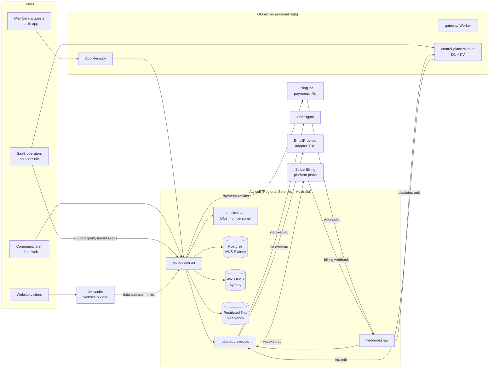

# Community Hub Platform — Architecture

|                   |                                                                                                                              |
| ----------------- | ---------------------------------------------------------------------------------------------------------------------------- |
| **Status**        | **Approved** 2026-09-17 — baseline for implementation. Changes go through an ADR in `docs/adr/` ([AGENTS.md](AGENTS.md) §13) |
| **Last updated**  | 2026-09-17 (revision 16: preview URLs; tooling/; ADR 0001)                                                                   |
| **Scope**         | `community-hub-core` (the multi-tenant SaaS) and its contracts with the mobile apps, GivingJar and Jellycube                 |
| **Launch region** | Australia (`au`). Canada, EU and US are designed for but not deployed                                                        |

This document is the source of truth for how the platform is structured and why. When code and this document disagree, fix one of them in the same pull request. Significant changes to a decision in [§4](#4-key-decisions) need a new ADR in `docs/adr/`.

---

## Contents

1. [Purpose and scope](#1-purpose-and-scope)
2. [Where we are today](#2-where-we-are-today)
3. [Architectural principles](#3-architectural-principles)
4. [Key decisions](#4-key-decisions)
5. [System context](#5-system-context)
6. [Tenancy model](#6-tenancy-model)
7. [Regional cell architecture on Cloudflare](#7-regional-cell-architecture-on-cloudflare)
8. [Codebase structure](#8-codebase-structure) — [client surfaces](#85-client-surfaces)
9. [Module catalogue](#9-module-catalogue)
10. [Plans, entitlements, add-ons and feature flags](#10-plans-entitlements-add-ons-and-feature-flags)
11. [Identity and access](#11-identity-and-access)
12. [Data protection and children's safety](#12-data-protection-and-childrens-safety)
13. [Mobile apps and the App Registry](#13-mobile-apps-and-the-app-registry)
14. [Payments](#14-payments)
15. [Website builder: Jellycube](#15-website-builder-jellycube)
16. [Third-party apps and integrations](#16-third-party-apps-and-integrations)
17. [API design](#17-api-design)
18. [Events, jobs and workflows](#18-events-jobs-and-workflows)
19. [Observability and audit](#19-observability-and-audit) — [product usage](#193-product-usage-intelligence)
20. [Security controls](#20-security-controls)
21. [Compliance](#21-compliance)
22. [Reliability, backup and disaster recovery](#22-reliability-backup-and-disaster-recovery)
23. [Environments, delivery and testing](#23-environments-delivery-and-testing)
24. [Migrating from self-hosted Laravel](#24-migrating-from-self-hosted-laravel)
25. [Roadmap](#25-roadmap)
26. [Open questions and risks](#26-open-questions-and-risks)
27. [Glossary](#27-glossary)
28. [Appendix: verified platform facts](#28-appendix-verified-platform-facts)

---

## 1. Purpose and scope

Community Hub is an enterprise-grade, multi-tenant SaaS for communities — churches, mosques, sports clubs and similar organisations. Customers subscribe to a plan, switch on modules their plan includes, and buy add-ons.

**In scope for `community-hub-core`**

- Tenancy (organisations and communities), identity, access control, entitlements and billing
- Community features: engagement, people and families, groups, membership, records and certificates, volunteers and safeguarding, forms, communications, giving, commerce, reporting
- Privacy, consent, audit and data-residency controls
- Public Content API used by websites and mobile apps
- Contracts (ports) that external systems plug into

**Out of scope — connected through contracts**

| System              | Owner                                                                                            | Contract                                                                                               |
| ------------------- | ------------------------------------------------------------------------------------------------ | ------------------------------------------------------------------------------------------------------ |
| Website builder     | Jellycube (our product, built on Cloudflare, shipped as an SDK for any platform)                 | `JellycubeHost` adapter — [§15](#15-website-builder-jellycube)                                         |
| Payment processing  | GivingJar (our Stripe-based processor, hosted in Australia)                                      | `PaymentProvider` port — [§14](#14-payments)                                                           |
| Transactional email | Adapter chosen later                                                                             | `EmailProvider` port — [§7.2](#72-what-runs-where); decision in [§26](#26-open-questions-and-risks) Q9 |
| Mobile apps         | Community Hub mobile codebase (Parish Hub at launch; other directory and white-label apps later) | App Registry + mobile API — [§13](#13-mobile-apps-and-the-app-registry)                                |

---

## 2. Where we are today

| Repository                            | What it is                                                                                                                                                                     | What happens to it                                                                                                                                                                                                                                                                |
| ------------------------------------- | ------------------------------------------------------------------------------------------------------------------------------------------------------------------------------ | --------------------------------------------------------------------------------------------------------------------------------------------------------------------------------------------------------------------------------------------------------------------------------- |
| `Community-Hub`                       | Laravel 12 + Inertia/React + MySQL, installed separately for each client (WordPress-style). 44 models, module toggles stored as JSON in `website_settings`.                    | Features are rebuilt as modules in core. Client data is imported per tenant ([§24](#24-migrating-from-self-hosted-laravel)). Self-hosting concerns (system update, backups, per-client SMTP, URL scanner) are removed. Website templates and the visual editor move to Jellycube. |
| `Community-Hub-Website-Control-Panel` | Laravel registry of communities (`site_url`, `api_url`, location, type) consumed by the mobile app                                                                             | Replaced by the **control plane** and **App Registry**                                                                                                                                                                                                                            |
| `Community-Hub-Mobile-App`            | Expo SDK 54 "Parish Hub" app. Lists communities, then calls each community's own server. Guest mode. Login is a Laravel email check plus Supabase OTP; push through OneSignal. | Moves into the monorepo as `apps/mobile`. Talks to one regional API. Supabase auth is removed.                                                                                                                                                                                    |

**Known issues that must not be carried over**

- A reviewer login bypass is hard-coded in the mobile client (`dev@ch.com` / `800000`). Review accounts must be server-side, per app, and auditable.
- The RSVP lookup sends the user's email in the query string (`/api/mobile-app/rsvps?email=`). Personal data never goes in URLs; member data is resolved from the session.
- The donation webhook finds a `Donation` by ID without checking which tenant it belongs to. Every lookup is tenant-scoped.
- Session tokens are stored in AsyncStorage. Use `expo-secure-store`.
- Mobile routes exist twice (versioned and unversioned). Core ships one versioned API plus a time-boxed compatibility layer.
- Any admin can switch paid modules on. Entitlements come from the plan, not from tenant settings.

---

## 3. Architectural principles

These are rules, not aspirations. Each is enforced by review, lint rules or tests.

1. **Modular monolith first.** One codebase, strict module boundaries, deployed as a small number of Workers. Extract a service only when there is a measured reason.
2. **Tenant isolation is enforced by the database**, not just by application code. Organisation-scoped (`app`) tables carry `org_id`; Postgres row-level security (RLS) rejects cross-organisation access. Identity and platform tables are region-scoped and have no `org_id` ([§6.3](#63-isolation-in-the-database)).
3. **Data stays in its region.** Personal data is stored and processed only in the tenant's region. Global components hold no personal data.
4. **Privacy by default.** The most protective setting is the default, particularly for children. Features opt into data access; they never opt out of protection.
5. **Entitlements are separate from feature flags.** "What a customer paid for" and "what code is rolled out" are different systems.
6. **Integrations go through ports.** Payments, website, email, SMS, push and mobile distribution are interfaces with adapters. Core never imports a vendor SDK directly.
7. **Contracts are versioned.** APIs, events and add-on interfaces have explicit versions and deprecation windows.
8. **Everything important is audited.** Reads of restricted data, permission changes, exports and support access all produce audit events.
9. **Infrastructure is code.** No console-only configuration in staging or production.
10. **Configuration adds regions, not code.** A new region is a new cell configuration, not a fork.

---

## 4. Key decisions

| #   | Decision                                                                                                                                                                            | Rationale                                                                                                                                                                                                                                                                    | Status                                                           |
| --- | ----------------------------------------------------------------------------------------------------------------------------------------------------------------------------------- | ---------------------------------------------------------------------------------------------------------------------------------------------------------------------------------------------------------------------------------------------------------------------------- | ---------------------------------------------------------------- |
| D1  | Build on **Cloudflare** (Workers, Durable Objects, Queues, Workflows, KV, D1, R2, Hyperdrive, Workers VPC, Workers for Platforms)                                                   | Business requirement; global edge, strong security products, one platform shared with Jellycube                                                                                                                                                                              | Accepted                                                         |
| D2  | **System of record is PostgreSQL in the tenant's country**, reached through Hyperdrive and Workers VPC                                                                              | Cloudflare storage cannot currently guarantee Australian or Canadian storage ([§28](#28-appendix-verified-platform-facts)). Postgres also gives RLS and mature tooling.                                                                                                      | Accepted                                                         |
| D3  | **Australia first**; `ca`, `eu`, `us` cells are configuration stubs                                                                                                                 | Current customers are Australian                                                                                                                                                                                                                                             | Accepted                                                         |
| D4  | **Organisation is the hard tenant boundary; community is a unit inside it.** Every current customer gets an implicit organisation with one community.                               | Future dioceses and leagues need shared billing, SSO and reporting across communities                                                                                                                                                                                        | Accepted                                                         |
| D5  | **TypeScript end to end**: Hono on Workers, Drizzle ORM, Zod contracts, React Router v7 admin, Expo mobile                                                                          | One language across API, web, mobile and SDKs; first-class on Workers                                                                                                                                                                                                        | Accepted                                                         |
| D6  | **Website builder is Jellycube**, integrated through the SDK's host adapter                                                                                                         | Jellycube is a separate product used by other platforms                                                                                                                                                                                                                      | Accepted                                                         |
| D7  | **Payments through GivingJar** behind a `PaymentProvider` port; platform subscriptions billed directly with Stripe Billing                                                          | Keeps processor switchable; separates tenant revenue from our revenue                                                                                                                                                                                                        | Accepted                                                         |
| D8  | **Field-level encryption in the application** with keys wrapped by in-region AWS KMS                                                                                                | Protects restricted data from database access, backups and operators; enables deletion by key destruction                                                                                                                                                                    | Accepted                                                         |
| D9  | **Own identity service on Workers** (email OTP, passkeys, OIDC provider) storing users in the regional database                                                                     | Replaces split Laravel + Supabase login; core must be the OIDC issuer for Jellycube and add-ons                                                                                                                                                                              | Accepted — library choice in [§26](#26-open-questions-and-risks) |
| D10 | **Each store app has its own community list.** SaaS admins assign communities to an app through the App Registry; the app never infers “all churches” or “all of Australia”         | Parish Hub (AU churches), a future mosque app, a sports app, and a Canadian parish app are different store listings with different names. A community appears in an app only when it is listed there ([§13](#13-mobile-apps-and-the-app-registry))                           | Accepted                                                         |
| D11 | **Real-time features do not use Durable Objects for personal data.** Live screens poll a regional endpoint                                                                          | Durable Objects have no Australian jurisdiction and `oc` is only a hint, so an object may run and persist outside Australia                                                                                                                                                  | Accepted                                                         |
| D12 | **A field that must be filtered, sorted or aggregated in SQL is not encrypted.** Encrypted fields support equality matching through blind indexes only                              | Application-layer encryption makes `SUM`, `GROUP BY` and range queries impossible; decrypting rows in a Worker does not scale                                                                                                                                                | Accepted                                                         |
| D13 | **Transactional email goes through an `EmailProvider` port.** The adapter is chosen later; it must process mail in the tenant's region or be an explicit APP 8 subprocessor         | Same switchability as payments. Cloudflare Email Service has no confirmed Australian processing guarantee and is a different product from Email Security's Australia region                                                                                                  | Accepted — provider in [§26](#26-open-questions-and-risks) Q9    |
| D14 | **A client cuts over as one unit:** system of record, admin, mobile and public website in the same window                                                                           | Today's Laravel site is the same app and database as the platform. Events, notices, donations and forms are read and written in-process. A leftover "website-only" install cannot stay live ([§24](#24-migrating-from-self-hosted-laravel))                                  | Accepted                                                         |
| D15 | **Jellycube stays generic.** Community Hub features on the public site are a **host widget pack** registered through the SDK, not widgets built into Jellycube                      | Jellycube is a Jamstack builder for any host and publishes static Astro (or similar). Lists must be HTML for SEO; forms and donate must post to core at request time ([§15.5](#155-host-widget-pack))                                                                        | Accepted                                                         |
| D16 | **Do not invent a component library.** Web UI is **shadcn/ui** (Base UI primitives, Tailwind) copied into `packages/ui`. Mobile uses the same tokens via **React Native Reusables** | Building primitives from scratch is slow and inconsistent. shadcn is owned source, accessible and themable. Polaris React is deprecated; MUI/Ant lock a third-party look; a universal compiler (Tamagui) fights React Router and Astro islands ([§8.5](#85-client-surfaces)) | Accepted                                                         |
| D17 | **Product usage is first-party and community-grained.** No third-party analytics SDK, no session replay, no user-level funnels in an offshore tool                                  | Mixpanel/Amplitude/GA/PostHog Cloud would process personal data outside Australia and collide with children's screens. Domain events already exist; roll them up ([§19.3](#193-product-usage-intelligence))                                                                  | Accepted                                                         |

---

## 5. System context



---

## 6. Tenancy model

### 6.1 Hierarchy

```
Platform
└── Organisation        hard boundary: region, legal agreements, billing, SSO, encryption root, RLS
    └── Community       soft boundary: settings, entitlement allocation, hostnames, app listings, members
        └── Site        optional, later: campus, venue, second Mass centre, home ground
```

| Concern                                                                  | Owned by                                    |
| ------------------------------------------------------------------------ | ------------------------------------------- |
| Region (`au`), data processing agreement, data controller                | Organisation                                |
| Platform subscription (Stripe Billing)                                   | Organisation (usage reported per community) |
| Entitlements                                                             | Organisation plan, allocated to communities |
| Encryption: organisation key → community key → household key             | Organisation / Community                    |
| SSO connection, SCIM                                                     | Organisation                                |
| People, households, children, consent records                            | Community                                   |
| Custom hostnames, Jellycube site, mobile app listings, GivingJar account | Community                                   |
| Staff roles                                                              | Organisation or community scope             |

### 6.2 Implicit organisations

Every current customer is a single community. On sign-up or import the platform creates:

- an organisation with `kind = 'implicit'`, and
- one community inside it.

The admin UI hides the organisation layer while `kind = 'implicit'`. Adding a second community sets `kind = 'explicit'` and reveals organisation features. No data migration is needed. See [§8.5](#85-client-surfaces).

### 6.3 Isolation in the database

Every organisation-scoped (`app`) table:

```sql
org_id        uuid not null,
community_id  uuid not null,          -- omitted only on organisation-level tables
id            uuid not null default uuidv7(),
primary key (org_id, id)

alter table <table> enable row level security;
alter table <table> force row level security;
create policy org_isolation on <table>
  using (org_id = current_setting('app.org_id')::uuid)
  with check (org_id = current_setting('app.org_id')::uuid);
```

- The application connects as a role **without** `BYPASSRLS`.
- Organisation-scoped requests open a transaction and run `SET LOCAL app.org_id = …` and `SET LOCAL app.community_id = …`. Session-level `SET` is forbidden because Hyperdrive pools connections per transaction. **Identity-schema work uses the identity role and does not set `app.org_id`. Platform-schema work uses the platform role and does not set `app.org_id`.**
- `community_id` scoping is enforced by `packages/db` query helpers and verified by tests. It is a soft boundary because organisation-level staff may legitimately query across communities.

**Not every table is organisation-scoped.** There are three categories, and each table declares which it is:

| Category                   | Schema     | Owner                          | Examples                                                                            | Protection                                                                                                                                                |
| -------------------------- | ---------- | ------------------------------ | ----------------------------------------------------------------------------------- | --------------------------------------------------------------------------------------------------------------------------------------------------------- |
| **Organisation-scoped**    | `app`      | the module that owns the table | people, households, donations, events, volunteers, consents, audit events           | `org_id` + RLS as above                                                                                                                                   |
| **Region-scoped identity** | `identity` | `core/identity`                | users, credentials, sessions, OTP challenges                                        | No `org_id`. A user belongs to a **region** and may hold memberships in several organisations. Own Postgres schema and role; no other module may query it |
| **Region-scoped platform** | `platform` | `core/tenancy`                 | region routing, organisation and community directory rows that are not tenant-RLS'd | No `org_id`. Own Postgres schema and role; no other module may query it                                                                                   |

Identity rows are deliberately minimal — authentication identifiers, credentials and session metadata only. A person's name, contact details and any profile information live on the organisation-scoped `people` row. This keeps a shared user record from leaking the fact that someone is a member of another organisation.

The domain **outbox** is organisation-scoped (`app` schema, `org_id` + RLS). It is not in the identity schema.

CI fails if an `app`-schema table lacks `org_id`, RLS or `FORCE ROW LEVEL SECURITY`; if any module outside `core/identity` references the `identity` schema; or if any module outside `core/tenancy` references the `platform` schema.

### 6.4 Moving a community

A community can leave an organisation (a parish changing diocese, a club leaving a league). The move tool re-wraps the community key under the destination organisation key and rewrites `org_id` for that community's rows in one transaction, with a full audit record. Household keys stay wrapped by the community key, so no re-encryption of field data is required.

---

## 7. Regional cell architecture on Cloudflare

### 7.1 Global versus regional

```
┌──────────────────────────── GLOBAL — must never hold personal data ─────────────────────────────┐
│ gateway Worker        login discovery, marketing redirects, legacy hostname routing              │
│ control-plane Worker  organisations/communities directory, plans, add-ons, App Registry          │
│ D1 (control plane)    ids, slugs, region, plan, listing status, Stripe customer id               │
│ KV                    hostname → {orgId, communityId, region}; entitlement snapshots; app config │
│ Feature flags         vendor TBD (Q12); targeting org / community / plan / region only           │
│ Stripe Billing facts  customer id, subscription id, status, price — no emails                    │
└──────────────────────────────────────────────────────────────────────────────────────────────────┘

┌──────────────── AU CELL — Regional Services = Australia on every regional hostname ──────────────┐
│ WAF · API Shield · Bot Management · Turnstile · rate limiting                                     │
│                                                                                                   │
│ au.api.communityhub.one   → api-au      Hono app loading all modules                              │
│                              ├─ RPC → realtime-au   Durable Objects (non-personal coordination)   │
│                              ├─ Queue → jobs-au     consumers, Workflows, Cron (IDs only)          │
│                              └─ fetch → exec-au     internal regional hostname for personal data   │
│ auth.au.communityhub.one     → api-au       identity / OIDC issuer                                │
│ webhooks.au.communityhub.one → webhooks-au  GivingJar, Stripe Billing and add-on inbound webhooks │
│ {slug}.communityhub.one      → api-au       member portal + legacy mobile compatibility routes    │
│                                                                                                   │
│ Hyperdrive (query caching OFF) → Workers VPC → Cloudflare Tunnel → PostgreSQL, AWS ap-southeast-2 │
│ AWS KMS ap-southeast-2 (key wrapping) · S3 ap-southeast-2 (restricted files)                      │
│ R2 (public media only, served through CDN)                                                        │
│ Logpush → S3 ap-southeast-2                                                                       │
└───────────────────────────────────────────────────────────────────────────────────────────────────┘
```

### 7.2 What runs where

| Need                                                               | Product                                           | Rules                                                                                                                                                                                                                                                        |
| ------------------------------------------------------------------ | ------------------------------------------------- | ------------------------------------------------------------------------------------------------------------------------------------------------------------------------------------------------------------------------------------------------------------ |
| API and business logic                                             | Workers (per cell), joined by service binding RPC | `workers_dev = false` everywhere; `preview_urls` set explicitly in Wrangler — `true` only on `global-no-pii` Workers (see [ADR 0001](docs/adr/0001-preview-urls-on-global-workers.md) and each app's `worker.meta.json`); `false` on every `regional` Worker |
| Admin web app                                                      | Workers Static Assets + React Router v7           | Served from a regional hostname                                                                                                                                                                                                                              |
| Customer domains                                                   | Cloudflare for SaaS custom hostnames              | Each hostname registered with Regional Services for its cell                                                                                                                                                                                                 |
| System of record                                                   | Hyperdrive + Workers VPC → PostgreSQL             | Caching disabled on any configuration that reads personal data                                                                                                                                                                                               |
| Live screens (check-in board, attendance, event dashboards)        | `api-au` + Postgres, polled by the client         | **No Durable Objects for personal data** — see [§7.6](#76-real-time-without-durable-objects)                                                                                                                                                                 |
| Background work                                                    | Queues, Workflows, Cron Triggers                  | Payloads and step results contain IDs and statuses only                                                                                                                                                                                                      |
| Public media (logos, event images, public galleries)               | R2                                                | Never children's photos or restricted documents                                                                                                                                                                                                              |
| Restricted files (children's photos, WWCC documents, certificates) | S3 in the cell's AWS region                       | Private bucket, short-lived presigned URLs, SSE-KMS plus application encryption                                                                                                                                                                              |
| Global lookups                                                     | D1 (control plane), KV                            | No personal data. Values are IDs, slugs, config                                                                                                                                                                                                              |
| Feature flags                                                      | Service TBD (Q12)                                 | Rollout only. Targeting is organisation, community, plan and region — never personal identifiers                                                                                                                                                             |
| Third-party add-on code                                            | Workers for Platforms                             | See [§16](#16-third-party-apps-and-integrations)                                                                                                                                                                                                             |
| Transactional email                                                | `EmailProvider` port (adapter TBD)                | Composed and sent from `exec-au`. Tenant sending domains with SPF/DKIM/DMARC. Provider must keep personal-data mail in-region, or be listed as an APP 8 subprocessor with a minimal payload (see Q9)                                                         |
| SMS                                                                | Twilio (Australian sender IDs)                    | Behind `SmsProvider` port                                                                                                                                                                                                                                    |
| Staff access to ops tools                                          | Cloudflare Access                                 | Hardware-key MFA. The ops console is a **global UI**. It must not read tenant records itself; those requests go to `api-au` under a support grant ([§11.4](#114-platform-support-access))                                                                    |

### 7.3 Residency rules specific to Cloudflare

These follow from documented platform behaviour ([§28](#28-appendix-verified-platform-facts)):

1. **Regional Services covers HTTP requests to custom domains only.** It does not cover `*.workers.dev`, Queue consumers, Cron Triggers or a Worker's outbound subrequests.
   - `workers.dev` is disabled on every Worker (`workers_dev = false`). [Preview URLs](https://developers.cloudflare.com/workers/versions-and-deployments/preview-urls/) are hosted only on `*.workers.dev`, so `preview_urls = true` is allowed only on Workers whose class is `global-no-pii` (declared in `worker.meta.json` beside the app). Regional Workers use `preview_urls = false` and are verified on `staging-au` or a Regional Services custom hostname — never on `workers.dev`. See [ADR 0001](docs/adr/0001-preview-urls-on-global-workers.md).
   - Queue messages and Workflow payloads carry IDs only.
   - When work involves personal data it happens at the cell's `exec` hostname, which runs under Regional Services.
2. **`jobs-au` never handles personal data — including in the response it gets back.** `exec-au` performs the _whole_ unit of work and returns counts, statuses and IDs only. A job that receives a member's name in an HTTP response has processed personal data in an unregionalised Worker, which is the same breach as reading it from the database there. In practice:
   - **Queue consumers** dispatch `{orgId, communityId, jobType, ids}` to `exec` and record the returned status.
   - **Cron handlers** do no work themselves; they call `exec` immediately.
   - **Workflow steps** call `exec` and return a status. Step return values are persisted by the platform, so they must never contain personal data.
   - **Outbound sends** (email, SMS, push) that contain personal data are composed and sent from `exec`, never from `jobs`.
3. **The identity service is regional.** `auth.au.communityhub.one` is an Australian Regional Services hostname, because it reads the regional `identity` schema and handles email addresses and one-time codes. There is one issuer per region; no global endpoint ever receives an email address, including for region discovery ([§11.1](#111-identity)).
4. **Hyperdrive can cache query results.** Caching is disabled for configurations used with personal data.
5. **Worker code and secrets are distributed globally.** No personal data or tenant keys in code, variables or secrets. Tenant key material lives in regional KMS.
6. **Workers Logs, KV, Workers AI, AI Gateway and Vectorize are not regionalised.** Logs are scrubbed of personal data ([§19](#19-observability-and-audit)); KV holds no personal data; AI features never receive restricted data. Feature-flag targeting attributes are limited to organisation ID, community ID, plan and region — never emails or other personal identifiers.
7. **Durable Objects have no Australian jurisdiction at all.** `oc` is a location hint, not a guarantee, so an object may run outside Australia even before storage is considered; in-memory state is discarded on hibernation, which means anything that must survive is written to Durable Object storage or a WebSocket attachment and persisted wherever the object lives. Australian cells therefore use Durable Objects only for data that is not personal data.

### 7.4 Request lifecycle

```mermaid
sequenceDiagram
  participant C as Client
  participant E as Cloudflare edge (AU)
  participant W as api-au Worker
  participant K as KV
  participant H as Hyperdrive
  participant P as Postgres (Sydney)

  C->>E: HTTPS stmarys.communityhub.one/v1/...
  E->>W: WAF, API Shield, rate limit passed
  W->>K: hostname → org, community, region (cached in isolate)
  W->>W: authenticate session, load entitlements snapshot
  W->>W: authorise (entitlement → community toggle → permission)
  W->>H: BEGIN; SET LOCAL app.org_id / app.community_id
  H->>P: query (RLS enforced)
  P-->>W: rows (restricted fields encrypted)
  W->>W: decrypt only fields the actor may read; write audit event
  W-->>C: response
```

This sequence is an organisation-scoped API request. Identity OTP and platform-schema tenancy work do not set `app.org_id` ([§6.3](#63-isolation-in-the-database)).

### 7.5 Adding a region later

1. Provision `infra/regions/<region>/` (Postgres, KMS, S3, Tunnel connectors).
2. Add the wrangler environment for each regional Worker.
3. Add the region to `packages/residency` and enable it in the control plane.
4. Register regional hostnames with the matching Regional Services region; for EU/US, use R2 and Durable Object jurisdictions.
5. Run the cross-tenant and residency test suites against the new cell.

### 7.6 Real-time without Durable Objects

Check-in, live attendance and event dashboards are the features that would naturally use a Durable Object, and they are exactly the features that handle children's names and pickup codes. They do not use one.

- **State lives in Postgres.** Each check-in session row carries a monotonic `rev` that increases on every change.
- **Clients poll** `GET /v1/c/{slug}/checkin/sessions/{id}?since={rev}` every 2–5 seconds against `api-au`. A site has tens of devices, not thousands, so this is inexpensive and fully in-region.
- **The check-in device works offline**, queueing scans locally and reconciling on reconnect, which matters more in a church hall than sub-second updates do.
- **If fan-out is ever needed**, a Durable Object may hold `{sessionId, rev}` and nothing else, acting purely as a "something changed, refetch" signal. Even opaque identifiers leaving Australia is a decision recorded in an ADR and approved by the privacy owner — never a default.

---

## 8. Codebase structure

### 8.1 Monorepo

pnpm workspaces + Turborepo.

```
community-hub/
├── apps/                     # each Worker app: wrangler.jsonc + worker.meta.json (class: global-no-pii | regional)
│   ├── gateway/              # global: login discovery, redirects, legacy hostname routing
│   ├── control-plane/        # global: orgs/communities directory, plans, add-ons, App Registry, Stripe Billing facts
│   ├── api/                  # regional: HTTP API, loads modules/*; compatibility router for legacy mobile routes
│   ├── jobs/                 # regional: queue consumers, Workflows, Cron
│   ├── exec/                 # regional: internal hostname for personal-data work started by jobs
│   ├── realtime/             # regional: Durable Objects — non-personal coordination only, unused at launch (§7.6)
│   ├── webhooks/             # regional: GivingJar, Stripe Billing and add-on inbound webhooks
│   ├── admin/                # tenant admin web (React Router v7)
│   ├── portal/               # member portal (React Router v7), served on {slug}.communityhub.one
│   ├── ops-console/          # SaaS operators; global UI behind Cloudflare Access; tenant reads via api-au
│   └── mobile/               # Expo app; one codebase, many store apps via APP_KEY
│
├── modules/
│   ├── core/
│   │   ├── tenancy/          # organisations, communities, sites, lifecycle, moves
│   │   ├── identity/         # users, sessions, OTP, passkeys, OIDC provider, SSO/SCIM
│   │   ├── people/           # persons, households, guardian links, age computation
│   │   ├── access/           # roles, grants, policies, support access
│   │   ├── entitlements/     # allocation, community toggles, limits
│   │   ├── consent/          # consent records, guardian consent, jurisdiction rules
│   │   ├── privacy/          # access/export/erasure requests, retention, legal holds
│   │   ├── audit/            # tamper-evident audit log
│   │   ├── usage/            # first-party product usage facts (community × feature × day)
│   │   ├── notifications/    # email/SMS/push orchestration, preferences, Spam Act consent
│   │   └── files/            # classification-aware file storage
│   ├── features/
│   │   ├── engagement/       # events, tickets, RSVPs, bulletins, notices, service times, life events
│   │   ├── groups/           # groups, tags, rosters
│   │   ├── membership/       # plans, memberships, renewals
│   │   ├── records/          # records, certificates, certificate requests
│   │   ├── volunteers/       # applications, checks (WWCC, Blue Card), documents, expiry
│   │   ├── safeguarding/     # incident reports, messaging rules, check-in/out
│   │   ├── forms/            # form builder, submissions, enquiries
│   │   ├── communications/   # broadcasts, scheduled messages, templates
│   │   ├── giving/           # campaigns, splits, donations, recurring giving, tax receipts
│   │   ├── commerce/         # products, inventory, orders
│   │   ├── content/          # articles, galleries, team members (published via Public Content API)
│   │   └── reporting/        # dashboards, finance summaries
│   └── verticals/
│       ├── faith-church/     # Mass/service times, sacraments, parish certificates, terminology
│       ├── faith-mosque/     # prayer times, zakat, madrasah classes, terminology
│       └── sports-club/      # teams, fixtures, player registration, season fees, terminology
│
├── adapters/
│   ├── payments-givingjar/   # implements PaymentProvider
│   ├── website-jellycube/    # implements JellycubeHost
│   ├── push-onesignal/       # implements PushProvider
│   ├── sms-twilio/           # implements SmsProvider
│   ├── email-<provider>/     # implements EmailProvider — adapter chosen later (Q9)
│   └── legacy-laravel-import/# imports self-hosted Laravel clients
│
├── packages/
│   ├── kernel/               # module manifest, request context, DI, outbox, errors
│   ├── residency/            # per-cell configuration and guards
│   ├── db/                   # Drizzle + Hyperdrive, transaction wrapper, RLS helpers, migrations runner
│   ├── crypto/               # WebCrypto AES-256-GCM, KMS key wrapping, blind indexes
│   ├── entitlements/         # snapshot reader, entitled(), limit()
│   ├── policy/               # permission evaluation
│   ├── payments/             # PaymentProvider port, ledger types
│   ├── notifications/        # EmailProvider / SmsProvider / PushProvider ports
│   ├── contracts/            # Zod schemas → OpenAPI; versioned event schemas
│   ├── api-client/           # typed client used by admin, mobile and Jellycube adapter
│   ├── app-sdk/              # SDK for third-party add-on developers
│   ├── ui/                   # shadcn/ui (copied) + tokens + product patterns — §8.5
│   ├── ui-native/            # React Native Reusables, same token names — §8.5
│   ├── website-widgets/      # Astro components + islands registered with Jellycube (events, forms, donate, service times)
│   ├── web-components/       # client islands used by write widgets (form submit, checkout redirect)
│   └── observability/        # logger with personal-data scrubbing, tracing
│
├── tooling/
│   └── checks/               # CI boundary checkers (worker-config, schema-rls, encrypted-query, residency-payload, terraform-invariants, traceability), each with must-fail fixtures
│
├── infra/
│   ├── modules/              # shared Terraform modules; each has tests/ and is in the CI matrix
│   ├── bootstrap/            # state bucket + KMS; local state then migrated into the bucket
│   ├── global/               # dedicated staging zone (not communityhub.one). Prod zone is tfvars-only.
│   └── regions/
│       └── au/               # one cell = one root: AWS + AU Cloudflare (Tunnel, Hyperdrive, Workers VPC)
│
└── docs/
    ├── adr/                  # architecture decision records
    └── runbooks/             # incidents, breach assessment, restores, key rotation
```

### 8.2 Module anatomy

```
modules/features/giving/
├── module.manifest.ts        # identity, dependencies, entitlements, permissions, data classes, events
├── domain/                   # entities, value objects, rules — no framework imports
├── application/              # commands and queries (use cases)
├── infrastructure/           # repositories (Drizzle), adapters to ports
├── http/                     # Hono routes, request/response schemas
├── public/                   # the only surface other modules may import
├── events/                   # published event schemas (versioned)
├── db/
│   ├── schema.ts             # Drizzle tables — app-schema tables have org_id and classifications
│   └── migrations/
└── tests/
```

```ts
// modules/features/giving/module.manifest.ts
export default defineModule({
  key: "giving",
  version: 1,
  requires: ["core.people", "core.consent"],
  entitlement: "module.giving",
  features: ["giving.one_off", "giving.recurring", "giving.splits", "giving.tax_receipts"],
  permissions: ["giving.view", "giving.manage", "giving.export", "giving.refund"],
  dataClasses: {
    // encrypted fields cannot be aggregated or sorted in SQL — see §12.2.1
    "donations.amount_minor": "confidential-queryable", // clear: dashboards SUM and GROUP BY it
    "donations.donor_person_id": "confidential-blind", // pseudonymous id + blind index
    "donations.donor_note": "confidential", // encrypted
  },
  publishes: ["giving.donation.succeeded.v1", "giving.donation.refunded.v1"],
  subscribes: ["people.person.merged.v1", "tenancy.community.offboarded.v1"],
  ports: ["PaymentProvider"],
  websiteWidgets: ["giving.donate", "giving.campaigns"],
});
```

### 8.3 Boundary rules (enforced in CI)

- A module imports another module only through its `public/` folder. Prefer events for side effects.
- A module never reads or writes another module's tables.
- `domain/` has no imports from Hono, Drizzle, Cloudflare bindings or adapters.
- Adapters depend on ports; modules never import adapters.
- Global apps (`gateway`, `control-plane`) cannot import modules that declare personal-data classes.
- Enforced with dependency-cruiser rules plus a custom check over manifests.

### 8.4 Conventions

| Concern     | Convention                                                                                                                 |
| ----------- | -------------------------------------------------------------------------------------------------------------------------- |
| IDs         | UUIDv7                                                                                                                     |
| Time        | `timestamptz` in UTC; community timezone stored on the community                                                           |
| Money       | Integer minor units + ISO 4217 currency                                                                                    |
| Validation  | Zod schemas in `packages/contracts`, shared by API, admin, mobile                                                          |
| Errors      | Typed domain errors → RFC 9457 problem details at the edge                                                                 |
| Soft delete | Only where the domain needs restore; erasure uses hard delete or key destruction                                           |
| Terminology | Vertical packs provide labels (e.g. "Mass Times" vs "Prayer Times"); code uses generic names ([§8.5](#85-client-surfaces)) |

### 8.5 Client surfaces

This is the **UI architecture**: which apps exist, what they share, and which domain rules they must not fight. Visual design, journeys, copy and Figma live outside this document.

#### Surfaces

| Surface       | Where                                                                                                                                                                                                                                      | Audience                         | Appearance                                                                                                                              |
| ------------- | ------------------------------------------------------------------------------------------------------------------------------------------------------------------------------------------------------------------------------------------ | -------------------------------- | --------------------------------------------------------------------------------------------------------------------------------------- |
| Tenant admin  | `apps/admin` (React Router v7, regional hostname)                                                                                                                                                                                          | Community and organisation staff | `packages/ui`                                                                                                                           |
| Member portal | `apps/portal` on `{slug}.communityhub.one` (with `api-au`)                                                                                                                                                                                 | Members and guardians            | `packages/ui`; member-scoped chrome, not the staff shell                                                                                |
| Ops console   | `apps/ops-console` (global UI, Cloudflare Access). Directory, plans, usage aggregates and Stripe **ids** go to control-plane. **Tenant record reads proxy through `api-au` under a support grant** ([§11.4](#114-platform-support-access)) | SaaS operators                   | `packages/ui`; ops chrome. Tenant data stays hidden until support access is granted                                                     |
| Mobile        | `apps/mobile` (Expo, many store apps)                                                                                                                                                                                                      | Members and guests               | `packages/ui` tokens plus native primitives. Theming per `APP_KEY`, not a fork of screens ([§13](#13-mobile-apps-and-the-app-registry)) |
| Public site   | Jellycube + `packages/website-widgets`                                                                                                                                                                                                     | Visitors                         | Jellycube theme. Host tokens from core. Write islands in `packages/web-components` ([§15.5](#155-host-widget-pack))                     |

There is one design language for products we ship. The public site may look like the parish; it must not invent a second Community Hub component set.

#### Design system (`packages/ui`)

**Adopt an existing kit. Do not design buttons, dialogs, tables or form controls from scratch.**

| Layer          | Choice                                                                          | Why                                                                                                                                                                                              |
| -------------- | ------------------------------------------------------------------------------- | ------------------------------------------------------------------------------------------------------------------------------------------------------------------------------------------------ |
| Web primitives | **shadcn/ui**, Base UI primitives (the 2026 default), Tailwind                  | Accessible overlays and forms without owning ARIA. Source is copied into the repo, so we are not theming a black-box `node_modules` library. Works with React Router v7 on Workers Static Assets |
| Web catalogue  | `packages/ui` is the only shadcn registry in the monorepo                       | Apps do not `npx shadcn add` into `apps/admin`. Features import `@community-hub/ui` only                                                                                                         |
| Tokens         | CSS custom properties in `packages/ui` (colour, type, space, radius, elevation) | White-label and vertical overlays change tokens, not components. Feature screens do not hard-code raw values                                                                                     |
| Mobile         | **React Native Reusables** + NativeWind, mapped to the **same token names**     | Closest shadcn equivalent on Expo. Native primitives (not Radix/Base UI). gluestack-ui v5 is native-only now; do not use it on the web                                                           |
| Public islands | `packages/web-components` styled with the same CSS variables                    | A static Jellycube page must not pull the admin React app. Parish look comes from Jellycube theme tokens ([§15.5](#155-host-widget-pack))                                                        |
| Icons          | Lucide, one set                                                                 | Do not mix icon packs                                                                                                                                                                            |
| Forms          | shadcn Form + React Hook Form + Zod from `packages/contracts`                   | One validation story from API to UI                                                                                                                                                              |
| Data tables    | TanStack Table composed in `packages/ui`, not a second table kit                | People, donations, events, volunteers                                                                                                                                                            |

**Rejected for this platform:** Material UI, Ant Design, Chakra, daisyUI, Shopify Polaris (Polaris React is deprecated; the replacement is for Shopify apps), Tamagui as the admin stack, and building a private primitive layer.

**Product patterns** (ours, thin, built _on_ shadcn — this is the guideline layer):

- `Page`, `PageHeader`, `IndexToolbar` — list/detail chrome
- `EntitlementGate`, `UpgradePrompt` — rule 2
- `RestrictedDataBanner` — children's / restricted screens
- `CommunitySwitcher` — rule 9
- `DataTable`, `FilterBar`, `EmptyState`, `ConfirmDialog`

A feature screen composes these. It does not restyle a `Button` per module.

**Enforcement**

- Components are accessible by default. **WCAG 2.2 AA is a merge gate** for admin, portal, ops, mobile, and widget islands ([§21](#21-compliance)).
- Dependency rules: `apps/admin`, `apps/ops-console` and the portal import UI only from `@community-hub/ui`. `apps/mobile` imports only from `@community-hub/ui-native` (Reusables, same tokens). No second component library.
- Vertical packs supply **labels and a small token overlay** (for example the heading on service times). They do not ship a second component library.
- White-label store apps may override tokens and store listing art. They reuse the same screens.
- The public site may look like the parish; it must not invent a second Community Hub component set.

Admin, portal and ops consume the React/shadcn implementation. Mobile maps the same tokens onto native primitives. Widget islands use the web-component subset.

#### Rules the UI must follow

These are already decided elsewhere. A screen that contradicts them is a bug.

1. **Implicit organisation.** Hide organisation chrome while `kind = 'implicit'`. Reveal it when the organisation becomes explicit ([§6.2](#62-implicit-organisations)).
2. **Entitlements.** Hide a feature or show an upgrade prompt. Do not render a control that only 403s ([§10.3](#103-evaluation-order)).
3. **Permissions.** Hide actions the actor cannot perform. The API still enforces them.
4. **Generic screens, vertical labels.** Routes, component names and copy keys stay generic (`service_times`, not `mass_times`). The vertical pack provides the string the user sees ([§8.4](#84-conventions)).
5. **No personal data in URLs.** Lists and search use the session and opaque ids ([§17](#17-api-design)).
6. **Children's and restricted screens.** No third-party analytics SDK or session replay on any surface (D17). First-party usage beacons are dropped here ([§12.3](#123-children-product-rules), [§19.3](#193-product-usage-intelligence)).
7. **Live boards poll** a regional endpoint. Durable Objects are not used for personal UI ([§7.6](#76-real-time-without-durable-objects)).
8. **Public lists are static HTML.** Forms, RSVP and donate are islands that POST to core ([§15.5](#155-host-widget-pack)).
9. **Mobile community switcher** shows only memberships that are live on **this** `APP_KEY`. Admin and portal switch among communities the actor can access, not store listings ([§13.2](#132-listing-rules-enforced)).

#### Not in this document

Palettes, type scale, wireframes, per-screen layout, marketing pages, and brand for Parish Hub versus a future mosque or sports app.

---

## 9. Module catalogue

Mapping from the Laravel application's module toggles to core modules.

| Laravel toggle / features                                                                | Core module                            | Notes                                                                                                             |
| ---------------------------------------------------------------------------------------- | -------------------------------------- | ----------------------------------------------------------------------------------------------------------------- |
| engagement — Bulletins, Events (tickets, RSVPs), Notice Board, Mass Timings, Life Events | `engagement` + vertical pack           | "Mass Timings" becomes generic **service times** with labels from the vertical pack                               |
| contacts — All Contacts, Groups, Tags, activity log                                      | `core/people`, `groups`                | Laravel `Contact` stores `dob`, `age`, `relationship` — children are split into Person + Household + GuardianLink |
| family — Family Records                                                                  | `core/people` (households)             |                                                                                                                   |
| membership — Membership, Plans                                                           | `membership`                           | Recurring charges through `PaymentProvider`                                                                       |
| records — Records, certificates, parish requests                                         | `records`                              | Sacramental certificates are religious data, often about children → restricted                                    |
| volunteers — applications, background checks, WWCC, Blue Card, documents                 | `volunteers`, `safeguarding`           | Check numbers are restricted fields; documents stored as restricted files                                         |
| forms — Forms, Enquiries                                                                 | `forms`                                | Fields carry a data classification                                                                                |
| communication — Broadcast Messages, scheduled notifications, templates, push             | `communications`, `core/notifications` |                                                                                                                   |
| donations — Campaigns, splits, Donate                                                    | `giving`                               |                                                                                                                   |
| ecommerce — Products, Orders & Inventory                                                 | `commerce`                             | Paid add-on                                                                                                       |
| website — Header, Footer, Pages, Templates, Global Settings                              | **Jellycube**                          | Not in core                                                                                                       |
| website — Blog/News, Photo Gallery, Team Members, Media Library                          | `content`, `core/files`                | Content stays in core; Jellycube renders it through data sources                                                  |
| Dashboard, Finance                                                                       | `reporting`                            |                                                                                                                   |
| Backups, System Update, URL Scanner, per-client email provider settings                  | —                                      | Removed: platform responsibilities                                                                                |

---

## 10. Plans, entitlements, add-ons and feature flags

### 10.1 Concepts

| Concept              | Meaning                                                                                        | Stored in                                                                                                                       |
| -------------------- | ---------------------------------------------------------------------------------------------- | ------------------------------------------------------------------------------------------------------------------------------- |
| **Plan**             | Package a customer subscribes to (e.g. Starter, Growth, Enterprise)                            | Control plane D1                                                                                                                |
| **Add-on**           | Separately purchasable capability (e-commerce, SMS pack, website, mobile listing, branded app) | Control plane D1                                                                                                                |
| **Entitlement**      | A feature key or limit the organisation is allowed to use                                      | Derived; snapshot in KV                                                                                                         |
| **Allocation**       | Which communities in an organisation receive an entitlement                                    | Control plane D1                                                                                                                |
| **Community toggle** | Community admin switching an entitled feature on or off                                        | Regional database                                                                                                               |
| **Override**         | Contracted exception for an enterprise deal, with expiry                                       | Control plane D1                                                                                                                |
| **Feature flag**     | Code rollout control, independent of billing                                                   | Feature-flag service (vendor TBD, Q12). Targeting on organisation, community, plan and region only — never personal identifiers |

### 10.2 Example catalogue

```ts
// Core modules (tenancy, identity, people, access, consent, privacy, audit,
// usage, notifications, files) are always on and are never entitlement-gated;
// their optional capabilities are. CI fails on any key no manifest declares.

plans.starter = [
  "module.engagement",
  "module.forms",
  "module.content",
  "module.giving",
  "people.directory",
  "groups.basic",
  "communications.email",
  "giving.one_off",
];
plans.growth = [
  ...plans.starter,
  "people.households",
  "people.custom_fields",
  "module.membership",
  "module.volunteers",
  "module.records",
  "safeguarding.checkin",
  "giving.recurring",
  "giving.tax_receipts",
  "communications.push",
];

addons.ecommerce = ["module.commerce"];
addons.website = ["website.jellycube"]; // system add-on
addons.mobile = ["mobile.listing"]; // may be listed in a directory app (which app is an ops choice)
addons.branded = ["mobile.whitelabel"]; // community's own single-community store app
addons.sms_pack = [{ key: "sms.monthly", limit: 2000 }];
```

Pricing and final plan contents are a product decision; the model supports any combination.

### 10.3 Evaluation order

A feature is available only when every step passes:

```
1. Feature flag kill switch   (flags service)    → is the code enabled at all?
2. Entitlement                (KV snapshot)      → did the organisation pay for it?
3. Allocation                 (KV snapshot)      → is it allocated to this community?
4. Community toggle           (regional DB)      → has the community switched it on?
5. Permission                 (packages/policy)  → may this actor perform this action?
```

Checks run in API middleware, in the admin UI (hide or show an upgrade prompt), in jobs, and in event subscribers. A disabled module's subscribers do not run.

### 10.4 Propagation

```
Stripe Billing webhook → webhooks-au (parse in-region; drop emails and names)
  → control-plane { customerId, subscriptionId, status }
  → recompute entitlements (D1)
  → Queue → write KV snapshot  ent:{orgId}            (orgs, allocations, limits)
          → publish tenancy.entitlements.changed.v1  (regional jobs react, e.g. provision add-on)
```

- KV is eventually consistent; changes may take up to about a minute to be visible everywhere. That is acceptable for upgrades and downgrades.
- **Hard usage limits** (SMS credits, member caps) are counted in a per-organisation Durable Object so they are exact. The object stores **counters only** — not names, emails or member lists — which is why a Durable Object is allowed here despite [§7.3](#73-residency-rules-specific-to-cloudflare) rule 7.
- **Downgrades hide, never delete.** Data of a disabled module remains until retention or an erasure request removes it.

---

## 11. Identity and access

### 11.1 Identity

- Users are stored in the **regional** database, in the `identity` schema, which is region-scoped rather than organisation-scoped ([§6.3](#63-isolation-in-the-database)). A user belongs to a region and may hold memberships in several communities and organisations within it. Identity rows hold authentication data only; profile data lives on the organisation-scoped `people` row.
- **`identity.users.email` is `confidential-blind`.** The display value is encrypted. OTP start looks up a region-scoped blind index (HMAC of the normalised address with the region's identity key), never a clear-text column and never on a global Worker. Identity HTTP is regional: OIDC on `auth.au.communityhub.one`, mobile OTP on `{api}/v1/auth/...`. Both hostnames are `api-au` under Regional Services = Australia ([§12.2.1](#1221-encryption-versus-queryability)).
- **Sign-in methods:** email one-time code, passkeys; staff can be required to use passkeys or TOTP. Enterprise organisations can connect SAML/OIDC SSO and SCIM (later phase).
- **Sessions:** short-lived access tokens + rotating refresh tokens. Mobile stores them in `expo-secure-store`.
- **Core is an OIDC provider** for Jellycube and approved add-ons, issued from the regional hostname `auth.au.communityhub.one`, which is registered with Regional Services = Australia. There is **one issuer per region**; relying parties discover the issuer from the community they are bound to. Tokens carry `org`, `community` and role claims scoped to the relying party.
- **Region discovery never involves an email address.** A global Worker that received an email in order to route it — even to hash it — would be processing personal data outside the region. Region comes from context that is not personal data: the mobile app already knows the community and its `api` base from the App Registry, admins arrive on a regional hostname, and the global landing page offers a country or community choice and then redirects. With a single region today, everything goes to `au`.
- A user may hold memberships in several communities in the same region. **Which of those memberships a given store app can show is an App Registry question** ([§13.2](#132-listing-rules-enforced)), not an identity one.
- **App store review accounts** are server-side, per mobile app, limited to a demo community, and audited.

### 11.2 Person versus user

A **person** is someone the community knows about. A **user** is someone who can sign in. Children are usually persons without users. Guardian links connect adult persons to children with explicit rights: `consent`, `pickup`, `view`, `manage`.

### 11.3 Roles

| Scope        | Roles                                                                                                              |
| ------------ | ------------------------------------------------------------------------------------------------------------------ |
| Platform     | `platform_admin`, `platform_support` (no tenant data access by default), `platform_security`                       |
| Organisation | `org_owner`, `org_admin`, `org_billing`, `org_auditor`                                                             |
| Community    | `community_admin`, `staff`, `finance`, `safeguarding_officer`, `volunteer_coordinator`, `content_editor`, `member` |
| Relationship | `guardian_of(person)`, `group_leader_of(group)`                                                                    |

Permissions are fine-grained strings declared in module manifests (`giving.refund`, `people.restricted.read`). Roles are bundles of permissions; communities can create custom roles within limits. Relationship checks (guardian, group leader) are evaluated by `packages/policy` against the database.

### 11.4 Platform support access

Support staff cannot see tenant data by default. Access requires:

1. A ticket reference and reason.
2. Approval from a community or organisation admin inside the product.
3. A time-boxed grant (default 4 hours, scoped to named modules).
4. Every read is audited and visible to the tenant in their audit log.

The ops console is a **global UI** (Cloudflare Access, no Regional Services guarantee). Directory, plans, App Registry, usage aggregates and Stripe ids are served from control-plane and contain no personal data. **An approved support read is proxied to `api-au`.** The global Worker must not decrypt, log or buffer tenant fields; it forwards the request under the grant and returns the regional response. That is the same split as Stripe Billing: personal data is processed only on a regional hostname.

A break-glass procedure exists for security incidents, requires two platform security staff, and notifies the tenant after the fact.

---

## 12. Data protection and children's safety

### 12.1 Classification

Every column and file has a class, declared in the module schema.

| Class                    | Examples                                                                                                                                                                                                          | Controls                                                                                                                                                                                                                                                                                   |
| ------------------------ | ----------------------------------------------------------------------------------------------------------------------------------------------------------------------------------------------------------------- | ------------------------------------------------------------------------------------------------------------------------------------------------------------------------------------------------------------------------------------------------------------------------------------------ |
| `public`                 | Published events, service times, public articles                                                                                                                                                                  | May be cached at the edge and served to guests                                                                                                                                                                                                                                             |
| `internal`               | Adult member names, group membership                                                                                                                                                                              | Tenant isolation, permission checks                                                                                                                                                                                                                                                        |
| `confidential`           | Addresses, phone numbers, donor notes                                                                                                                                                                             | Field encryption, export requires permission                                                                                                                                                                                                                                               |
| `confidential-queryable` | Donation amounts, check expiry dates, derived age bands                                                                                                                                                           | **Not encrypted**, because SQL must aggregate, sort or range-filter them. Protected by RLS, column-level permissions, at-rest encryption and audit ([§12.2.1](#1221-encryption-versus-queryability))                                                                                       |
| `confidential-blind`     | Donor person reference, member email used for lookup                                                                                                                                                              | Pseudonymous identifier plus a blind index; equality matching only                                                                                                                                                                                                                         |
| `restricted`             | **Identity and sensitive records of a person under 18** (name, date of birth, photos), health and allergy information, safeguarding reports, WWCC/Blue Card numbers, religious records (sacramental certificates) | Field encryption with household or community keys, purpose-bound access, every read audited, never sent to AI, logs, analytics or third-party apps without explicit tenant approval. Derived flags such as `is_minor` are the exception in [§12.2.1](#1221-encryption-versus-queryability) |

### 12.2 Encryption

```
AWS KMS (Sydney)  ── wraps ──►  Organisation key
                                   └─ wraps ──►  Community key
                                                    ├─ wraps ──► Household key   (restricted person data, and a minor's confidential* columns)
                                                    └─ encrypts  adult confidential fields, blind-index keys
```

- **Application-layer encryption** with WebCrypto AES-256-GCM in the Worker before data reaches Postgres. Database operators, Hyperdrive and backups see ciphertext.
- **Unwrapped keys** are held in isolate memory for a short time only; never written to KV, Durable Object storage, logs or queues.
- **Search** uses HMAC-SHA-256 blind indexes. Adult `people.*` indexes are community-scoped. `identity.users.email` uses the region's identity key. A minor's `confidential-blind` indexes use the household key, so they die with household-key destruction.
- **Deletion by key destruction:** erasing a household destroys its household key, making restricted copies (including backups and restricted files) unreadable. **The payment ledger is not encrypted with the household key.** DGR and tax-retention rows stay readable; the donor person link may become unlinkable.
- **Transport:** TLS 1.3 at the edge; TLS with certificate verification between Tunnel and Postgres; storage encrypted at rest (RDS and S3 with KMS).
- **Key rotation:** KMS keys rotate annually; organisation and community keys can be rotated online by re-wrapping.

#### 12.2.1 Encryption versus queryability

> **Rule:** a field the database must filter, sort or aggregate cannot be encrypted. Choose one of: a blind index (equality only), a derived value stored in the clear, or a different classification. Decide this when the schema is written, not when the report is built.

Application-layer encryption means the database sees ciphertext, so `SUM`, `GROUP BY`, `ORDER BY` and `BETWEEN` are impossible, and decrypting every row inside a Worker to compute a total breaks both CPU limits and cost. How this resolves for the fields that matter:

| Field                                                      | Classification                   | Rationale                                                                                                                                                                                                                                                                                                                                                                                                                                                                                                                                      |
| ---------------------------------------------------------- | -------------------------------- | ---------------------------------------------------------------------------------------------------------------------------------------------------------------------------------------------------------------------------------------------------------------------------------------------------------------------------------------------------------------------------------------------------------------------------------------------------------------------------------------------------------------------------------------------- |
| `donations.amount_minor`                                   | `confidential-queryable` (clear) | Finance dashboards aggregate it. The sensitive fact is the donor-to-amount link, not the number                                                                                                                                                                                                                                                                                                                                                                                                                                                |
| `donations.donor_person_id`                                | `confidential-blind`             | Pseudonymous reference plus blind index, so "donations by this person" still works                                                                                                                                                                                                                                                                                                                                                                                                                                                             |
| `donations.donor_note`                                     | `confidential` (encrypted)       | Free text, never queried                                                                                                                                                                                                                                                                                                                                                                                                                                                                                                                       |
| `people.date_of_birth`                                     | `restricted` (encrypted)         | Never queried directly                                                                                                                                                                                                                                                                                                                                                                                                                                                                                                                         |
| `people.is_minor`, `people.age_band`, `people.birthday_md` | `confidential-queryable` (clear) | **Exception:** these are derived flags so youth rosters and age-gates work in SQL. The child's name, date of birth and other identity fields stay `restricted`                                                                                                                                                                                                                                                                                                                                                                                 |
| `volunteers.wwcc_number`, `blue_card_number`               | `restricted` (encrypted)         | Government identifiers, looked up by equality at most                                                                                                                                                                                                                                                                                                                                                                                                                                                                                          |
| `volunteers.wwcc_expiry`                                   | `confidential-queryable` (clear) | Expiry reports sort and range-filter on it                                                                                                                                                                                                                                                                                                                                                                                                                                                                                                     |
| `people.email`, `people.phone`                             | `confidential-blind`             | Blind index for lookup and duplicate detection; display value encrypted. **If `is_minor` is true, these columns (and any other `confidential` / `confidential-blind` field on that person) are encrypted with the household key**, not the community confidential key. A guardian's phone is stored on the guardian's person row, not copied onto the child. **Trade-off:** a minor cannot be looked up or de-duplicated by email or phone outside their household — importers and merge tools match minors with household-scoped indexes only |
| `identity.users.email`                                     | `confidential-blind`             | OTP and account lookup need equality match. Region-scoped blind index; ciphertext stored; processed only on `api-au` (`auth.{region}` and `{api}/v1/auth/...`) ([§11.1](#111-identity))                                                                                                                                                                                                                                                                                                                                                        |

**Reporting reads rollups, not the ledger.** `reporting` maintains incrementally updated aggregates (per campaign, per fund, per day, per community), updated by the event subscriber that records a payment. Dashboards never scan `donations`, which is also the right decision for performance and cost.

### 12.3 Children: product rules

These are invariants. A feature that violates one is not shipped.

1. **Age is computed** from date of birth and the community's jurisdiction settings. Unknown date of birth in a child-oriented flow (youth group, Sunday school, junior team) is treated as a minor.
2. **Guardian consent** is required for collecting and using a child's data where the child cannot consent. Consent records store who consented, what for, the notice version and timestamp.
3. **No public exposure.** Children never appear in directories, public content, search results, or Jellycube data sources.
4. **Photos** of children require a recorded media consent. Restricted photos are stored only in the regional restricted file store and served through short-lived signed URLs.
5. **No private adult-to-child messaging.** Messages to minors go to groups with guardians copied; conversations are retained for safeguarding review.
6. **Check-in and check-out** use pickup codes matched between the child's label and the guardian's; authorised pickup lists are enforced; every event is audited.
7. **Volunteer eligibility.** Roles working with children require a current, verified WWCC (or state equivalent such as Blue Card). Expiry blocks rostering and notifies the coordinator.
8. **No tracking.** No third-party analytics SDKs, advertising identifiers or session replay on any surface (D17). First-party usage beacons are off on screens that show children's data ([§19.3](#193-product-usage-intelligence)).
9. **Minimum data.** Forms targeting children collect only fields justified by purpose; free-text medical notes are restricted. Guardian contact details live on the guardian. When `is_minor` is true, that person's `confidential` and `confidential-blind` columns are held under the household key ([§12.2.1](#1221-encryption-versus-queryability)). Importers and person-merge tools therefore match minors inside the household, not by a community-wide email or phone index.
10. **Push text is generic** when it concerns a child ("You have a new update from St Mary's"), because the push provider is outside Australia.

### 12.4 Retention and privacy requests

- Each data type has a retention rule defined per jurisdiction in `core/privacy` (e.g. donation records kept for tax purposes; unsuccessful volunteer applications deleted after a set period).
- A Workflow runs retention daily per community, using the `exec` hostname for data access.
- Access, correction, export and erasure requests are tracked with deadlines, evidence and audit events.
- Legal holds suspend retention for specified records.

---

## 13. Mobile apps and the App Registry

There is **one Expo codebase** (`apps/mobile`) and **many store apps**. Launch is Parish Hub for Australian churches. Later apps — mosques, sports clubs, another country's parish app with a different store name — are new App Registry rows and new EAS builds of the same code, not forks.

### 13.1 Model

Control plane (global, no personal data):

```
mobile_apps     id, key, name, bundle_ids, store_accounts, branding, push_app_id,
                mode ('directory' | 'single'),
                region,                      -- cell this store app serves ('au' at launch)
                community_types[],           -- types that may be listed, e.g. ['church']
                vertical,                    -- faith-church | faith-mosque | sports-club
                min_supported_version, review_account_ref
app_listings    app_id, community_id, status ('draft' | 'live' | 'hidden'), featured, sort_order
communities     id, org_id, slug, name, type, region, logo_url, public_location, verified
```

| Kind                     | What it is                                                                                                         | Example                                                   |
| ------------------------ | ------------------------------------------------------------------------------------------------------------------ | --------------------------------------------------------- |
| **Directory app**        | Store listing with a community picker. Shows **only** communities with a live `app_listings` row for this `app_id` | Parish Hub (`parish-hub-au`, region `au`, types `church`) |
| **White-label / single** | One community; skips the picker                                                                                    | A parish's own branded app                                |

Launch row: `key = parish-hub-au` (existing Parish Hub builds may keep `parish-hub` as an alias), `name = Parish Hub`, `region = au`, `community_types = ['church']`, `vertical = faith-church`.

Later rows are added without changing core, for example:

- an Australian mosque directory (`region = au`, `community_types = ['mosque']`, its own store name and bundle IDs)
- an Australian sports-club directory (`region = au`, `community_types = ['sports-club']`)
- a Canadian parish directory (`region = ca`, `community_types = ['church']`, a **different store name**)

SaaS operators create the app row and attach listings in the ops console. A community must hold `mobile.listing` (directory) or `mobile.whitelabel` (single). Entitlement is necessary, not sufficient: **nothing appears in an app until an operator lists it on that app.**

### 13.2 Listing rules (enforced)

The directory for `GET /v1/apps/{appKey}/communities` is **exactly** the live listings for that app. It is not “all communities”, “all of this type”, or “all of this region”.

1. A community is returned only if `app_listings.status = 'live'` for this `app_id`.
2. The community's `region` must match the app's `region` (Parish Hub AU never lists a Canadian parish, even if someone tries).
3. The community's `type` must be in the app's `community_types` (Parish Hub never lists a mosque or a sports club).
4. `?near=` only reorders **within that list**. It does not pull in communities listed on other apps.
5. Draft and hidden listings are invisible to the store app. Featured and sort_order are display only.
6. The same community may be live on more than one app (directory + white-label). It must not leak into an app it is not listed on.
7. In a signed-in session, the community switcher shows only memberships that are also live on **this** `APP_KEY`. A person who belongs to a parish and a cricket club does not see the club inside Parish Hub.

CI / contract tests: calling the communities endpoint with `parish-hub-au` must not return a community whose type is not `church` or whose region is not `au`, and must not return a church that has no live listing on that app.

### 13.3 Flow

```
App build contains APP_KEY (e.g. parish-hub-au)

1. GET https://api.communityhub.one/v1/apps/{appKey}
      → name, branding, min_supported_version, mode, region, community_types
2. GET https://api.communityhub.one/v1/apps/{appKey}/communities?near=lat,lng
      → only live listings for this app
      → [{ id, slug, name, type, logo, region: 'au', api: 'https://au.api.communityhub.one' }]
3. Guest:
   GET {api}/v1/c/{slug}/public/{events|bulletins|notices|service-times|campaigns|articles}
      → public content, edge-cached
4. Member:
   POST {api}/v1/auth/email-otp/start   → POST {api}/v1/auth/email-otp/verify
   GET  {api}/v1/c/{slug}/me/{profile|household|donations|rsvps|certificate-requests}
   GET  {api}/v1/c/{slug}/app-home      → welcome text, quick access cards, posts
```

- Auth is regional (the `api` URL on the listing). The global app-discovery endpoints return directory metadata only — no personal data.
- Home screen cards are driven by entitlements plus community configuration and the app's vertical pack, replacing today's `mobile-app/settings` payload.
- Location for "near me" is sent as coarse coordinates and not stored.

### 13.4 Builds

- One Expo codebase in `apps/mobile`. `app.config.ts` reads `APP_KEY` and selects bundle identifiers, display name, icons, splash and the vertical pack. Copy, labels and which home cards exist still come from the registry and the community at runtime.
- EAS Build and EAS Update **per app key**. Each store app has its own bundle IDs, store listing name and review account. Over-the-air updates respect that app's `min_supported_version`.
- Adding a country or a vertical is a new `mobile_apps` row plus a new store listing, not a new repository.
- Store developer accounts for white-label apps are an open question ([§26](#26-open-questions-and-risks)).

### 13.5 Push notifications

`PushProvider` port, OneSignal adapter initially. Each store app has its own `push_app_id`. Device tokens are stored regionally, scoped to the app key, and mirrored to that OneSignal app. Payloads contain generic text and an opaque deep link; the app fetches details after authentication.

### 13.6 Compatibility with existing app versions

During migration the App Registry returns `site_url = https://{slug}.communityhub.one` to old Parish Hub builds. `apps/api` serves the legacy `/api/mobile-app/*` and `/api/v1/mobile-app/*` response shapes for that hostname through a compatibility router, fixed to use session identity instead of email parameters. The router is removed once `min_supported_version` excludes those builds. Old builds still only see communities listed on Parish Hub.

---

## 14. Payments

### 14.1 Two money flows

| Flow                                                         | Payer → payee                | System                                                                                                                                                                                                                                                                                                                                                                                                                                                                                                                                           |
| ------------------------------------------------------------ | ---------------------------- | ------------------------------------------------------------------------------------------------------------------------------------------------------------------------------------------------------------------------------------------------------------------------------------------------------------------------------------------------------------------------------------------------------------------------------------------------------------------------------------------------------------------------------------------------ |
| Platform subscription                                        | Organisation → Community Hub | Stripe Billing **facts** (customer id, subscription id, status, price) live on `control-plane`. **Every Stripe API call whose request or response may contain a name, email or address is made from `exec-au`.** Control-plane never calls Stripe. Creating a customer, a Checkout or Billing Portal session, or reading a Customer object happens in-region; exec returns `{ customerId, subscriptionId, status, url }` only. Inbound webhooks follow the same split (`webhooks.au.communityhub.one/billing/stripe` → control-plane ids/status) |
| Community payments (donations, memberships, tickets, orders) | Member → community           | `PaymentProvider` port, GivingJar adapter                                                                                                                                                                                                                                                                                                                                                                                                                                                                                                        |

### 14.2 Port

```ts
// packages/payments/port.ts
export interface PaymentProvider {
  readonly key: "givingjar" | string;
  onboardCommunity(c: CommunityRef): Promise<{ accountRef: string; onboardingUrl?: string }>;
  getAccountStatus(accountRef: string): Promise<AccountStatus>;
  createCheckout(input: CheckoutInput): Promise<{ providerRef: string; url: string }>;
  createRecurring(input: RecurringInput): Promise<{ providerRef: string; url: string }>;
  cancelRecurring(providerRef: string): Promise<void>;
  refund(providerRef: string, amountMinor?: number): Promise<RefundResult>;
  getPayment(providerRef: string): Promise<NormalisedPayment>;
  verifyWebhook(req: Request): Promise<NormalisedPaymentEvent[]>;
}
```

### 14.3 Ledger

Core owns the payment ledger; the provider is never the source of truth for what a payment was for.

```
payments        org_id, community_id, id, reference, purpose ('donation'|'membership'|'ticket'|'order'),
                purpose_id, amount_minor, currency, provider, provider_ref, status, created_at, settled_at
payment_events  org_id, payment_id, provider_event_id (unique), type, payload_hash, received_at
```

- Checkout metadata sent to the provider contains only `payment reference`, `org_id` and `community_id`.
- Receipts and Australian tax-deductible (DGR) receipts are generated by `giving`, not by the provider.

### 14.4 Webhook handling

```
POST webhooks.au.communityhub.one/payments/givingjar
  → verifyWebhook (HMAC, timestamp tolerance)
  → insert payment_events (unique provider_event_id → idempotent)
  → Queue message { orgId, communityId, paymentEventId }
  → jobs-au → exec-au: load ledger row scoped to org/community, apply state transition,
    publish giving.donation.succeeded.v1

POST webhooks.au.communityhub.one/billing/stripe
  → verify Stripe signature in-region
  → extract customerId, subscriptionId, status (drop email, name and address)
  → forward those ids to control-plane to recompute entitlements

create / update Customer, Checkout, Billing Portal
  (whether initiated by an admin on api-au or by control-plane through jobs-au)
  → exec-au is the Stripe client. The control-plane path sends ids only;
    exec-au loads the billing contact from the regional database.
    The admin/ops path decrypts the contact on api-au and calls exec-au.
  → request and response may contain email/name; exec strips them
  → returns { customerId, subscriptionId, status, url } to control-plane
```

### 14.5 Rules

- Hosted checkout only; card data never reaches core (PCI DSS SAQ-A scope).
- GivingJar is hosted in Australia; a data processing agreement covers donor data.
- **Control-plane never calls Stripe.** `customers.retrieve` returns email, so even an id-only fetch would process personal data on a global Worker. exec-au is the Stripe client; it strips personal fields before anything is stored globally.
- Each community has a `payment_provider` setting. A community can move to a new provider for new payments while existing recurring payments continue on the old provider until migrated.
- Idempotency keys are required on all payment-creating API calls.

---

## 15. Website builder: Jellycube

Jellycube is our own **general-purpose Jamstack builder**. It publishes static sites (Astro first; other static adapters later) for SEO, speed and cacheability. Its editor palette is generic: layout, text, media, generic form controls. It must stay that way so other hosts can use it.

Community Hub is one host. Platform content on the public site — events, notices, Mass/service times, forms, donate — is **not** copied into Jellycube and is **not** hard-coded in Jellycube's sidebar. Core registers a **host widget pack** through the SDK. The editor shows those widgets for this host only, filtered by the community's entitlements and vertical labels.

### 15.1 Host adapter contract

The Jellycube SDK defines the interface; core implements it in `adapters/website-jellycube`.

```ts
export interface JellycubeHost {
  identity: {
    oidcIssuer: string; // https://auth.au.communityhub.one
    mapRoles(claims: HostClaims): EditorRole[]; // community_admin → site_owner
  };
  provisioning: {
    onSiteCreated(site: SiteRef, host: HostRef): Promise<void>;
    onSiteSuspended(site: SiteRef): Promise<void>;
    onSiteDeleted(site: SiteRef): Promise<void>;
  };
  dataSources: {
    list(host: HostRef): Promise<DataSourceDefinition[]>;
    fetch(host: HostRef, key: string, params: unknown): Promise<PublicJson>;
  };
  widgets: {
    list(host: HostRef): Promise<HostWidget[]>; // palette items for this community
  };
  forms: {
    submitEndpoint(host: HostRef, formKey: string): URL; // submissions stored by host only
  };
  entitlements: {
    features(host: HostRef): Promise<string[]>;
  };
  theme: {
    tokens(host: HostRef): Promise<ThemeTokens>;
  };
  events: ["content.published", "content.updated", "content.deleted"];
}

export interface HostWidget {
  key: string; // 'engagement.events.list', 'giving.donate', 'forms.embed', …
  entitlement: string; // hidden unless the community is entitled
  label: string; // vertical pack: "Mass Times" vs "Prayer Times"
  render: "static" | "island" | "static+island";
  insert: { package: string; export: string }; // Astro component in @community-hub/website-widgets
  inspector: unknown; // Zod JSON schema: limit, formKey, campaignKey, …
  dataSource?: string; // optional key into dataSources.fetch
}
```

`widgets.list` is derived from module manifests (`websiteWidgets`) plus entitlements plus the community's vertical pack. Jellycube does not contain a Community Hub widget catalogue of its own.

### 15.2 Integration

| Concern                                                                      | Design                                                                                                                                                  |
| ---------------------------------------------------------------------------- | ------------------------------------------------------------------------------------------------------------------------------------------------------- |
| Provisioning                                                                 | Enabling `website.jellycube` creates the site, stores `HostRef`, and adds `@community-hub/website-widgets` so Astro can import host components at build |
| Editor sign-in                                                               | Core is the OIDC issuer; "Website" in the admin menu opens Jellycube signed in and scoped to the community                                              |
| Palette                                                                      | Jellycube generic widgets plus `widgets.list()` from the host. Donate does not appear if `giving` is not entitled                                       |
| Lists (events, notices, bulletins, service times, articles, galleries, team) | **`static`.** HTML is generated at publish from the Public Content API so crawlers see real content. Rebuild or purge on `content.*` events             |
| Live figures (campaign totals)                                               | **`island`** (or `static+island`): shell in HTML, amount fetched at request time so a rebuild is not required for every donation                        |
| Forms                                                                        | **`island`.** Widget loads the published form schema from core; submit POSTs to core. Jellycube does not store responses                                |
| Donations                                                                    | **`island`.** Widget lists public campaigns (static shell) and starts checkout on core (`PaymentProvider`). No card fields in the widget (PCI SAQ-A)    |
| RSVP / tickets                                                               | Event page is static; the action is an island posting to core                                                                                           |
| Labels                                                                       | Widget labels come from the vertical pack ("Mass Times" for `faith-church`)                                                                             |
| Freshness                                                                    | Core publishes content events; Jellycube rebuilds or purges the affected routes                                                                         |
| Hostnames                                                                    | Jellycube owns public website hostnames (`www.stmarys.org.au`); core owns portal and API hostnames                                                      |
| Cutover                                                                      | This contract is required **before** the first client leaves Laravel ([§24](#24-migrating-from-self-hosted-laravel))                                    |

### 15.3 Why not put these widgets inside Jellycube

- Jellycube would stop being a general builder. Every host would wait on Jellycube releases for domain features.
- Events and Mass times would be edited in two places, which is the Laravel coupling we are leaving.
- Static publish would either bake stale platform data with no rebuild story, or skip SEO by iframe-ing everything.

Iframes of the member portal are allowed only as a last resort for a widget that cannot be expressed as static HTML plus an island. They are not the default.

### 15.4 Privacy rules

- Data sources and static widgets return `public` class data only. Children never appear.
- Jellycube stores website chrome (pages, layout, editor identity). It does not store member, donor, form-response or children's data.
- Form posts, donate starts and RSVPs go to regional core hostnames. Jellycube custom hostnames for Australian communities use Regional Services = Australia because those requests pass through Jellycube Workers on the way to core.
- Jellycube is recorded as a subprocessor for editor identity data.

### 15.5 Host widget pack

Owned by core, in `packages/website-widgets` (Astro components) and `packages/web-components` (client islands). Modules declare which widgets they offer.

| Widget key                           | Module                  | Render                 | Build / runtime                                   |
| ------------------------------------ | ----------------------- | ---------------------- | ------------------------------------------------- |
| `engagement.events.list` / `.detail` | `engagement`            | static + island (RSVP) | Events HTML at build; RSVP/ticket POST at runtime |
| `engagement.notices.list`            | `engagement`            | static                 | Notices HTML at build                             |
| `engagement.bulletins.list`          | `engagement`            | static                 | Bulletin list at build                            |
| `engagement.service_times`           | `engagement` + vertical | static                 | Mass / prayer / session times at build            |
| `content.articles.list` / `.detail`  | `content`               | static                 | Articles at build                                 |
| `content.gallery` / `content.team`   | `content`               | static                 | Public media and team at build                    |
| `forms.embed`                        | `forms`                 | island                 | Schema from core; submit to core                  |
| `giving.campaigns` / `giving.donate` | `giving`                | static+island          | Campaign copy at build; checkout and totals live  |
| `membership.join`                    | `membership`            | island                 | Join / pay on core                                |

Launch set for parish sites: events, notices, bulletins, service times, forms, donate. Gallery, team and articles follow content migration. Membership and commerce widgets follow those modules.

Inspector fields are host-defined (which form, which campaign, how many events, category filter). Editors do not paste API URLs.

### 15.6 Requirements on the Jellycube SDK

1. Host-provided authentication (OIDC); no Jellycube-managed passwords for hosted sites.
2. Pluggable data-source registry supporting RPC and HTTPS transports.
3. **Host widget registry:** palette entries, inspector schema, and insert of a named package export into the Astro (or other static) project — not opaque HTML that the builder cannot round-trip.
4. Distinguish `static` vs `island` inserts so publish can prefetch data sources at build and leave client islands for writes.
5. No storage of form submissions when the host supplies a form endpoint.
6. Lifecycle webhooks and a host reference on every site.
7. Theme tokens supplied by the host.
8. Rebuild or targeted purge when the host emits `content.*` events.

---

## 16. Third-party apps and integrations

### 16.1 First-party integrations

Accounting (Xero, MYOB), email marketing (Mailchimp), calendar feeds and similar live in `adapters/` and are enabled **per community through entitlements, with an explicit tenant opt-in**. They use the public API with scoped credentials, never direct database access. They may disclose personal data offshore (APP 8); they are off by default and never receive restricted data without the extra approval in [§16.2](#162-partner-apps-later-phase).

### 16.2 Partner apps (later phase)

- OAuth 2.0 apps with granular scopes; tenants approve scopes per community.
- **Scopes touching restricted data require a separate explicit approval** and are unavailable to partner apps by default.
- Signed webhooks delivered through Queues with retries and a dead-letter queue.
- Partner code that runs on our platform uses **Workers for Platforms**:
  - one user Worker per partner app in a dispatch namespace,
  - custom CPU and subrequest limits per invocation,
  - no database or storage bindings — only a scoped API client,
  - an **outbound Worker** that enforces an egress allow-list and audits outbound calls.

---

## 17. API design

| Topic                 | Standard                                                                                                                                                              |
| --------------------- | --------------------------------------------------------------------------------------------------------------------------------------------------------------------- |
| Base URLs             | `https://au.api.communityhub.one/v1/...`; community portal hostnames serve the same routes                                                                            |
| Versioning            | URL major version (`/v1`). Breaking changes require `/v2` and a published deprecation window of at least 12 months for mobile-facing routes                           |
| Resource paths        | `/v1/c/{communitySlug}/public/...` (guest), `/v1/c/{communitySlug}/me/...` (member), `/v1/c/{communitySlug}/admin/...` (staff), `/v1/orgs/{orgId}/...` (organisation) |
| Schemas               | Zod in `packages/contracts`; OpenAPI generated and published                                                                                                          |
| Success envelope      | `{ "data": ..., "meta": { ... } }`                                                                                                                                    |
| Errors                | RFC 9457 `application/problem+json` with stable `type` URIs and a `traceId`                                                                                           |
| Pagination            | Cursor based: `?cursor=...&limit=...`, `meta.nextCursor`                                                                                                              |
| Idempotency           | `Idempotency-Key` header required on payment and bulk-send endpoints                                                                                                  |
| Rate limits           | Per IP and per user at the edge; per organisation quotas in the API                                                                                                   |
| Personal data in URLs | Forbidden (no emails, names or phone numbers in paths or query strings)                                                                                               |
| Caching               | Only `public` routes are cacheable; responses with any non-public field send `Cache-Control: private, no-store`                                                       |

---

## 18. Events, jobs and workflows

- **Event naming:** `<module>.<entity>.<verb>.v<n>`, e.g. `people.person.merged.v1`.
- **Outbox:** events are written to an `outbox` table in the same transaction as the change. After commit the Worker enqueues them (`ctx.waitUntil`); a Cron sweeper publishes anything left behind.
- **Payloads:** IDs, versions and non-personal attributes only. Subscribers that need personal data hand the work to `exec`; they do not fetch the data and process it themselves ([§7.3](#73-residency-rules-specific-to-cloudflare), rule 2).
- **`exec` returns statuses, not data.** Every `exec` endpoint is a complete unit of work — "send these receipts", "expire these checks", "apply this payment event" — and answers with `{ processed, failed, skipped }` plus IDs. Reviewers reject any `exec` route that returns a name, address, amount or file.
- **Consumers are idempotent**, keyed by event ID.
- **Queues** use dead-letter queues and alerting on backlog age.
- **Workflows** are used for multi-step, long-running processes: recurring giving reconciliation, consent reminders, volunteer check expiry, privacy requests, retention, tenant import, tenant offboarding.
- **Scheduled communications** are Workflows with a sleep until send time. The step re-checks consent and entitlements and calls `exec` to compose and send; the workflow itself only records how many were sent.
- **Cron Triggers** run unregionalised, so a cron handler resolves the due work as IDs and dispatches to `exec` immediately.

---

## 19. Observability and audit

### 19.1 Logging and tracing

- `packages/observability` provides the only logger. It drops or hashes fields tagged as personal data and rejects free-form objects in production.
- Workers Logs and traces contain IDs, routes, timings and error codes — never names, emails, phone numbers or decrypted fields.
- Logpush sends HTTP and Worker trace events to S3 in the cell's region for retention and investigation.
- Metrics per module: latency, error rate, queue lag, Hyperdrive connection health, payment webhook failures.
- Service level objectives are defined per public route group and alert on burn rate.

### 19.2 Audit log

- Append-only `audit_events` table per organisation: actor, action, target IDs, purpose, request ID, timestamp, previous-event hash.
- Hash chaining makes tampering detectable; a daily job writes the chain head to write-once storage (S3 Object Lock, Sydney).
- Audited actions include: restricted reads, exports, permission and role changes, support access, consent changes, payment refunds, entitlement changes, key operations.
- Tenants can view and export their audit log.

### 19.3 Product usage intelligence

This answers "how are communities using the platform?" It is **not** user-level analytics, and it is **not** observability (§19.1) or the audit log (§19.2).

**Do not add Mixpanel, Amplitude, Google Analytics, PostHog Cloud, Hotjar, FullStory or similar.** Those tools process personal data outside Australia, identify people, and want an SDK on every screen — including children's and giving screens, which is forbidden ([§12.3](#123-children-product-rules)). Session replay is not used anywhere on this platform.

#### What to measure

Grain is **community × feature × day**. Never a person, email, device advertising id or session recording.

Ask three questions, in this order:

1. **Coverage** — of communities entitled to a feature, how many have it toggled on, and how many had at least one _success action_ in 7 / 30 days? (A parish with 400 events must not hide that 80% of communities never created one.)
2. **Intensity** — among communities that used it, how many success actions? Helps capacity and UX for power users.
3. **Adoption lag** — days from entitle → toggle → first success. Shows whether a feature is discoverable.

A **success action** is a domain event that already means the feature did its job: `engagement.event.published`, `forms.response.submitted`, `giving.donation.succeeded`, `communications.broadcast.sent`, `safeguarding.checkin.completed`, and so on. Page views of an admin route are supporting context, not the score.

#### Sources (in-region)

| Source                              | What it is good for                                                                                  | What it must not contain                                                                                                                           |
| ----------------------------------- | ---------------------------------------------------------------------------------------------------- | -------------------------------------------------------------------------------------------------------------------------------------------------- |
| **Outbox / domain events**          | Success actions, the primary signal                                                                  | No names, notes, amounts, or restricted fields. Counts and feature keys only in the usage table                                                    |
| **Entitlements and toggles**        | Coverage denominator (paid vs switched on vs used)                                                   | Already non-personal                                                                                                                               |
| **Staff session counts**            | "Is this community alive?" Distinct _count_ of staff who used admin that day                         | No user ids in the ops copy; hash or count in the cell                                                                                             |
| **Allowlisted first-party beacons** | Which admin surface was opened (`admin.feature.opened` with `feature_key`, `surface`, `role_bucket`) | Posted to `api-au` only. Schema-validated. Dropped on children's / restricted screens. No third-party SDK                                          |
| **Public site**                     | Form posts, donate starts, RSVPs already hit core — use those events                                 | Do not inject a tracking pixel into Jellycube by default. A parish may add their own analytics on their site; that is their subprocessor, not ours |

`core/usage` writes `usage_facts_daily` in the regional database (`org_id`, `community_id`, `feature_key`, `day`, `entitled`, `toggled`, `success_count`, `staff_active_count`, `surface_open_count`). A job copies **aggregates** to the control plane for the ops console: feature totals and distributions across Australia, never a row that could identify a member.

Tenant **reporting** stays separate: a parish seeing their own donation totals is their data, in their admin, under RLS. Platform operators do not open that dashboard to "see how they're doing."

#### Ops console

The product view for SaaS operators:

- Feature adoption: entitled / toggled / used in 7 and 30 days
- Idle communities: entitled, little or no success actions
- Surface mix: admin vs portal vs mobile vs public writes
- After a release: adoption lag for that `feature_key`

Access is Cloudflare Access, same as other ops tools. This is not support access to tenant records ([§11.4](#114-platform-support-access)).

#### What this will not tell you

Dashboards will not explain _why_ a parish never used volunteers. For that: tagged support tickets, opt-in in-product feedback, and conversations with admins. Those sit outside this document. Do not try to replace them with a heatmap.

#### Later, if the tables are not enough

A BI tool (Metabase, or a warehouse) may read a replica **in Australia**, still on the same facts. Self-hosted PostHog in-region is only on the table if counsel signs APP 8 / children's rules and the event allowlist stays identical. It is not the launch path.

---

## 20. Security controls

| Area           | Control                                                                                                                      |
| -------------- | ---------------------------------------------------------------------------------------------------------------------------- |
| Edge           | WAF managed rules, rate limiting, Bot Management, Turnstile on sign-up, OTP, public forms and donations                      |
| API            | API Shield schema validation from generated OpenAPI; mTLS for partner server-to-server calls                                 |
| Authentication | Passkeys/TOTP for staff; OTP attempt limits; refresh token rotation with reuse detection                                     |
| Authorisation  | Default deny; manifest-declared permissions; relationship checks; RLS as a second layer                                      |
| Secrets        | Workers secrets or Secrets Store for service credentials; tenant keys only in KMS-wrapped form                               |
| Network        | Postgres not publicly reachable; access only through Cloudflare Tunnel via Workers VPC                                       |
| Supply chain   | Lockfile enforcement, dependency and secret scanning, signed releases, provenance for published SDKs                         |
| Operators      | Cloudflare Access with hardware-key MFA; least privilege in Cloudflare and AWS; quarterly access review                      |
| Testing        | Automated cross-tenant access tests on every pull request; annual external penetration test; vulnerability disclosure policy |
| Incidents      | Runbooks for breach assessment (Notifiable Data Breaches scheme), key compromise, provider outage                            |

---

## 21. Compliance

> This section describes how the architecture supports compliance. It is not legal advice; each item must be confirmed with Australian privacy counsel before launch.

### 21.1 Australia (launch)

| Obligation                                                                             | How the platform supports it                                                                                                       |
| -------------------------------------------------------------------------------------- | ---------------------------------------------------------------------------------------------------------------------------------- |
| **Privacy Act 1988 and Australian Privacy Principles**                                 | Collection notices per form and registration flow; purpose-bound access; access and correction requests; data kept in Australia    |
| **Sensitive information** (religious affiliation, health)                              | Communities record consent or the applicable basis; religious records and health data are `restricted`                             |
| **APP 8 — cross-border disclosure**                                                    | Subprocessor register per region; offshore services (e.g. OneSignal, Jellycube editor identity if applicable) receive minimal data |
| **Notifiable Data Breaches scheme**                                                    | Audit trail, breach assessment runbook and workflow supporting the 30-day assessment requirement                                   |
| **Children's Online Privacy Code** (being developed by the OAIC)                       | Privacy-protective defaults, guardian consent, age-based rules in a jurisdiction table ready to update when the code is registered |
| **Capacity to consent for young people**                                               | Jurisdiction table holds the age below which guardian consent is required; value to be confirmed by counsel                        |
| **Statutory tort for serious invasions of privacy**                                    | Restricted data controls and audit reduce exposure                                                                                 |
| **National Principles for Child Safe Organisations; state Working With Children laws** | WWCC/Blue Card tracking with expiry enforcement; safeguarding messaging rules; check-in controls                                   |
| **Spam Act 2003**                                                                      | Consent and unsubscribe records for email and SMS                                                                                  |
| **ATO requirements for deductible gift recipients**                                    | Compliant receipts generated by `giving`                                                                                           |
| **Social media minimum age obligations**                                               | Assess whether community messaging features fall in scope before launching member-to-member features                               |
| **Accessibility**                                                                      | WCAG 2.2 AA for admin, portal, ops console, mobile and host widget islands ([§8.5](#85-client-surfaces))                           |

### 21.2 Certifications

- SOC 2 cannot be Type II at launch: Type II reports on how controls operated over an observation window. The sequence is **controls, policies and evidence collection from day one → Type I once controls are in place → Type II after a window of at least six months**. ISO/IEC 27001 (with 27701 for privacy) follows its own certification timeline. Sales material must not promise Type II before the report exists.
- Cloudflare, AWS, GivingJar and other subprocessors are covered by their own attestations under a shared responsibility model.

### 21.3 Future regions

The jurisdiction table and cell design support: Canada (PIPEDA, Quebec Law 25, CASL), EU/UK (GDPR, UK Children's Code, European Accessibility Act) and the US (COPPA, state privacy laws, TCPA). Each region requires its own legal review before enablement.

---

## 22. Reliability, backup and disaster recovery

| Item                           | Target / design                                                                                                                                                                                                                                                                                                                                                                                                                        |
| ------------------------------ | -------------------------------------------------------------------------------------------------------------------------------------------------------------------------------------------------------------------------------------------------------------------------------------------------------------------------------------------------------------------------------------------------------------------------------------- |
| Availability target            | 99.9% monthly for API and portal (initial, proposed — not yet approved)                                                                                                                                                                                                                                                                                                                                                                |
| **No out-of-country failover** | Pinning to Regional Services = Australia means requests that cannot be served by Australian Cloudflare data centres **fail**; they are not served from another country. The same applies to AWS Sydney. This is the cost of the residency promise, and it caps achievable availability. Any emergency decision to serve from outside Australia is a business and legal decision, with customer notification, not an operational switch |
| Postgres                       | Multi-AZ in ap-southeast-2                                                                                                                                                                                                                                                                                                                                                                                                             |
| Backups                        | Automated snapshots and point-in-time recovery; encrypted copies to ap-southeast-4 (Melbourne) so backups remain in Australia                                                                                                                                                                                                                                                                                                          |
| KMS                            | Multi-Region key replica in ap-southeast-4 for recovery                                                                                                                                                                                                                                                                                                                                                                                |
| Restricted files               | S3 versioning; replication to ap-southeast-4                                                                                                                                                                                                                                                                                                                                                                                           |
| RPO / RTO                      | RPO ≤ 15 minutes, RTO ≤ 4 hours for a regional database failure (initial targets)                                                                                                                                                                                                                                                                                                                                                      |
| Restore testing                | Quarterly restore drill into an isolated environment                                                                                                                                                                                                                                                                                                                                                                                   |
| Degraded modes                 | If Postgres is unavailable, public content is served from edge cache and write routes return clear retry errors                                                                                                                                                                                                                                                                                                                        |
| Provider outages               | GivingJar or push provider failures queue work and retry; no loss of ledger state                                                                                                                                                                                                                                                                                                                                                      |

---

## 23. Environments, delivery and testing

### 23.1 Environments

| Environment  | Purpose                                                       | Data                    |
| ------------ | ------------------------------------------------------------- | ----------------------- |
| `local`      | `wrangler dev` + local Postgres (Docker) + Miniflare bindings | Synthetic               |
| `dev`        | Shared integration                                            | Synthetic               |
| `staging-au` | Pre-production, same topology as production                   | Synthetic or anonymised |
| `prod-au`    | Production                                                    | Real                    |

Production data is never copied to non-production environments.

### 23.2 Delivery

- GitHub Actions: lint, type-check, unit and integration tests, boundary checks (including terraform-invariants), RLS checks, OpenAPI diff, build.
- **Offline Terraform** on every PR: `fmt -check`, `validate`, `tflint`, `terraform test` after `init -backend=false -lockfile=readonly`, on every root **and every module**. No cloud credentials. Live `terraform plan` waits until GitHub OIDC (AWS) and a narrowly scoped Cloudflare token exist; until then that job is absent, not skip-green. Apply is a human-triggered operations step (see `docs/runbooks/apply-staging-au.md`), never on merge.
- Wrangler owns Worker scripts, routes and bindings. Terraform owns zones, DNS except Wrangler custom-domain records, Regional Services, Tunnel, Hyperdrive, Workers VPC, and AWS ([ADR 0002](docs/adr/0002-terraform-roots-follow-failure-domains.md)).
- Database migrations run before deployment and must be backward compatible with the previous Worker version (expand, migrate, contract).
- Workers use gradual deployments for API changes; automatic rollback on error-rate alerts.
- Mobile: EAS Build per app key; EAS Update channels per environment.

### 23.3 Testing strategy

| Layer              | Tooling                                                         | Focus                                                                                                                                                     |
| ------------------ | --------------------------------------------------------------- | --------------------------------------------------------------------------------------------------------------------------------------------------------- |
| Domain             | Vitest                                                          | Rules, state transitions, age and consent logic                                                                                                           |
| Module integration | Vitest with `@cloudflare/vitest-pool-workers` + Postgres        | Routes, repositories, RLS behaviour                                                                                                                       |
| `packages-db` CI   | Docker Postgres behind **PgBouncer in transaction mode**        | Must-fail fixture: a session-level `SET app.org_id` bleeds into the next checkout. Live Tunnel → Workers VPC → Hyperdrive is a staging smoke test, not CI |
| Tenant isolation   | Dedicated suite                                                 | Every endpoint called with a token from another organisation and community must fail                                                                      |
| Residency          | Dedicated suite                                                 | No personal data in queue payloads, workflow results, KV or logs                                                                                          |
| Contracts          | Schema and consumer tests                                       | Mobile API, Jellycube host adapter, PaymentProvider adapters                                                                                              |
| End to end         | Playwright (admin), Maestro or Detox (mobile)                   | Critical journeys: sign-in, donate, RSVP, check-in, consent                                                                                               |
| Accessibility      | axe (or equivalent) in Playwright; native a11y checks on mobile | WCAG 2.2 AA on admin, portal, ops and widget islands ([§8.5](#85-client-surfaces))                                                                        |

---

## 24. Migrating from self-hosted Laravel

Today's public website and the platform are **the same Laravel app and the same MySQL**. Blade templates call Eloquent in-process (`PagesController::getDynamicDataForView` loads events, notices, campaigns, bulletins, products, galleries and team from the models staff edit). Public routes write back into those tables: form submit (`FormResponse` plus `saveToContacts`), donate (PayHub → `Donation`), event RSVP and tickets, contact, volunteer apply, membership buy, shop checkout. Turning off the `website` module toggle does not isolate this — engagement, donations and forms are other keys in the same `module_toggles` JSON. There is no detached public content API.

**A leftover "website-only" Laravel install cannot stay live.** Purging member tables still breaks form, contact, RSVP and donate paths that upsert `contacts`. Purging content tables empties the homepage and sends new donations and form fills into a database nobody is using.

The end state is still a split of _roles_: core is the system of record; the public site (Jellycube, or a thin renderer that uses the same contract) displays public data and posts forms, donations and RSVPs to core. That is an API, not two products with their own copies.

### 24.1 Rule

No client is production on core while its public website still reads or writes the old Laravel database. Admin, mobile and the public domain cut over in **one window** per client (D14).

A frozen **static export** to R2 is allowed only if the client agrees to a brochure freeze — no donate, forms, RSVP, tickets, shop, or live listings. Current parish customers do not qualify.

### 24.2 Steps per client

1. **Provision** an implicit organisation and one community in `au`.
2. **Import** with `adapters/legacy-laravel-import` from a MySQL dump:

   | Laravel                                                                                     | Core                                                                                        |
   | ------------------------------------------------------------------------------------------- | ------------------------------------------------------------------------------------------- |
   | `users`, `roles`                                                                            | identity users, community roles                                                             |
   | `contacts`, `families`                                                                      | persons, households, guardian links (children identified from `dob`, `age`, `relationship`) |
   | `groups`, `tags`, `contact_group`                                                           | groups, tags                                                                                |
   | `events`, `event_rsvps`, `bulletins`, `notices`, `life_events`                              | engagement                                                                                  |
   | `campaigns`, `donations`, `pending_payments`                                                | giving, payment ledger                                                                      |
   | `membership_plans`, `memberships`                                                           | membership                                                                                  |
   | `records`, `record_documents`, `parish_requests`                                            | records (restricted)                                                                        |
   | `volunteers`, `volunteer_documents`                                                         | volunteers (restricted fields and files)                                                    |
   | `forms`, `form_responses`                                                                   | forms                                                                                       |
   | `products`, `orders`, `categories`                                                          | commerce                                                                                    |
   | `blog_posts`, `photo_galleries`, `gallery_photos`, `team_members`, `media`                  | content, files                                                                              |
   | `mobile_app_settings`, `mobile_app_services`, `mobile_app_ministries`, `push_subscriptions` | app home configuration, service times, device tokens                                        |
   | `pages`, `templates`, `page_templates`, `website_settings`, `homepage_settings`             | public-site import (Jellycube, or the thin renderer if that is what ships in Phase 4)       |

3. **Verify** with row counts, checksums on money totals, and a sample review by the client — including a staging pass of the **public** homepage, donate, a form submit and an RSVP against core, not only admin screens.
4. **Run in parallel on staging.** Laravel remains the live origin. Core admin, core public site and the mobile compatibility router run against the imported tenant. Staff do not treat core as production while the public domain still hits Laravel.
5. **Cut over in one window:**
   - Public hostname (`www.stmarys.org.au` or equivalent) → Jellycube (or the Phase 4 renderer), Regional Services = Australia.
   - Forms, donate, RSVP and tickets post to core.
   - App Registry / mobile → core API; portal → `{slug}.communityhub.one`.
   - Staff admin → core.
   - Laravel is set read-only immediately (no new form, donate or RSVP writes), then taken down.
6. **Decommission:** deliver a final export to the client, securely delete the self-hosted database and files, record the deletion.

A client is not scheduled until every public write they actually use (forms, donate, RSVP, shop) already posts to core.

### 24.3 Principles

- Imports are repeatable and idempotent against staging until sign-off.
- Restricted fields are encrypted during import; plaintext dumps are deleted after the run.
- No client is migrated until the tenant isolation and residency suites pass for the modules they use, **and** until the public site on core has passed donate, form submit and RSVP on staging.
- After cutover, Laravel must not accept writes. A second source of truth is a failed migration.

---

## 25. Roadmap

| Phase                         | Deliverables                                                                                                                                                                                                                                                                                                                                          |
| ----------------------------- | ----------------------------------------------------------------------------------------------------------------------------------------------------------------------------------------------------------------------------------------------------------------------------------------------------------------------------------------------------- |
| **0. Foundations**            | Monorepo, CI, Terraform for Cloudflare and AU AWS, kernel, residency, db with RLS, crypto, observability, audit, **`packages/ui` from shadcn (D16)**                                                                                                                                                                                                  |
| **1. Core platform**          | Organisations and communities (implicit orgs), identity and OIDC, people and households, access, entitlements and control plane, Stripe Billing, ops console, **`core/usage` (facts grow as modules ship)**                                                                                                                                           |
| **2. Engagement and mobile**  | Engagement, groups, forms, communications, content, Public Content API, App Registry, new mobile API, legacy compatibility router, **Parish Hub (`parish-hub-au`) only**. **`verticals/faith-church` ships here** — every current customer is a parish, so Mass times, sacraments and parish wording are launch requirements, not a later nicety      |
| **3. Money and safeguarding** | Giving and membership through GivingJar adapter, payment ledger, rollups and receipts, volunteers, safeguarding and check-in, records                                                                                                                                                                                                                 |
| **4. Public website on core** | Jellycube host adapter, **host widget pack** (events, notices, bulletins, service times, forms, donate), data sources, form/donate/RSVP posts to core. **Gate on first client migration.** If the Jellycube SDK is not frozen, ship a thin in-core public renderer on the same APIs; Jellycube replaces it later without a second data migration (Q2) |
| **5. Client migration**       | Laravel importer, pilot cutovers. **Each client moves admin, mobile and the public website in one window** ([§24](#24-migrating-from-self-hosted-laravel)). Commerce add-on if a pilot uses the shop                                                                                                                                                  |
| **6. Growth**                 | Further directory apps (mosques, sports clubs, other countries with their own store names), white-label apps, organisation features (dioceses, leagues), SSO/SCIM, partner apps on Workers for Platforms, vertical packs for mosques and sports clubs                                                                                                 |
| **7. New regions**            | Legal review and cell rollout for additional countries                                                                                                                                                                                                                                                                                                |

---

## 26. Open questions and risks

| #   | Item                                                                                                                                            | Type               | Owner      | Notes                                                                                                                                                                                                                                                                    |
| --- | ----------------------------------------------------------------------------------------------------------------------------------------------- | ------------------ | ---------- | ------------------------------------------------------------------------------------------------------------------------------------------------------------------------------------------------------------------------------------------------------------------------ |
| Q1  | GivingJar API coverage: recurring payments, refunds, per-community account onboarding, webhook signing format                                   | Question           | Payments   | Determines adapter scope                                                                                                                                                                                                                                                 |
| Q2  | Jellycube SDK timeline: host adapter freeze **including host widget registry** (palette, inspector, static vs island insert, content rebuild)   | Dependency         | Jellycube  | Phase 4 prefers Jellycube; if the SDK is not ready, the thin in-core renderer is the fallback so Phase 5 is not blocked. Either way the public site talks only to core                                                                                                   |
| Q3  | Identity library choice for OTP, passkeys and OIDC provider on Workers                                                                          | Decision           | Platform   | Evaluate maturity, audit history, Workers compatibility                                                                                                                                                                                                                  |
| Q4  | Permission engine: in-house policy package versus Cedar or OpenFGA when organisation features launch                                            | Decision           | Platform   | Start in-house with a clean interface                                                                                                                                                                                                                                    |
| Q5  | Store developer accounts for white-label apps (ours versus the client's)                                                                        | Question           | Product    | Affects app ownership and compliance responsibilities                                                                                                                                                                                                                    |
| Q6  | Replace OneSignal with direct APNs/FCM to remove an offshore processor                                                                          | Decision           | Mobile     | Not required for launch                                                                                                                                                                                                                                                  |
| Q7  | Age thresholds for guardian consent and the content of the Children's Online Privacy Code                                                       | Legal              | Compliance | Jurisdiction table must be signed off                                                                                                                                                                                                                                    |
| Q8  | Plan and add-on pricing                                                                                                                         | Product            | Product    | Model supports any structure                                                                                                                                                                                                                                             |
| Q9  | Which `EmailProvider` adapter to use for transactional mail                                                                                     | Decision           | Platform   | Must process in the tenant's region, or be an APP 8 subprocessor with a minimal payload. Cloudflare Email Service has no confirmed Australian processing guarantee (it is a different product from Email Security's Australia region). No vendor is assumed until chosen |
| Q10 | Sign-off on whether opaque identifiers (`sessionId`, `rev`) may transit a Durable Object outside Australia, if real-time fan-out is ever needed | Legal              | Compliance | Default until then: polling only ([§7.6](#76-real-time-without-durable-objects))                                                                                                                                                                                         |
| Q11 | Availability target and the accepted consequence of having no out-of-country failover                                                           | Decision           | Product    | 99.9% is proposed, not agreed ([§22](#22-reliability-backup-and-disaster-recovery))                                                                                                                                                                                      |
| Q12 | Feature-flag service vendor                                                                                                                     | Decision           | Platform   | Placeholder was "Flagship". Targeting must stay organisation, community, plan and region — never personal identifiers. Prefer an in-region or APP 8-reviewed processor                                                                                                   |
| R1  | Cloudflare adds or changes storage jurisdictions                                                                                                | Risk / opportunity | Platform   | If Australian jurisdictions arrive, D1 or Durable Object storage could replace Postgres per module behind `packages/db`                                                                                                                                                  |
| R2  | Hyperdrive and Workers VPC are critical path dependencies                                                                                       | Risk               | Platform   | Monitor, load test, keep degraded modes                                                                                                                                                                                                                                  |
| R3  | Rebuild scope versus existing Laravel feature depth                                                                                             | Risk               | Delivery   | Build in phases; **migrate each client as one cutover**. Do not split a live parish across Laravel website and core admin                                                                                                                                                |

---

## 27. Glossary

| Term                 | Meaning                                                                                                                                          |
| -------------------- | ------------------------------------------------------------------------------------------------------------------------------------------------ |
| **Cell**             | A complete regional deployment (Workers, database, keys, storage) serving tenants in one region                                                  |
| **Organisation**     | Hard tenant boundary: billing, region, keys, SSO. Implicit for single-community customers                                                        |
| **Community**        | A church, mosque, club or similar unit inside an organisation                                                                                    |
| **Control plane**    | Global service holding directory, plans and App Registry — no personal data                                                                      |
| **Entitlement**      | A feature or limit an organisation has paid for                                                                                                  |
| **Port / adapter**   | Interface owned by core / implementation for a specific vendor                                                                                   |
| **Restricted data**  | Highest data class: children, health, safeguarding, check numbers, religious records                                                             |
| **Blind index**      | Keyed hash used to search encrypted values                                                                                                       |
| **`exec` hostname**  | Internal regional endpoint used by jobs so personal-data processing runs in-region                                                               |
| **App Registry**     | Control-plane records defining each store app (key, region, community types) and **which communities that app lists**                            |
| **Host adapter**     | Core's implementation of the Jellycube SDK's host interface                                                                                      |
| **Host widget pack** | Astro components and islands owned by core, registered into Jellycube's palette for this host only                                               |
| **Design system**    | shadcn/ui copied into `packages/ui`, plus product patterns; mobile maps the same tokens via React Native Reusables ([§8.5](#85-client-surfaces)) |
| **Usage facts**      | Community × feature × day rollups for platform product intelligence; not user-level analytics ([§19.3](#193-product-usage-intelligence))         |
| **Client cutover**   | One window in which a parish's admin, mobile and public website leave Laravel and talk only to core                                              |

---

## 28. Appendix: verified platform facts

Checked against Cloudflare documentation on **2026-09-16**, except rows marked _reported, not verified from public docs_. Re-verify before relying on them; the platform changes frequently.

| Fact                                                                                                                                                                                          | Source                                                                          |
| --------------------------------------------------------------------------------------------------------------------------------------------------------------------------------------------- | ------------------------------------------------------------------------------- |
| D1 jurisdictions: `eu`, `fedramp`; set only at database creation                                                                                                                              | developers.cloudflare.com/d1/configuration/data-location/                       |
| D1 (Workers Paid): 10 GB per database, 50,000 databases per account (raisable)                                                                                                                | developers.cloudflare.com/d1/platform/limits/                                   |
| Durable Objects jurisdictions: `eu`, `us`, `fedramp`; location hints (including `oc`) are best effort                                                                                         | developers.cloudflare.com/durable-objects/reference/data-location/              |
| R2 jurisdictions: `eu`, `us`, `fedramp`; location hints (including `oc`) are best effort                                                                                                      | developers.cloudflare.com/r2/reference/data-location/                           |
| Workers KV: jurisdictions `eu`, `us`, `fedramp` in private beta — **still no Australian option**. KV holds no personal data either way                                                        | _Reported, not verified from public docs_ — Cloudflare private beta, 2026-09-17 |
| Durable Objects discard in-memory state on hibernation; anything that must survive goes to Durable Object storage or a WebSocket attachment (max 16 KiB), persisted wherever the object lives | developers.cloudflare.com/durable-objects/concepts/durable-object-lifecycle/    |
| Regional Services managed regions include Australia and Canada; Customer Metadata Boundary supports only EU and US                                                                            | developers.cloudflare.com/data-localization/region-support/                     |
| Regional Services regionalises Worker execution for custom domains only; not `workers.dev`, Queues, Cron Triggers or outbound subrequests; code and secrets are deployed globally             | developers.cloudflare.com/data-localization/how-to/workers/                     |
| Preview URLs are hosted only on `*.workers.dev`; Wrangler default is `preview_urls = workers_dev`, so previews stay off unless a Worker opts in explicitly                                    | developers.cloudflare.com/workers/versions-and-deployments/preview-urls/        |
| Workers VPC connects Workers to private networks through Cloudflare Tunnel; TCP databases through Hyperdrive                                                                                  | developers.cloudflare.com/workers-vpc/                                          |
| Hyperdrive (Paid): 25 configured databases per account                                                                                                                                        | developers.cloudflare.com/hyperdrive/platform/limits/                           |
| Workers for Platforms: custom per-invocation limits, outbound Workers, `caches.default` disabled for user Workers, no gradual deployments for user Workers                                    | developers.cloudflare.com/cloudflare-for-platforms/workers-for-platforms/       |
